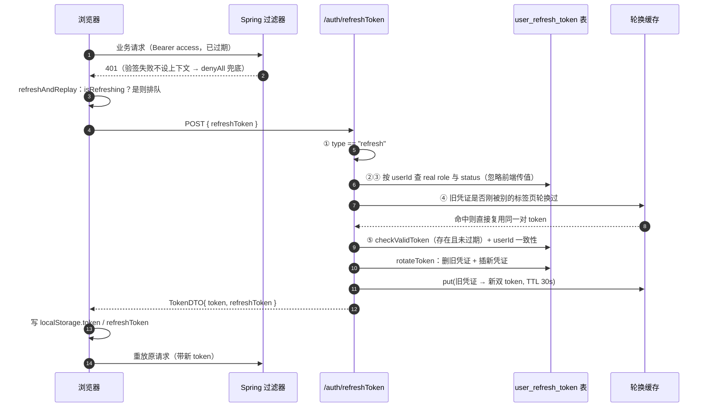
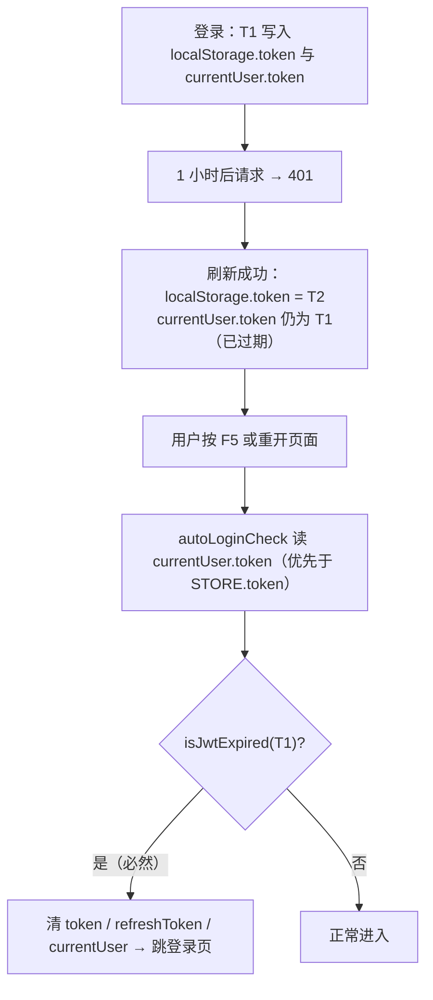

# N10 Token 自动续期：机制全貌与失效情形审计

> 系列导航：N1 多租户隔离｜N2 租户上下文｜N3 三层套餐模型｜N4 多语言词表｜N5 JWT 双令牌与无感刷新｜N6 免登录白名单｜…｜**N10（本篇）**
>
> **与 N5 的关系**：N5 回答「这套双令牌体系是怎么设计的、为什么这么设计」；本篇回答「**实现在今天这个代码状态下，哪些情况下自动续期其实不起作用**」。N5 已记录的坑（`clearExpiredToken` 无人调用、队列不存 reject、403 不刷新等）本文不重复叙述，只引用。
>
> **证据口径**：本文全部结论来自 2026-11-20 对 `eClassroom` 分支源码的静态核对（含行号），**没有做运行时抓包验证**。凡标注「需实测确认」的条目，表示逻辑上成立但未在真实浏览器里复现过。
>
> **修复状态**：§3 的 1~5 号已于 2026-11-20 落地（含 15 项前端 jsdom 回归 + 4 项后端单测 + 四处变异验证），实施细节与偏离说明见 §3.1；6 号（`clearExpiredToken` 挂定时）仍是 N5 的既有待办。

---

## 1. 机制全貌

### 1.1 参数与存放

| 项 | 值 | 位置 |
|---|---|---|
| access token | **1 小时**（`jwt.expiration=3600000`，可配） | `api/src/main/resources/application.properties:176` |
| refresh token | **7 天**，硬编码常量不可配 | `api/src/main/java/com/reservation/utils/JwtUtil.java:27` |
| 签名算法 | access 用 **HS512**、refresh 用 **HS256**（同一把 `signingKey`） | `JwtUtil.java:92 / 108` |
| 类型区分 | `type` claim：`access` / `refresh`（2026-10-28 加固新增） | `JwtUtil.java:99 / 116` |
| refresh 凭证落库 | `user_refresh_token`（userId + token + expireTime） | `RefreshTokenService` |
| 客户端存放 | 双 token 都在 `localStorage`，**不记录过期时间** | `frontend/js/public/utility_request.js:197` |
| 并发轮换缓存 | 进程内，TTL 30 秒、上限 2000 条、key 为旧凭证 SHA-256 | `RefreshTokenRotationCache` |

三个服务（8081 booking / 8090 message / 8092 classroom）共享同一密钥域：三份 `application.properties` 都写 `${JWT_SECRET:<同一默认串>}`。

### 1.2 一次续期的完整链路



### 1.3 后端 `/auth/refreshToken` 的五道关

| # | 校验 | 作用 | 位置 |
|---|---|---|---|
| ① | `isTokenOfType(..., "refresh")` | 挡住拿 access token 换新 token；老 token 无 type claim 时放行给 DB 兜底 | `authController.java:287` |
| ② | 从 token 自身解 `userId + tenantId` | 不依赖 SecurityContext（本端点在白名单，过滤器不跑） | `authController.java:292-298` |
| ③ | `getByUserIdNoTenant` 实时查 | **完全忽略前端传的 account/role**（原先传 `role=platform_admin` 就能拿管理员 token）；不存在或 `frozen` 直接拒 | `authController.java:306-320` |
| ④ | `rotationCache.get(旧凭证)` | 解决同源多标签页并发刷新互踢 | `authController.java:326-338` |
| ⑤ | `checkValidToken` + userId 一致性 | DB 凭证存在、未过期，且与 JWT 里的 userId 对得上 | `authController.java:341-355` |

通过后 `rotateToken` **只删这一条旧凭证再插新的**（刻意不调 `deleteByUserId`，否则跨设备互踢），新 refresh 重新签满 7 天。

**这意味着 refresh 是滑动的**：只要 7 天内有一次活动，会话就一路续下去，**没有「累计最长多久必须重登」的绝对上限**。

### 1.4 前端三端 + 两条长连接

| 通道 | 触发点 | 并发处理 | 覆盖情况 |
|---|---|---|---|
| Web XHR | `utility_request.js` 的 401 拦截（HTTP 401 与 body `code=401` 共用 `refreshAndReplay`） | `isRefreshing` + `requestQueue` | ✅ 完整 |
| 小程序 | `miniprogram/core/request.js` 同构实现 | 同上，另有 `tokenOnly` / `enhance` 免疫 | ✅ 完整 |
| 消息中心 8090 | 独立 axios 实例 `mreq` / `areq` | **无** | ❌ 不刷新（见 A2） |
| 课堂 WebSocket | `classroom-ws.js`，`?access_token=` 拼 URL | 指数退避重连 | ❌ 重连复用旧 token（见 C1） |
| 消息 SSE | `new EventSource(url + token)` | 浏览器自动重连 | ❌ 重连带旧 token（见 C2） |

Web 端还做了失败分类：网络故障 / 5xx **保留登录态**只提示重试，只有明确 401 才清态跳登录；重放过的请求再 401 走 `_retry` 分支直接清态，不会死循环。

### 1.5 三层并发

1. **同页多请求** → 前端 `isRefreshing` 队列，一次只刷一轮。
2. **同源多标签页** → 后端 `rotationCache`（30s TTL），用旧凭证复用同一对新 token。
3. **多设备** → 各自持有独立 refresh token，轮换互不影响；但**登录时 `saveNewToken` 会删该用户全部凭证**（`RefreshTokenService.java:29-38`），即单设备登录语义。

---

## 2. 失效情形审计

### 2.0 分类口径

「自动续期无效」有四种截然不同的成因，混在一起讨论会得出错误结论：

| 类 | 含义 | 用户感受 |
|---|---|---|
| **A** | 根本没发起刷新 | 直接掉线，且 refresh token 明明还有效 |
| **B** | 刷新成功了，但立刻被判废 | 「刚还好好的，按个刷新就掉线」 |
| **C** | 长连接不覆盖续期 | 课堂/消息推送静默失联 |
| **D** | 反向：该失效却仍有效 | 安全侧，改密/踢人后旧凭证还能用 |

### 2.1 A 类：根本没发起刷新

#### A0（比 A1 更靠前，2026-11-20 实测补录）登录当场凭证就没落盘

`login.html` 密码登录成功分支在 `auth.js` 已写入 `refreshToken` 之后，又用
`localStorage.setItem('refreshToken', user.refreshToken || '')` 把它覆盖成空串
（`user` 是 `authenticateUser` 返回的 `currentUser` 快照，天然不含该字段）。

这一条比 A1~A4 都更靠前 —— 那些是"该刷新却没刷新"，这条是**根本没有刷新凭证可刷**。
DevTools 里的判据极简：登录后 Local Storage 的 `refreshToken` 值为空 = 命中；正常应是 `eyJ...` 长串。
详见 [3.1 的 6 号](#6-号登录成功分支把-refreshtoken-覆盖成空串2026-11-20-实测发现)。

#### A1（最严重）页面重载即掉线

`student.html` / `teacher.html` / `booking.html` 的 onload 都调 `autoLoginCheck()`：

| 文件 | 行号 |
|---|---|
| `frontend/booking.html` | 57 |
| `frontend/student.html` | 447 |
| `frontend/teacher.html` | 382 |

而 `autoLoginCheck()` 在本地判 exp 就直接清三件套并返回 null：

```js
// frontend/js/public/api.js:279-306
const token = userInfo.token || STORE.getItem('token');
if (isJwtExpired(token)) {
    STORE.removeItem('currentUser');
    STORE.removeItem('token');
    STORE.removeItem('refreshToken');      // ← 连 refresh 一起清掉
    document.cookie = 'currentUser=;expires=Thu, 01 Jan 1970 00:00:01 GMT;path=/';
    return;                                 // ← 全程没有尝试刷新
}
```

调用方拿到 null 后 `saveLoginRedirect('noauth')` + 跳登录页。**refresh token 完全没被使用**。

#### A2 消息中心不参与续期

`frontend/js/messages-inbox.js:93` 另建了 `mreq`（baseURL 指向 8090），响应拦截器里 401 的处理是：

```js
// messages-inbox.js:109（mreq）与 :140（areq）同一写法
if (st === 401) { msg = '登录已过期，请重新登录'; cleanupAuth(); setTimeout(...跳登录..., 600); }
```

`cleanupAuth()` 会清掉 token + refreshToken + currentUser。所以：**用户在页面停留超过 1 小时后点开消息中心，哪怕 refresh 还有 6 天，也会被直接登出**。

#### A3 `noAuthRedirect` 的请求

`utility_request.js:155` 对带 `noAuthRedirect: true` 的请求直接 `reject`，不刷新、不跳转。这类请求本来是给「免登录端点」用的，但 `promo.js:298` 把一个**需要鉴权**的写操作也打上了这个标记：

```js
// frontend/js/public/promo.js:298 —— 注册成功后记录协议签署留痕（fire-and-forget）
window.request({ url: '/legal/accept', method: 'POST', noAuthRedirect: true, ... });
```

若此刻 token 恰好过期，这次 POST 会静默失败，**协议签署留痕悄悄丢失**，且没有任何提示。（该请求在注册成功的瞬间发出，token 刚签发、实际触发概率低，属隐患而非现网故障。）

#### A4 登录页 / 公开落地页

`utility_request.js:155` 统一排除 `__PUBLIC_LANDING__` 与登录页——这是设计意图（避免与 tCode 重定向形成死循环），不算缺陷，但意味着**这两类页面上的任何鉴权请求都不会自动续期**。

### 2.2 B 类：刷新成功但立刻被判废

#### B1 双份 token 快照分叉（A1 的根因）

登录时 token 被写进**两个地方**：

```js
// frontend/js/public/auth.js:113-118
STORE.setItem('token', user.token);
const currentUser = { userId, account, name, role, token: user.token };   // ← 第二份快照
STORE.setItem('currentUser', JSON.stringify(currentUser));
```

而刷新成功后只更新第一份：

```js
// frontend/js/public/utility_request.js:196-199
localStorage.setItem('token', newToken);
if (newRefreshToken) localStorage.setItem('refreshToken', newRefreshToken);
// currentUser.token 没有同步 —— 从此两份值分叉
```

于是形成这条必然发生的链条：



**结论：只要发生过一次「过期 → 刷新」，此后任何一次页面重载都会掉线。** 这不是边缘情形，是日常路径——因为 T1 在触发刷新的那一刻就已经过期了。

关键细节：`autoLoginCheck` 的取值顺序是 `userInfo.token || STORE.getItem('token')`（`api.js:288`），**currentUser 优先**。即使 `STORE.token` 是新值 T2，也照样被判过期。

#### B2 刷新成功、重放仍 401

新 token 在目标服务上不被认可时，会走 `_retry` 分支直接清态。现实成因：

- 8090 / 8092 未注入同一个 `JWT_SECRET`（三份配置都靠环境变量，漏一个就分叉）；
- 请求被错误分流到没有该映射的服务（同类问题见 `check:proxy` 守卫记录的那次 403）。

现象是「刷新接口返回 200，但重放立即 401，然后就跳登录页了」——最难排查的一类，因为日志里刷新明明成功了。

### 2.3 C 类：长连接不覆盖续期

#### C1 课堂 WebSocket

```js
// classroom-ws.js:83 —— token 在 connect 时被固化成会话字段
var s = { handlers: handlers, token: token || '', ... };

// classroom-ws.js:111 —— 每次建链都用这个字段
var url = s.base + '/' + ch + '?access_token=' + encodeURIComponent(s.token) + ...

// classroom-ws.js:167-179 —— 重连只重新 _openChannel，不重读 localStorage
_scheduleRetry: function (scheduleId, ch) { ... setTimeout(function () { self._openChannel(scheduleId, ch); }, delay); }
```

后果：课堂里待满 1 小时后，任何一次断线（网络抖动、切后台、锁屏）都**再也连不回来**——退避重连每次都带那张过期票，服务端 `WsHandshakeAuthInterceptor` 直接拒握手。HTTP 那侧的自动刷新帮不上忙，因为 `s.token` 是个快照。

#### C2 消息 SSE

```js
// messages-inbox.js:937
const url = MSG_BASE + EP.MSG_SSE_CONNECT(token);
es = new EventSource(url);        // EventSource 不能自定义 header，token 只能进 URL
es.onerror = function () { /* EventSource 会自动重连 */ };   // :960
```

两个问题叠加：token 进了 URL（会落进 nginx access log 与 Referer），而自动重连带的是同一个旧 token，过期后只会反复失败。

### 2.4 D 类：反向——该失效却仍有效

| # | 情形 | 证据 | 影响 |
|---|---|---|---|
| **D1** | **改密码 / 管理员重置密码不撤销 refresh token** | `UserService.java:1002`（changePassword）、`:919`（resetPassword）只 `updatePassword`，无 `kickUser`、无版本号 | 密码泄露后「重置密码」这一步救不回账号：攻击者手里的 refresh 仍可继续滑动续期，**永不失效** |
| **D2** | 踢出 / 冻结延迟最长 1 小时 | `kickUser` 只删 refresh；`JwtAuthenticationFilter` 只注入 `JwtUtil`，不查库 | 「强制下线」后旧 access 在剩余有效期内照常通行 |
| **D3** | 子服务不校验 token 类型 | `message-service` / `classroom-service` 的 `verifyAccessToken` **只验签 + 过期，不校验 `type`**（各自 `JwtUtil.java:58`） | refresh token 能通过这两个服务的签名校验。因 refresh 无 `role` claim，拿不到管理员能力，属纵深防御缺口而非直接提权——但 ①「access 与 refresh 可互换」这条边界只在 8081 成立 |
| **D4** | 改密后已发出的 access token 不受影响 | 同 D2 | 与 D1 叠加：一次完整的「改密 → 旧设备仍在线」链路 |

> D1 值得强调：N5 第 1 节把「改密码旧 token 照样通行」列为核心问题，并给出「refresh 落库 ⇒ 可注销」的解法。落库确实做了，但**改密这条路径没有调用那个注销入口**，设计目标与实现之间漏了一环。

### 2.5 汇总（按触发频率排序）

| 优先级 | 情形 | 触发条件 | 频率 | 修复状态 |
|---|---|---|---|---|
| **P0** | B1 + A1 双快照分叉 | 发生过一次刷新后续任何页面重载 | **必然，人人都会遇到** | ✅ 1、2 号已修 |
| **P1** | A2 消息中心不刷新 | 停留超 1 小时后进消息中心 | 高频 | ✅ 3 号已修 |
| **P1** | C1 课堂 WS 重连失效 | 课堂内停留超 1 小时后掉线 | 中频（长课时必现） | ✅ 4 号已修 |
| **P2** | D1 改密不撤凭证 | 管理员重置密码 / 用户改密 | 低频但属安全 | ✅ 5 号已修 |
| **P2** | B2 跨服务密钥不一致 | 部署时漏注入 `JWT_SECRET` | 低频，故障面大 | 部署侧约束，未改代码 |
| **P3** | C2 SSE、A3 `noAuthRedirect`、D2/D3/D4 | 各自条件 | 低 | 未修（见 §3 备注） |

---

## 3. 修复清单（1~5 号已于 2026-11-20 落地）

| # | 改什么 | 位置 | 状态 |
|---|---|---|---|
| 1 | 刷新成功后**同步写回 `currentUser.token`** | `utility_request.js` 的 `refreshAndReplay` 与 `refreshAccessTokenOnce` | ✅ 已实现 |
| 2 | `autoLoginCheck` 遇过期**不再清态**（原建议"先刷新再清"，实际走"交给接口层刷新"，理由见 3.1） | `api.js` 的 `autoLoginCheck` | ✅ 已实现 |
| 3 | 消息中心两个独立实例的 401 改为「先换票、再重试一次」 | `messages-inbox.js` 的 `mreq` / `areq` | ✅ 已实现 |
| 4 | WS 建链时**现取** `localStorage.token` 而不是快照 | `classroom-ws.js` 的 `_openChannel` | ✅ 已实现 |
| 5 | 改密 / 重置密码后撤销该用户全部 refresh 凭证 | `UserService.java` 的 `changePassword` / `resetPassword` | ✅ 已实现 |
| 6 | `clearExpiredToken` 挂 `@Scheduled` | 见 N5 §4.9 | ⏳ 未做（N5 既有待办，不属本次范围） |

### 3.1 实施记录（2026-11-20）

#### 1 号：刷新同步 `currentUser.token`

在 `utility_request.js` 里新增 `syncCurrentUserToken(newToken)`，两个刷新区都接上：
`refreshAndReplay`（401 重放链路）与 `refreshAccessTokenOnce`（3 号新增的对外换票）。
外加一个防御：`currentUser` 解析失败时直接清掉它 —— 留着只会让下一次进入继续读到坏值。

#### 2 号：`autoLoginCheck` 不再凭本地 exp 判死刑（**偏离了原建议**）

原建议是「过期 → 先尝试一次刷新 → 失败才清」。落地时改成了**更彻底的做法：过期也不清任何东西，照常返回 `userInfo`**，把换票这件事交给首个接口请求（`refreshAndReplay` 有完整的失败分类与登出逻辑）。

理由：`autoLoginCheck()` 是**同步函数**，被 `student.html` / `teacher.html` / `booking.html` 的 onload 直接取返回值：

```js
userInfo = autoLoginCheck();
if (!userInfo) { saveLoginRedirect('noauth'); ...跳登录页... }
```

要让它「先刷新」就得改成 `async`，三个页面的初始化流程（菜单渲染、角色判断、重定向）全部要跟着改成 `await`，改动面和回归风险都远大于收益。而「过期不清态」已经能拿到同样的结果：过期 token 进入页面 → 首个请求 401 → 换票 → 重放成功。若 refresh 也失效，`forceLogout` 会统一清态跳登录，比页面各自判一次更一致。

原则也顺带对齐了：**登录态由服务端裁决，前端不凭本地 `exp` 单方面判定会话结束。**

已知副作用（可接受）：refresh 也过期时，用户会先看到页面、再被弹回登录页，比原先"进页面前就跳"多一次闪烁。

#### 3 号：消息中心「先换票再重试」（没有换实例）

原建议是「改用统一 `service` 实例」，但 `mreq` 的 baseURL 指向 8090（message-service），`areq` 指向 8081，与主实例的 baseURL 不同，直接换实例会让请求打到错的服务。改为**复用刷新能力而不是复用实例**：

- `utility_request.js` 对外暴露 `window.refreshAccessTokenOnce()`：只负责换一张票，不重放、不清态、不跳转，失败 throw；与主链路共用同一把 `isRefreshing` 闸，不会并发刷两次（若主链路正在刷，它等落地后直接读本地新值）。
- `messages-inbox.js` 新增 `retryWithFreshToken(error, instance)`：401 时换票 → 带新 token 重发一次，`__msgRetry` 标记防循环；重发仍失败才落到 `rejectWithMessage` 的清态逻辑。
- 顺带把两个实例内联的错误文案逻辑合并成 `rejectWithMessage(error, {silent})`，消除了重复代码。**行为上的一处小变化**：`areq` 之前没有 404/500 的专门文案，现在与 `mreq` 统一（"接口地址不存在" / "服务器内部错误"）。

#### 4 号：WS 建链现取 token

`classroom-ws.js` 的 `_openChannel` 里每次建链前读一次 `localStorage.token`：

```js
var freshToken = null;
try { freshToken = window.localStorage.getItem('token'); } catch (e) { /* ignore */ }
if (freshToken) s.token = freshToken;
```

取不到（隐私模式、非浏览器环境）时沿用会话里的旧值，行为与改动前一致 —— 不会因为读不到就传空 token 出去。

#### 5 号：改密 / 重置密码撤销凭证

`UserService` 新增私有辅助 `revokeRefreshTokensQuietly(userId)`，在 `changePassword` 与 `resetPassword` 落库后各调一次 `refreshTokenService.kickUser`。

两个刻意的选择：

- **吞异常**：密码此时已经改成功了，清凭证失败不该把整个操作变成报错（那会得到"密码没改成功也没提示"的更坏结果）。残留凭证最迟 7 天自然过期。
- **接受本人当前 access 仍可用**：删的是 refresh 凭证，本人这张 access 在剩余有效期内（≤1 小时）照常通行，下次换票才失败。这是改密应有的语义 —— 其他设备和未来会话立刻失守，当前会话给一个缓冲窗口。

#### 6 号：登录成功分支把 `refreshToken` 覆盖成空串（2026-11-20 实测发现）

**现象**：登录后 DevTools → Application → Local Storage 里 `refreshToken` **这个 key 存在、值为空字符串**。

**结论：不正常。** 正常应该是 `eyJhbGciOi...` 开头的一串 JWT。这条是本轮审计里唯一被实测抓到的「A 类」失效 —— 凭证从头到尾就没落盘，所以后面所有的续期加固（1~4 号）对它都无效：access 到期后 `/auth/refreshToken` 收到的是 `''`，后端 `Result.fail(401, "刷新凭证为空")`，前端按 401 清态跳登录页。用户侧表现是「登录约 1 小时后必掉线，像被踢」。

**根因**（两处写入顺序打架）：

```text
authenticateUser()                       login.html 密码登录成功分支
  └─ saveCurrentUserSession(res) ①       （拿到 authenticateUser 的返回值）
       STORE.setItem('refreshToken',        user = currentUser 快照
                    res.refreshToken)      → 不含 refreshToken 字段
       返回 currentUser 快照 ②  ──────────→  localStorage.setItem(
                                               'refreshToken', user.refreshToken || '')
                                             = setItem('refreshToken', '')   ← 覆盖①
```

`saveCurrentUserSession` 刻意不把 `refreshToken` 放进 `currentUser` 快照（那份快照会整串 JSON 塞进 localStorage 再写 cookie，多带一个 7 天期凭证只会扩大 XSS 面）—— 这个设计是对的；错的是调用方拿这份快照当「登录响应」用，`user.refreshToken` 永远是 `undefined`，`|| ''` 于是稳定地把刚写好的凭证抹平。

原注释「注册接口暂未返回 refreshToken，留空避免刷新逻辑误判」是从注册分支（`login.html` 注册成功处，那里确实没有 refreshToken）误抄过来的，掩盖了这个分支其实是登录。

**修复**：

| 位置 | 改动 |
|---|---|
| `frontend/login.html` 密码登录成功分支 | 删掉整行 `setItem('refreshToken', ...)`，改为「`refreshToken` 唯一落盘点 = `auth.js → saveCurrentUserSession`」的注释 + 缺失时 `console.warn` 自检 |
| `frontend/login.html` 扫码登录 `onWechatLoginSuccess` | `res.refreshToken \|\| ''` → 有值才写；缺失时同样 warn（该分支 `res` 是后端 `/auth/wechat/qr/status` 的 data，confirmed 时会带凭证，所以行为不变） |
| `frontend/js/public/promo.js` `savePromoSession` | `writeStorage('refreshToken', data.refreshToken \|\| '')` → 有值才写（同一类覆盖，虽未实测触发） |

**为什么不改成「让 `authenticateUser` 返回值带上 `refreshToken`」**：那会重新建立「调用方要自己写凭证」的隐式契约，等下次有人调整返回结构，同一个 bug 会静默复活。凭证落盘只留一个入口，调用方只读不写。

**回归检查方式**：登录 → DevTools Application → Local Storage 看 `refreshToken` 应为 `eyJ...` 长串；再把 `token` 改成过期值、保留 `refreshToken`，点任意菜单应静默换票。若 `refreshToken` 仍为空，控制台会先出现 `[login] 登录响应未携带 refreshToken` 这条 warn（说明是后端没下发，而不是前端又覆盖了）。

### 3.2 验证

| 层 | 方式 | 结果 |
|---|---|---|
| 前端（6 号） | 源码 + `frontend/dist` 双份 grep：`setItem('refreshToken', ... \|\| '')` 已无残留（仅注释里作反例保留）；`build.js` 全量重建后 `dist/login.html`、`dist/js/public/promo.js` 均已同步 | 通过（真机复验待用户重新登录） |
| 前端 | 新增 `tests/check_token_refresh_recovery.js`（jsdom，15 项）：过期不清态 / 快照过期不误判 / 无 token 仍按未登录 / 刷新同步 `currentUser` / 只打一次刷新接口 / WS 重连取新票 / 取不到时沿用旧值 | 15/15 通过 |
| 后端 | 新增 `PasswordChangeRevokesTokensTest`（4 项）：本人改密撤凭证 / 重置密码撤凭证 / 清凭证失败不影响改密 / 原密码错不落库不撤凭证 | 4/4 通过 |
| 变异验证 | ① 把「过期即清态」加回 `api.js` → 测试红 3 项；② 去掉 `refreshAccessTokenOnce` 的同步 → 红 1 项；③ 把 WS 现取短路成 `if (false)` → 红 2 项；④ 注释掉改密里的撤销调用 → 单测红 1 项。全部还原后重新变绿 | 四处均证真会红 |
| 构建 | `build-backends.sh --only booking` 打包 + 收口 `deploy/jars`；`frontend/build.js` 全量重建 dist | 通过 |
| 守卫 | 17 道 pre-commit（含 `global-collide` / `endpoints` / `shared-sync` / `proxy`） | 全绿 |

**人工验证建议**（自动化测不到真实浏览器行为）：

1. 登录 → DevTools 把 `localStorage.token` 改成过期值（保留有效 `refreshToken`）→ 点任意菜单 → 应静默换票并正常加载；
2. 紧接着按 F5 → **应仍在登录态**（修复前必掉线，这是本次最关键的一条）；
3. 课堂里让 `localStorage.token` 过期后拔网线再恢复 → 三条 WS 通道应能重连成功（修复前会一直退避失败）；
4. 管理员重置某账号密码 → 该账号**其他设备**刷新页面时应被要求重新登录（当前设备最多再用 1 小时）；
5. 停留超过 1 小时后点开消息中心 → 应正常加载（修复前直接被登出）；
6. **登录成功当场**看 Local Storage 的 `refreshToken` → 必须是 `eyJ...` 长串（**不是空串**）。这是 6 号的验收点；空串意味着这台浏览器 1 小时后必掉线，且前面 1~4 号全部白做。

---

## 4. 附：核对位置速查

| 主题 | 文件:行 |
|---|---|
| access / refresh 有效期 | `application.properties:176`；`JwtUtil.java:27` |
| 签发与 type claim | `JwtUtil.java:92-118`、`152-176` |
| 刷新端点五道关 | `authController.java:279-370` |
| 轮换与注销语义 | `RefreshTokenService.java:29-60`（saveNewToken / rotateToken） |
| 并发轮换缓存 | `RefreshTokenRotationCache.java`（TTL 30s / 2000 条 / SHA-256 key） |
| Web 刷新拦截 | `utility_request.js:153-240`（refreshAndReplay）、`:196-199`（写回） |
| 初始化过期判定 | `api.js:263-277`（isJwtExpired）、`:279-306`（autoLoginCheck） |
| 登录双份写入 | `auth.js:113-118` |
| refreshToken 唯一落盘点 | `auth.js` · `saveCurrentUserSession`（`STORE.setItem('refreshToken', ...)`）—— 6 号修复后，登录页不再回写 |
| 消息中心旁路 | `messages-inbox.js:93`（mreq）、`:109 / 140`（401 处理）、`:937`（SSE） |
| 课堂 WS | `classroom-ws.js:83 / 111 / 167-179` |
| 改密 / 重置 | `UserService.java:919`、`:1002` |
| 子服务类型校验 | `message-service/.../JwtUtil.java:58`、`classroom-service/.../JwtUtil.java:58` |

**2026-11-20 修复后新增的位置**（找这些函数就能找到修复点）：

| 主题 | 文件 · 函数 |
|---|---|
| 刷新后同步 currentUser 快照 | `frontend/js/public/utility_request.js` · `syncCurrentUserToken` |
| 对外「只换票」入口 | `frontend/js/public/utility_request.js` · `window.refreshAccessTokenOnce` |
| 消息中心 401 换票重试 | `frontend/js/messages-inbox.js` · `retryWithFreshToken` / `rejectWithMessage` |
| WS 建链现取 token | `frontend/js/public/classroom-ws.js` · `_openChannel` |
| 改密撤凭证 | `api/.../service/UserService.java` · `revokeRefreshTokensQuietly` |
| 前端回归 | `tests/check_token_refresh_recovery.js`（15 项） |
| 后端回归 | `api/src/test/.../service/PasswordChangeRevokesTokensTest.java`（4 项） |
