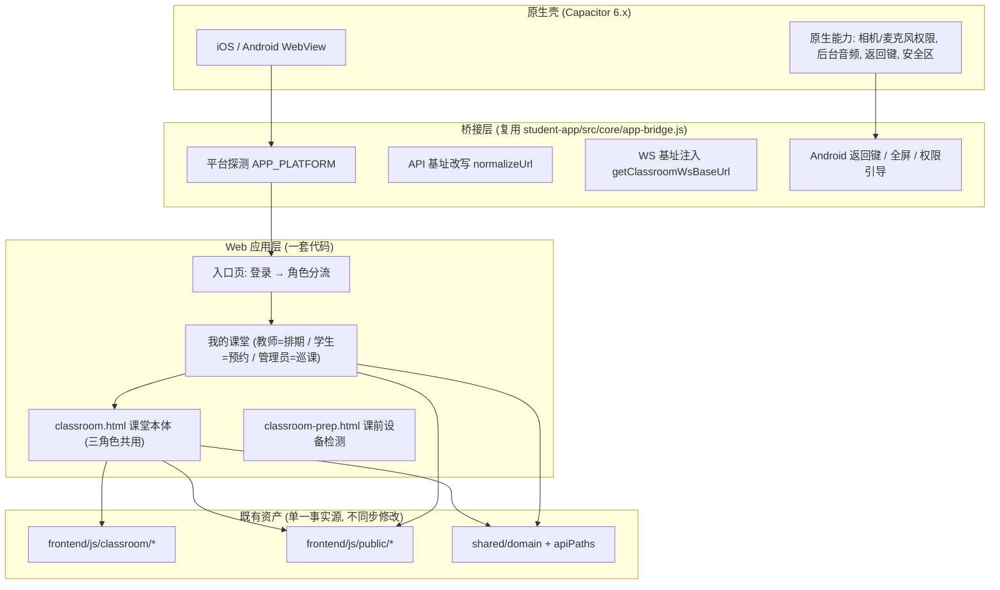

# 课堂独立一码多端解决方案

> **文档信息**

| 项 | 值 |
|---|---|
| 日期 | 2026-11-24 |
| 目标分支 | `student-crossplatform`（建议课堂独立工程从此处拉出） |
| 状态 | 方案（待评审） |
| 主题 | 把「课堂」能力从工作台模块拆为独立的一码多端产品，覆盖浏览器 / iOS / Android |
| 前置阅读 | `N10-多租户在线课堂集成.md`、`小程序课堂入口接入方案-20261121.md`、`课堂实例-排期-约束-统计-回收与生命周期综合分析.md` |

---

## 一、背景与目标

### 1.1 为什么要「独立」

当前课堂不是一个独立产品，而是**嵌在三套工作台里的一个跳转目标**：

| 角色 | 入口文件 | 进入方式 |
|---|---|---|
| 教师 | `frontend/js/teacher-myClassroom.js` | 排期列表 → `POST /classrooms/{sid}/start` 开课 |
| 学生 | `frontend/js/student-myClassroom.js` / `student-joinClassroom.js` | 预约列表 / 课堂号 → `POST /classrooms/{sid}/enter` 加入 |
| 管理员 | 运营台 `classroom-ops.html` | 临时建课 / 巡课 / 强制结课 |

但**课堂本体只有一个页面**：`frontend/classroom.html`。它一次性加载 teacher / student / admin 三套模块（`:248-250`），再由 `classroom-main.js:295-311` 全部 init，各模块按登录角色自行裁剪 UI（`classroom-controls.js:27-69`）。

这就带来一个架构错配：**共用度最高的核心（课堂本体 ~80% 共用），却被三个不同的工作台入口包裹**。独立出来做一码多端，本质是把这个已经共用的核心，配上一层统一的「登录 → 我的课堂 → 课堂」外壳。

### 1.2 目标

1. **一套代码覆盖三端**：浏览器、iOS、Android 共用同一份 Web 代码；
2. **一个 App 覆盖三角色**：教师、学生、管理员凭登录态自动分流，不再维护三个壳；
3. **零重写课堂本体**：复用 `classroom.html` 全套脚本，保留 WebRTC / WS / 白板 / 录制 / 讲稿现状；
4. **独立发布**：课堂 App 有独立版本节奏，不跟随预约主系统的发版。

### 1.3 边界（本方案不做什么）

- ❌ 不重做音视频引擎（不换 TRTC / 声网）；
- ❌ 不把重后台搬进 App：报表、对账、内容审核、租户开关配置（`platform-admin-eclassroom.js`，全部 `PLATFORM_ONLY`）继续留在大屏后台；
- ❌ 不改后端课堂状态机与生命周期（沿用 `ClassroomClosingService.closeAfterEnd` 唯一收尾入口）；
- ❌ 不改数据库结构。

---

## 二、现状分析（代码级证据）

### 2.1 课堂本体：已是三角色共用单页

`frontend/classroom.html:216-252` 的脚本加载顺序：

```
基础设施  axios.min.js → utility_request.js → api.js → shared-domain-bridge.js → feature-flags.js
实时通道  classroom-ws.js
设备/RTC  media-devices.js → rtc/{rtc-engine,engine-mesh,engine-sdk}.js → classroom-rtc.js
课堂能力  record / whiteboard / material / panels / video-focus / chat / controls
角色模块  classroom-teacher.js → classroom-student.js → classroom-admin.js
总调度    classroom-main.js
```

角色裁剪发生在渲染层：`classroom-controls.js:27-69` 按 `role` 显隐——学生出举手/上传，教师出点名/点评/下课；`classroom-main.js:578-598` 把 admin 当 teacher 处理（静音、录制、讲稿翻页）；但白板对 admin 只读（`classroom-whiteboard.js:66-69` 只认 teacher/manager）。

**结论：课堂本体不需要按端重写，只需要被正确加载。**

### 2.2 课前准备：已是同一页双模式

`classroom-prep.html?mode=student`：学生模式只保留设备检测，教师模式额外有资料/名单/同步（`classroom-prep.js`）。这一页可直接纳入 App，无需改造。

### 2.3 入口层：两端分离，是主要工作量

| 维度 | 教师 | 学生 | 管理员 |
|---|---|---|---|
| 数据源 | `SCHEDULE_LIST_BY_TEACHER`（排期） | `BOOKING_PAGE`（预约）/ 课堂号 | `monitorClassrooms`（全部进行中） |
| 主动作 | `POST /classrooms/{sid}/start` | `POST /classrooms/{sid}/enter` | 巡课 / `remoteEndClass` |
| 端点定义 | `frontend/js/public/api.js:1136`（**字面量**） | `api.js:1123`（**字面量**） | `api.js`（未登记） |

这三个端点**均未登记进 `shared/apiPaths.js`**（本轮已核验），意味着端点守卫覆盖不到。

### 2.4 权限边界：后端已兜底

- `RoleConst.java:14-16`：`isManager` = `admin` / `platform_admin`；
- `ClassroomAccessGuard.java:70-72`：manager 全局放行，非 manager 调管理端点直接 403；
- `ClassroomController` 各端点均过 `accessGuard.assertAccess`；
- 运营台 `AdminConsoleController.java:55-56` 强制 `isManager()`。

**结论：即使 App 端 role 参数被篡改，后端仍能挡住越权。但前端仍应收口，见 §6.3。**

### 2.5 技术栈画像（决定跨端难度）

| 能力 | 实现 | 跨端影响 |
|---|---|---|
| 实时通信 | WS 三通道 `heartbeat / signal / whiteboard`（`classroom-ws.js:25`） | 地址默认同源 `ws(s)://location.host`，可被 `getClassroomWsBaseUrl()` 覆盖（`:29-40`） |
| 音视频 | Mesh 原生 WebRTC（`engine-mesh.js:22` `RTCPeerConnection` per user）+ SDK 备用引擎 | **WebView 支持 WebRTC，但原生 App 端有权限/后台/音频会话挑战**，见 §6.1 |
| 设备 | `getUserMedia` / `enumerateDevices`（`media-devices.js:41,115,164`） | 需 App 授予相机/麦克风权限，且 HTTPS / Permissions-Policy 正确 |
| 屏幕共享 | `getDisplayMedia`（`classroom-record.js:626-630`） | iOS WebView 支持有限，需降级 |
| 讲稿 | PDF.js（`pdf.min.js`） | WebView 内可用，注意 worker 路径 |
| 请求层 | `window.request`（axios 实例）+ `window.ApiPaths.normalizeUrl` 补 `/api/v1` | 已有 `app-bridge.js` 桥接范式可复用 |

---

## 三、可行性结论

**可行。课堂本体约 80% 已经共用，独立一码多端不是重写，而是「统一外壳 + 入口收口 + 四处风险收口」。**

### 3.1 可直接复用的资产

| 资产 | 位置 | 复用方式 |
|---|---|---|
| 课堂本体全套脚本 | `frontend/js/classroom/` + `frontend/classroom.html` | 原样同步，不改动 |
| 实时/请求/鉴权基础设施 | `frontend/js/public/`（`utility_request/api/auth/feature-flags/classroom-ws`） | 原样同步 |
| 纯逻辑领域层 | `shared/domain/`、`shared/apiPaths.js` | Web 走 `shared-domain-bridge.js`，直接复用 |
| 小程序师生共用范式 | `miniprogram/package-classroom/my/my.js:102-104` | 单页 + role 分支的直接参照 |
| Capacitor 壳与桥接 | `student-app/`（已建成） | 构建/同步/平台适配整段复用 |

### 3.2 必须新建的部分

1. 课堂 App 的**统一入口页**（登录 → 我的课堂 → 课堂）；
2. **角色分流器**（按登录态 role 决定「我的课堂」展示哪份列表）；
3. 三处**安全收口**（见 §6.3）；
4. 端点登记进 `shared/apiPaths.js`（见 §6.6）。

---

## 四、技术路线选型

| 路线 | 覆盖端 | 复用课堂资产 | 音视频风险 | 工作量 |
|---|---|---|---|---|
| **Capacitor 套壳（推荐）** | H5 / iOS / Android | 课堂页零改动直接加载 | WebView 内跑现成 WebRTC，风险最低 | **低** |
| uni-app (Vue3) | H5 / App / 小程序 | 逻辑可 import，UI 需组件化重写 | App 端 WebRTC 仍受限 | 中高 |
| Taro (React) | 同上 | 同上（项目无 React 基础） | 同上 | 中高 |
| Flutter | iOS / Android 强，H5 弱 | JS 逻辑无法复用 | 需原生 SDK 重做 | 高 |

### 推荐：Capacitor 6.x + 双模式

沿用 `student-app` 已验证的技术底座：`@capacitor/core / browser / app` 6.x，`server.url` 默认 + local 打包可选。

**为什么推荐套壳**：课堂的技术风险几乎全在音视频与 WS，Capacitor 让这些代码一行不改地在 WebView 里跑；任何重写 UI 的路线都会把「WebRTC 已跑通」这个既成事实推倒重来。

### 两种运行模式

| 模式 | 原理 | 优点 | 代价 |
|---|---|---|---|
| **server 模式（默认）** | `server.url` 指向线上前端，WebView 直接加载 | 页面与后端同源，`/api/v1`、WS、登录态全部零改动；发版只更新线上前端，App 不必重发 | 依赖网络；App 只是「带原生能力的浏览器」 |
| **local 模式（可选）** | 静态包打进 App，跑在 `capacitor://localhost` | 离线可启动、可上架审核友好 | 需 `apiOrigin` 改写请求（桥接已支持）、后端 CORS 放行、WS 改 `wss://` |

> 实施建议：**先只做 server 模式跑通三端**，local 模式作为二期。这与 `student-app/config/environments.js` 的设计完全一致。

---

## 五、总体架构设计

### 5.1 分层



### 5.2 三角色统一入口（独立 App 的关键）

```
App 启动 → [server 模式] WebView 加载线上前端登录页
         → 登录成功（auth.js 已按 role 跳转，无需改造）
         → 统一「我的课堂」页按登录态 role 分流：
              teacher       → SCHEDULE_LIST_BY_TEACHER  → 开课按钮 → /start
              student       → BOOKING_PAGE / 课堂号      → 加入按钮 → /enter
              admin/pm_admin→ monitorClassrooms          → 巡课浮层 → forceEnd
         → 三条分支最终都进入同一个 classroom.html
```

**要点**：入口是「三份列表」，但终点是「一个课堂页」。这正是独立 App 能同时服务三角色的根本原因。

### 5.3 与现有 `student-app` 的关系

**建议：独立工程 `classroom-app/`，与 `student-app/` 平级，共享构建范式但独立发布。**

| 项 | student-app | classroom-app（本方案） |
|---|---|---|
| 定位 | 预约主业务（注册/登录/预定/课堂入口） | 课堂专项（登录/我的课堂/课堂本体/课前检测） |
| 受众 | 学生（可扩师生） | 教师 + 学生 + 管理员 |
| `app-bridge.js` | 课堂是「跳转目标」，用 iframe 层内嵌 | 课堂是「主内容」，内嵌逻辑需**禁用** |
| 白名单 | 学生端脚本 | 课堂脚本 + 三角色入口脚本 |
| 包体 | 较小 | 含 RTC/录制/讲稿，较大 |

> 关键实现差异：`app-bridge.js` 现有 `openUrl` 拦截是「把 classroom.html 装进应用内 WebView」（`:112-140`）。在课堂独立 App 里 classroom.html **本身就是主 WebView 内容**，必须在配置里关掉 `classroomEmbed`（`CFG.classroomEmbed = false`），否则会出现套娃。

---

## 六、关键技术难点与对策

### 6.1 WebRTC 在 App WebView 的挑战（最高风险）

| 难点 | 现象 | 对策 |
|---|---|---|
| 权限 | WebView 内 `getUserMedia` 被拒，按钮无反应 | Capacitor 需配合原生权限插件或 Android `uses-permission`；iOS 在 `Info.plist` 声明 NSCamera/NSMicrophoneUsageDescription |
| **Permissions-Policy** | 权限都给了、按钮仍无反应；`nginx -t` 与后端日志干净 | **先查响应头 `Permissions-Policy`，`camera=()` 空 allowlist 连页面自身都禁**。项目曾全仓 8 处踩坑（5 份 nginx conf + cloudBased 模板），已由 `npm run check:headers` 守卫；改服务器需重新 scp conf + reload，改仓库不等于改服务器 |
| 自签证书 | 认为证书是元凶 | 不是。Chromium 自签绕过页 `isSecureContext=true`，`getUserMedia` 按设计放行（crbug 40090684）。别在证书上浪费时间 |
| 后台音频 | 锁屏/切后台后听不到 | WebView 能力有限；二期评估原生音频会话插件，一期接受前台限制 |
| 屏幕共享 | iOS WebView `getDisplayMedia` 不可用 | 检测能力后隐藏录制按钮（`classroom-record.js:626` 已有能力判断），或引导用教师端网页 |

### 6.2 WebSocket 地址

`classroom-ws.js:29-40` 默认取 `location.host` 同源——server 模式天然正确。local 模式需注入：

```js
window.getClassroomWsBaseUrl = function () { return APP_CONFIG.wsOrigin; };
```

且必须在 `classroom-ws.js` **加载之前**注入（建议放 `app-config.js`）。注意 WS 根不含 `/ws/classrooms`，留 `/ws` 会拼出 `/ws/ws/classrooms/...`（历史坑）。

### 6.3 鉴权与 role 伪造（必须收口）

| 风险 | 证据 | 对策 |
|---|---|---|
| URL role 可冒充登录角色 | `classroom-main.js:87` `role: this._getParam('role') \|\| user.role` | 前端改为只认登录态：`role: user.role`；URL role 仅作兼容且需后端复核 |
| 课堂页未走 `guardEntryPage` | `classroom.html` 无此调用；只有 `classroom-main.js:49` 的 `guardClassroom()` 查租户开关 | 补 token / role / tCode 一致性校验 |
| 教师 DOM 留在学生页 | teacher 模块在学生课堂也 init，只是隐藏 | 引入能力表（capability map）统一收口，减少误触与包体 |
| admin 前端校验可绕过 | `classroom-admin.js:64` `ctx.role !== 'admin'` 为纯前端判断 | 保留后端 `accessGuard` 作为最终边界，**不因进 App 而放松** |

### 6.4 原生体验细节

- **Android 物理返回键**：复用 `app-bridge.js` 的 `App.addListener('backButton')` 逻辑；课堂内先退出全屏/浮层，再退回「我的课堂」；
- **iOS 安全区**：`app.css` 已含 safe-area-inset 样式，课堂全屏层需沿用；
- **混合内容**：`allowMixedContent: false`（现配置），线上必须全 HTTPS + WSS，否则 WebView 直接拦截。

### 6.5 前端请求路径铁律

课堂所有 API 请求必须自带 `/api/v1` 前缀，`apiPaths.normalizeUrl` 只补不完整路径。**axios 对以 `/` 开头的 url 忽略 baseURL**（`utility_request.js` 注释），`window.apiBaseUrl` 不是救命稻草。写 `/classrooms/x/start` 会被 nginx `location /` 兜底成 404。

### 6.6 端点登记（守卫覆盖）

将 `/classrooms/{sid}/start`、`/classrooms/{sid}/enter`、`monitorClassrooms`、`remoteEndClass` 收进 `shared/apiPaths.js`，并执行四步同步：

```
sync-miniprogram-shared → check-shared-sync → gen-shared-bridge → frontend/build.js
```

否则 `check:endpoints` 守卫扫不到这些端点，后续改名会静默断裂。

---

## 七、后端服务调用与 API 地址配置

> 这一章回答两个问题：独立课堂到底打到哪些后端服务？API 地址该怎么配才不会打错服务/打不通？
> 结论先行：**课堂不是只连一个后端，而是同时连三；且课堂有「三套地址」，配置时必须分开处理。**

### 7.1 课堂实际调用的后端服务（三服务分流）

前端所有请求都发往同一个网关路径 `/api/v1/*` 与 `/ws/*`，由 nginx（生产）或 `dev-proxy.js`（本地）按前缀分流到三个服务。**分流清单的唯一事实源是 `doc-develop/90-tools/dev-proxy.js:51-99`，与 `deploy/nginx/*.conf` 逐字一致。**

| 服务 | 默认端口 | 分流前缀 | 课堂链路里谁在调 |
|---|---|---|---|
| **booking（主服务）** | 8081 | `/api/v1/*` 兜底（其余都不匹配时） | 登录/刷新令牌、我的课堂列表（排期 `SCHEDULE_LIST_BY_TEACHER`、预约 `BOOKING_PAGE`）、租户课堂开关 `/api/v1/eclassroom/config` |
| **message-service** | 8090 | `/api/v1/{message*,messages,sensitive,sse,users/}`（`dev-proxy.js:54-57`） | 课堂内聊天/通知（若复用消息中心）；课堂本体本身不依赖 |
| **classroom-service** | 8092 | `/api/v1/{classrooms,attendance,recordings,uploads,files,schedules,rtc}/`、`7 个 /api/v1/admin/*`、`/ws/classrooms/*`（`dev-proxy.js:62-99`） | 课堂本体全部实时能力：enter/start/end/status、rtc/config、members、attendance、materials、rollcall、monitor、forceEnd |

**关键分流细节（照抄，勿自创）：**

- 复数 `/api/v1/schedules/` 归课堂（课堂排期事件接收），单数 `/api/v1/schedule` 归 booking（`dev-proxy.js:69-71`）——拼写差一个字母，服务就错；
- `/api/v1/admin/*` **不能整片划给课堂**，主服务也有 admin 语义接口，只能按 7 个精确前缀划（`dev-proxy.js:84-90`）；
- `POST /api/v1/admin/classrooms`（无子路径）必须用 `location = /api/v1/admin/classrooms` 精确匹配，否则当子路径匹配会漏到 8081 判 403（`dev-proxy.js:94-99`）；
- `/ws/classrooms/*` 走课堂 WS，需带 Upgrade 头；`api location` 必须写成 `^~`，否则 `\.mp4$` 静态正则会抢先截走 `/api/v1/files/x.mp4`。

### 7.2 课堂的「三套地址」——配置的核心

独立 App 里最容易踩的坑，是以为只有一个 API 地址。实际上前端有三条互不相干的地址链路：

| # | 地址变量 | 来源 | 谁在用 | 代码锚点 |
|---|---|---|---|---|
| ① | `window.API_BASE_URL` | `api.js:60-67`，由 `API_SERVER_HOST/PORT` 拼，默认空串 | 普通业务（登录、排期、预约）—— axios `service` | `utility_request.js` |
| ② | `getClassroomApiBaseUrl()` | 登录响应 `res.eclassroom.apiBaseUrl` → `setEclassroomConfig()` 存 localStorage → `feature-flags.js:125-128` 读 | **课堂专属 API**：`window.classroomUrl(base, path)` 拼接 | `api.js:1078,1095` |
| ③ | `getClassroomWsBaseUrl()` | 同源 `res.eclassroom.wsBaseUrl`（`feature-flags.js:130-133`） | **课堂 WS**：`classroom-ws.js:29-40` 的 `wsOrigin()` | `classroom-ws.js` |

**后端下发链路**（`api/.../EclassroomService.java:95-112`）：按租户查 `sys_tenant_eclassroom` 绑定的 `sys_eclassroom_instance`，用实例的 `api_host` 拼 `buildApiUrl(instance)` / `buildWsUrl(instance)`，随登录响应回传前端（`auth.js:193`）。所以**课堂地址是按租户动态下发的，不能写死在 App 配置里**。

**回环归一逻辑（务必理解）**：`feature-flags.js:107-123` 的 `isLoopbackBase` 会把 `127.0.0.1 / localhost / ::1` 归一成**空串**，让请求走同源反向代理。原因：种子实例 `default-local` 的 `api_host=127.0.0.1`，浏览器里这个地址指向「访问者自己的电脑」，局域网访问必错。

> ⚠️ 这个归一逻辑**隐含假设「同源代理存在」**。在 server 模式成立；在 local 模式（页面跑在 `capacitor://localhost`）不成立——空串会让课堂 API 打到 `capacitor://localhost/api/v1`，必然失败。见 §7.4。

### 7.3 两种模式的地址配置方法

#### 模式 A：server 模式（默认，强烈推荐）

`capacitor.config.json` 的 `server.url` 指向线上前端域名，WebView 加载的页面与后端**同源**。

```
server.url = https://your-domain.com     # 页面根地址
```

- 所有 `/api/v1/*`、`/ws/*` 用相对路径，交给同源 nginx 分流到 8081/8090/8092 —— **App 侧零配置**；
- 课堂 ②③ 两条地址即使下发回环/空串，也会被 `isLoopbackBase` 归一为空，同样走同源代理；
- 只需保证 nginx 分流清单正确（与 `dev-proxy.js` 一致），且全站 HTTPS + WSS。

**这是最省心、最不容易打错服务的方案，P0 阶段只做这个。**

#### 模式 B：local 模式（二期，需补齐桥接）

页面跑在 `capacitor://localhost`，没有同源代理，三套地址**全部要改成绝对地址**：

```
apiOrigin           = https://<booking-domain>       # → ① 普通业务
classroomApiOrigin  = https://<classroom-domain>/api/v1  # → ② 课堂 API
classroomWsOrigin   = wss://<classroom-domain>       # → ③ 课堂 WS
```

需要三处动作：

1. **① 已支持**：`app-bridge.js:51-55` patch `ApiPaths.normalizeUrl`，把相对 `/api/v1/*` 拼上 `apiOrigin`（主请求 + 刷新令牌实例都覆盖）；
2. **②③ 是缺口（本轮新发现）**：现有 `app-bridge.js` **只 patch 了 ①，没有覆盖 `getClassroomApiBaseUrl` / `getClassroomWsBaseUrl`**。local 模式下这两个函数返回空串或被回环归一，课堂 API/WS 会打错地址。必须在 `app-bridge.js` 里追加覆盖：

   ```js
   var origGetApi = global.getClassroomApiBaseUrl;
   global.getClassroomApiBaseUrl = function () {
     return CFG.classroomApiOrigin || (origGetApi ? origGetApi() : '');
   };
   var origGetWs = global.getClassroomWsBaseUrl;
   global.getClassroomWsBaseUrl = function () {
     return CFG.classroomWsOrigin || (origGetWs ? origGetWs() : '');
   };
   ```
   注入时机仍需在 `classroom-ws.js` / `feature-flags.js` 之前；
3. **后端 CORS 放行**：booking 与 classroom 两个服务都要在 `APP_CORS_ORIGIN_PATTERNS`（cloud profile 默认**空**）里加 `capacitor://localhost`、`http://localhost`，否则接口 403。

> 补充坑：云托管反代故意不透传 Host，后端 `getServerName()` 取到 api 域名，而浏览器同源 POST 仍带 `Origin` = frontend 域名 → Spring 判为跨域 → **403 + 纯文本 `Invalid CORS request`**。根治是在 nginx server 级加 `proxy_set_header Origin "";`（语义上本就同源），或给 api 配 `APP_CORS_ORIGIN_PATTERNS`。另：变量形式 `proxy_pass` 必须配 `resolver`，且 `nginx -t` 查不出该问题（请求期才失败），启动脚本取不到 nameserver 应直接 `exit 1`。

### 7.4 `environments.js` 配置项扩展建议

在 `student-app/config/environments.js` 现有字段基础上，为课堂独立工程增加：

```js
const config = {
  env: ENV,
  frontendOrigin: ...,      // server 模式：页面根地址
  apiOrigin: ...,           // local 模式：booking 绝对地址 → ①
  classroomApiOrigin: ...,  // local 模式：classroom-service API 根 → ②
  classroomWsOrigin: ...,   // local 模式：classroom-service WS 根 → ③
  wsOrigin: ...,            // 通用 WS 兜底
  appId: 'com.lessonappointment.classroom',
  appName: '云课堂',
  webDir: 'www'
};
```

配置原则：**server 模式下 ①②③ 全留空**（跟着页面同源走）；只有 local 模式才填绝对地址。切换模式只改环境变量 + 重新 `npm run build`，不改代码。

### 7.5 地址配置验证清单

- [ ] 登录响应里能看到 `eclassroom.apiBaseUrl` / `wsBaseUrl`，且值来自当前租户绑定实例（非硬编码）
- [ ] server 模式：浏览器 DevTools 里课堂请求 URL 为相对 `/api/v1/...`，WS 为 `wss://<页面域名>/ws/classrooms/...`
- [ ] 三服务分流正确：普通 API → 8081、消息 → 8090、课堂 API/WS → 8092（可用 `/api/v1/system/info` 探 booking、`/api/v1/message/system/info` 探 message 的自述身份）
- [ ] 单数 `/api/v1/schedule` 到 booking、复数 `/api/v1/schedules/` 到 classroom，未串台
- [ ] local 模式：三套地址均为绝对地址，`getClassroomApiBaseUrl()` 覆盖已生效，CORS 放行 `capacitor://localhost`
- [ ] 全链路 HTTPS/WSS，无 mixed content；`Permissions-Policy` 含 `camera|microphone` 白名单（见 §6.1）

---

## 八、工程结构

```
classroom-app/                       # 独立工程，与 student-app 平级
├── config/environments.js           # 环境单一权威源（复用 student-app 范式）
├── scripts/
│   ├── sync.js                      # 白名单同步 frontend/js/classroom + public + 三角色入口
│   ├── build.js                     # 配置注入 + HTML 注入桥接 + 生成 capacitor.config.json
│   └── serve.js                     # 本地预览
├── src/
│   ├── core/
│   │   ├── app-config.js            # 运行时配置 + WS 基址注入
│   │   ├── app-bridge.js            # 复用 student-app，关闭 classroomEmbed
│   │   └── role-router.js           # 新增：按登录态 role 分流「我的课堂」
│   ├── pages/
│   │   ├── index.html               # 启动页
│   │   └── my-classroom.html        # 统一入口（按 role 渲染三份列表）
│   └── styles/app.css
├── www/                             # 构建产物（gitignore）
├── capacitor.config.json            # 构建生成（gitignore）
├── package.json                     # Capacitor 6.x
└── README.md
```

**同步白名单要点**（`scripts/sync.js`）：

- ✅ 必带：`classroom.html`、`classroom-prep.html`、`js/classroom/` 整目录（含 `rtc/`）、`js/public/` 中 `utility_request / api / auth / feature-flags / classroom-ws / my-classroom-core / termsFunction / documentTitle / workLanguage`、`js/shared-domain-bridge.js`、vendor（axios/pdf/font-awesome）、`css/classroom.css`；
- ✅ 三角色入口：`teacher-myClassroom.js`、`student-myClassroom.js`、`student-joinClassroom.js`、`messages-inbox.js`；
- ❌ 不带：admin/teacher 工作台其余脚本、平台配置脚本、重后台 `ops.js`。

> 注意：`build.js` 复制资产要走黑名单（防源文件随 dist 上线）。`frontend/build.js` 已有此坑的防护（`readme.md` 大小写、`.orig` 后缀、根级目录整段跳过），新脚本需照抄该防护逻辑。

---

## 九、实施路线图

| 阶段 | 优先级 | 交付 | 验收标准 |
|---|---|---|---|
| **P0 · 骨架跑通** | P0 | 工程骨架 + server 模式 Capacitor 壳 + 三端构建脚本 | `npm run build` 成功；浏览器/H5 可登录并进入课堂；Android 模拟器可加载 |
| **P0 · 安全收口** | P0 | role 只认登录态；补 `guardEntryPage` 校验；端点登记 `apiPaths.js` | 改 URL role 无法越权；四步同步守卫全绿 |
| **P1 · 角色分流** | P1 | 统一「我的课堂」页 + 三角色列表/动作 | 三种账号登录各看到自己的列表，均可进入同一课堂页 |
| **P1 · 原生适配** | P1 | 权限引导、返回键、安全区、Permissions-Policy 校验 | 真机可采集音视频；返回键逐级退出；`npm run check:headers` 绿 |
| **P1 · 课前检测** | P1 | 纳入 `classroom-prep.html` 双模式 | 师生均可在进课堂前完成设备检测 |
| **P2 · 轻运营** | P2 | 参照小程序 `package-classroom/monitor`、`distribute`，纳入巡课/强结/链接分发 | 管理员手机端可巡课、强制结课、发链接 |
| **P2 · local 模式** | P2 | 静态包入 App + 绝对 API 基址 + WSS | 断网可启动；后端 CORS 放行后接口可用 |
| **不做** | — | 重后台（报表/对账/审核/租户配置） | 留在网页后台 |

---

## 十、风险清单

| 风险 | 等级 | 缓解 |
|---|---|---|
| App 端 WebRTC 权限/后台音频 | 高 | P0 阶段先用真机验证 `getUserMedia`；Permissions-Policy 优先排查；后台音频接受一期限制 |
| role 伪造 + 前端校验可绕过 | 高 | 前端收口 + 后端 `accessGuard` 双保险，不依赖单一侧 |
| 双模式混用导致 WS/API 地址错乱 | 中 | `environments.js` 单一权威源；server 模式优先，local 模式二期单测 |
| 改仓库未改服务器 nginx | 中 | conf 重新 scp + `nginx -t` + reload；cloudBased 模板改动要重建镜像 |
| 端点未登记导致守卫盲区 | 中 | 纳入 `apiPaths.js` + 四步同步 |
| 包体膨胀（RTC + 录制 + 讲稿） | 低 | server 模式包体极小；local 模式再评估分包 |
| App Store / 应用市场审核（WebView 套壳） | 低 | 保证有原生能力（权限、返回键、推送），避免纯链接壳被拒 |

---

## 十一、验证清单

**构建与守卫**
- [ ] `npm run build` 成功，`www/` 产物含全部课堂脚本与角色入口
- [ ] 连续两次构建 md5 一致（幂等）
- [ ] `npm run check:global-collide`、`check:endpoints`、`check:headers` 全绿

**三端运行**
- [ ] 浏览器 H5：三角色账号登录 → 我的课堂 → 进入课堂 → 音视频/白板/讲稿正常
- [ ] Android 真机：相机/麦克风授权 → 加入课堂 → 双向音视频 → 返回键逐级退出
- [ ] iOS 真机：同上；安全区无遮挡；屏幕共享降级提示正确

**安全**
- [ ] 篡改 URL `role=admin` 以学生身份登录 → 无法调用管理端点（403）
- [ ] 非本租户 tCode 进入课堂 → `guardClassroom` 拦截
- [ ] 管理员巡课/强制结课可用，学生不可见对应按钮

**WS / 网络**
- [ ] 三通道（heartbeat/signal/whiteboard）均建立成功
- [ ] HTTPS 页面走 WSS，无 mixed content 报警
- [ ] 自签环境排查过 Permissions-Policy 而非证书

---

## 附录 A：关键代码锚点索引

| 主题 | 文件:行 |
|---|---|
| 课堂三模块全加载 | `frontend/classroom.html:248-250` |
| 三模块全部 init | `frontend/js/classroom/classroom-main.js:295-311` |
| 角色 UI 裁剪 | `frontend/js/classroom/classroom-controls.js:27-69` |
| admin 当 teacher 处理 | `frontend/js/classroom/classroom-main.js:578-598` |
| admin 白板只读 | `frontend/js/classroom/classroom-whiteboard.js:66-69` |
| 巡课 / 强制结课 | `frontend/js/classroom/classroom-admin.js:17-70` |
| URL role 覆盖登录态（风险） | `frontend/js/classroom/classroom-main.js:87` |
| 课堂守卫 | `frontend/js/classroom/classroom-main.js:49`、`frontend/js/public/feature-flags.js:225` |
| WS 地址生成 | `frontend/js/public/classroom-ws.js:29-40` |
| WS 三通道 | `frontend/js/public/classroom-ws.js:25` |
| Mesh WebRTC | `frontend/js/classroom/rtc/engine-mesh.js:22` |
| 屏幕共享能力判断 | `frontend/js/classroom/classroom-record.js:626-630` |
| 教师开课端点（字面量） | `frontend/js/public/api.js:1136` |
| 学生加入端点（字面量） | `frontend/js/public/api.js:1123` |
| 后端角色边界 | `RoleConst.java:14-16`、`ClassroomAccessGuard.java:70-72` |
| Capacitor 桥接范式 | `student-app/src/core/app-bridge.js` |
| 环境配置范式 | `student-app/config/environments.js` |
| 三服务分流清单（唯一事实源） | `doc-develop/90-tools/dev-proxy.js:51-99` |
| 普通业务 API 基址 ① | `frontend/js/public/api.js:60-67` |
| 课堂 API/WS 基址 ②③ | `frontend/js/public/feature-flags.js:107-133` |
| 课堂 URL 拼接 | `frontend/js/public/api.js:1095` |
| 课堂地址后端下发 | `api/.../EclassroomService.java:95-112` |
| 登录写入课堂配置 | `frontend/js/public/auth.js:193` |

---

## 附录 B：一句话总结

> 课堂独立一码多端 = **复用已共用的课堂本体 + 一个三角色统一入口 + Capacitor 双模式壳 + 四处风险收口**；不重写音视频、不搬重后台，先跑通 server 模式三端，再谈 local 模式与轻运营。

🔔🔔🔔
