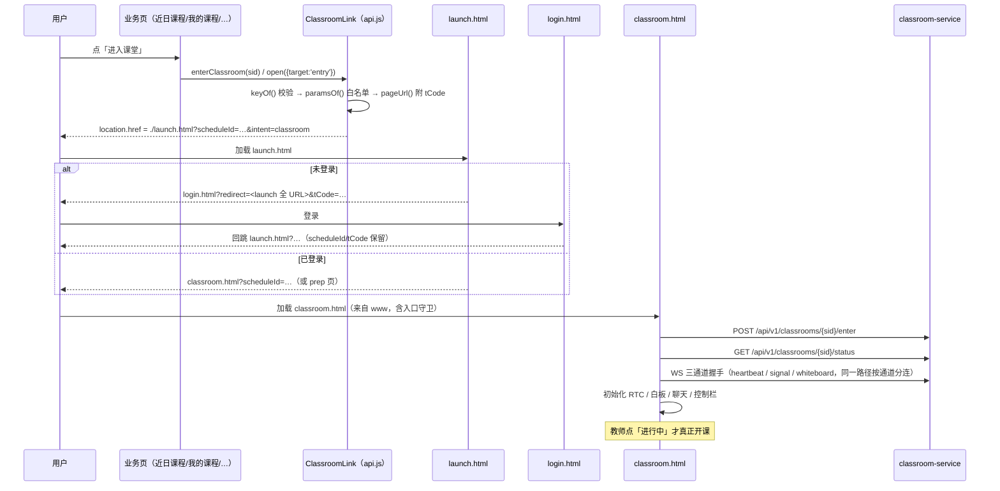

# 从「进入课堂」到课堂页 / App —— 全链路机理与路径

> 版本：2026-11-26 13:10
> 适用代码：`frontend/` + `classroom-app/`（分支 `student-crossplatform`）
> 关联：`frontend课堂深链改造方案-20261124.md`、`P0施工手册-课堂深链收敛-20261126.md`、技术债 `D-003`

---

## 0. 一句话结论

前端**没有任何一处**直接写 `classroom.html?scheduleId=…`。所有入口都收敛到
`ClassroomLink` 这一个构造器，它产出的地址永远是 **`launch.html?scheduleId=…`**；
`launch.html` 再按登录态做一次分流，最后才落到 `classroom.html`。
页面文件本身由「承接层」（dev 代理 / 生产 nginx）决定取自 `frontend` 还是 `classroom-app/www`。

```
入口按钮 → ClassroomLink（造 URL）→ launch.html（分流）→ classroom.html（启动课堂）→ 后端 enter
                ↑ 构造层                          ↑ 分流层            ↑ 落地层
                          └──── 承接层决定页面文件从哪来 ────┘
```

**为什么必须多这一层 launch.html**：因为 `classroom.html` 在 `frontend/` 和 `classroom-app/www/`
里**同名同路径**。深链若直接指向 `classroom.html`，同源同根部署时无法确定命中的是哪一份；
`launch.html` 是 www 独有路径，能确定由课堂 App 承接。这是整条链路的起点约束。

---

## 1. 全景：四段接力

| 段 | 位置 | 职责 | 不做什么 |
|---|---|---|---|
| ① 入口层 | 各业务页面 | 拿到 `scheduleId`，调统一入口 | 不拼 URL |
| ② 构造层 | `frontend/js/public/api.js` `[CLS-LINK-BEGIN]`~`[CLS-LINK-END]` | 校验 key、拼参数、附 `tCode`、决定相对还是绝对 | 不做分流、不判断角色 |
| ③ 分流层 | `classroom-app/www/launch.html` | 解析参数 + 登录态 → 决定去课堂 / 课前 / 登录 / 我的课堂 | 不取业务数据、不渲染列表 |
| ④ 落地层 | `classroom.html` + `js/classroom/classroom-main.js` | 守卫、调 enter 接口、连 WS、启 RTC | 不管入口从哪来 |

---

## 2. 第一段：入口层 —— 所有按钮都通向同两个函数

### 2.1 调用点清单

| # | 触发位置 | 文件:行 | 走法 |
|---|---|---|---|
| 1 | 排期详情卡片「进入课堂」 | `js/admin-schedule.js:2290` | `onclick="enterClassroom(sid)"` → 全局函数 |
| 2 | 预定审核卡片 | `js/admin-booking.js:249` | 同上 |
| 3 | 预约备注面板 | `js/public/appointmentNotes.js:934` | `window.enterClassroom(sid)` |
| 4 | 学生预约卡片 | `js/student-bookingBrowserCards.js:236` | `onclick="enterClassroom(sid)"` |
| 5 | 教师课程 / 排期列表（**「近日课程」「我的课程」「课次列表」都在这里**） | `js/teacher-courseAndScheduleBrowserCards.js:202` | 裸调 `enterClassroom(sid)` |
| 6 | 我的课堂（教师 + 学生，两种角色共用一套核心） | `js/public/my-classroom-core.js:187`（进入）/ `:202`（课前）/ `:195`（回放） | `window.ClassroomLink.open({...})` |
| 7 | 课堂运营台 | `js/classroom/ops.js:398` | `window.ClassroomLink.open({...})` |
| 8 | 消息中心「进入课堂」按钮 | `js/messages-inbox.js` + `shared/domain/message.js` | 点的是消息里落库的 **绝对 URL**（`payload.url`） |
| 9 | 加入课堂页（粘课堂号） | `js/student-joinClassroom.js:190` | `ClassroomLink.open({ target:'entry' })` |

入口 1~5 走 `window.enterClassroom`（全局别名），6~7、9 直接调 `ClassroomLink.open`——**两者最终是同一个函数**。

### 2.2 两个同名不同物的 enterClassroom（高频误判点）

| 名字 | 位置 | 性质 | 做什么 |
|---|---|---|---|
| `window.enterClassroom(key)` | `api.js:1054` | **页面跳转** | 造 URL 并 `location.href` |
| `window.ClassroomAPI.enterClassroom(base, sid, name)` | `api.js:1346` | **HTTP 调用** | `POST /api/v1/classrooms/{sid}/enter` |

> 后者被 `classroom-main.js:96` 调用，是落地层的「真正进课堂」。
> **禁止合并或改名成同一个** —— 一个是浏览器导航，一个是后端握手，混了会两头都坏。

---

## 3. 第二段：构造层 —— `ClassroomLink` 的契约

### 3.1 落位与约束

写在 `frontend/js/public/api.js` 里，位置在 `[CLS-LINK-BEGIN]` / `[CLS-LINK-END]` 之间，
是一个**自带 IIFE** 的独立段（`api.js` 主体是扁平脚本，不能整文件包 IIFE —— 它的全局函数被 40+ 文件直接调用）。

这么放的原因：`api.js` 已在 `sync.js` 的 `PUBLIC_JS` 白名单位居首位，所有页面都已加载它，
**加构造器不需要动任何 HTML**。

### 3.2 目标页映射（`TARGET`）

```js
var TARGET = {
  classroom: 'classroom.html',
  prep:      'classroom-prep.html',
  replay:    'replay.html',      // 注意：回放页不在 www 里，仍是 frontend 的页
  entry:     'launch.html'       // ★ 所有「进入课堂」的实际落点
};
```

路径约束：**必须是根目录下单个 `.html` 段**（`SEG_RE = /^[A-Za-z0-9_-]+\.html$/`）。
这条不是洁癖——`messages-inbox.js` 的 `safeJumpUrl` 与 `shared/domain/message.js` 的白名单都按这个规则校验，
多段路径会让消息里的「进入课堂」按钮**渲染不出来**。

### 3.3 两个不变式（这是整套设计的地基）

| 不变式 | 函数 | 行为 | 为什么 |
|---|---|---|---|
| **`href()` 恒相对** | `api.js:917` | 返回 `./launch.html?…` | 跑在 `https://` 还是 `capacitor://localhost` 都留在当前 WebView，壳内不会跳出 App |
| **`shareUrl()` 恒绝对** | `api.js:963` | 返回 `https://<origin>/launch.html?…`；**无基址时返回空串，绝不降级成相对路径** | 落库 / 发消息 / 跨端分享都需要可点开的绝对地址；静默降级会写出「别人点不开」的链接 |

绝对基址 `publicWebOrigin()` 按序取：`window.PUBLIC_WEB_ORIGIN` → `APP_CONFIG.publicWebOrigin` → `FRONTEND_ORIGIN` → `location.origin`，
无效候选（空 / 非 http(s) / 带 path / `capacitor:`）跳过。

`shareUrlSafe()` 额外返回 `insecure`，判定三条件**取或**：
目标非 https / 目标为 localhost·回环·私网 / 来源页自身非 https。
落库前必须检查它——私网地址写进消息，对方在公网点开就是打不开。

### 3.4 参数白名单

`paramsOf()` 只放行：`scheduleId`（必填）、`mode`、`src`、`intent`、以及 `meta` 里的
`start/end/state/idx/total`（纯展示元数据）。

- **`tCode` 不在这里**，由 `pageUrl()` 统一附加（避免出现两份来源不一致）
- 客户端能改的参数一律不可信，**不允许**把 role / 权限类信息塞进 URL 当依据

### 3.5 校验

- `keyOf()`：`/^[A-Za-z0-9_-]{4,64}(~\d{1,2})?$/`。实测库内 `course_schedule.schedule_id` 全为 32 位 hex；
  第 2 课次起为 `<id>~N`（与后端 `ClassroomKey.of` 逐字同规则）
- 非法 key → `href()` 返回 `''`，`enterClassroom` 弹「课堂号非法」，**不产出坏链接**

---

## 4. 第三段：分流层 —— `launch.html`

纯内联实现，**不依赖任何外部脚本**（哪怕 www 只部署了课堂相关页也能工作）。

### 4.1 分流表

| 条件 | 去向 |
|---|---|
| 无 `scheduleId` | `my-classroom.html`（让用户自己选课次，而不是报错卡住） |
| `scheduleId` 形态非法 | 停在原地，显示可操作提示（不猜） |
| 未登录（无 `currentUser` 或无 token） | `login.html?redirect=<自身完整 URL>&tCode=…` |
| 已登录 + `intent=prep` | `classroom-prep.html?scheduleId=…`（学生额外带 `mode=student`） |
| 已登录 + 其他 | `classroom.html?scheduleId=…` |

登录回跳的两个细节（都踩过）：

- 登录页认的是 **`redirect=`**，不是 `back=`（`frontend/login.html:1467`）
- `tCode` 必须**单独再带一份**：登录页只从自己的 search 里读 `tCode` 来锁定机构输入框，
  塞进 `redirect` 里面的它读不到 → 多租户下会锁错机构

回跳可用性已核：`login.html:1480` 用 `/\.html(\?|#|$)/` 校验，`launch.html?scheduleId=…` 能通过；
返回 `pathname + search + hash`，所以 **`scheduleId` 与 `tCode` 回跳后都还在**。

---

## 5. 第四段：落地层 —— `classroom.html` 启动课堂

### 5.1 页面装载顺序（顺序错了会连锁报错）

```
axios → pdf → utility_request → api.js → shared-domain-bridge.js → feature-flags.js
→ classroom-ws.js → media-devices.js → rtc/*(3) → classroom-rtc.js → classroom-record.js
→ classroom-whiteboard.js → …（聊天 / 控制栏 / 角色 / 素材）→ classroom-main.js
```

两个硬依赖：

- `api.js` 必须在 `shared-domain-bridge.js` **之前**（后者要往 `window.ApiPaths` 挂端点常量）
- `shared-domain-bridge.js` 必须在 `classroom-main.js` **之前**，否则 `EP` 为空 → URL 拼出 `undefined`

### 5.2 启动流水线（`classroom-main.js` `run()` → `_boot()`）

| 步 | 动作 | 关键点 |
|---|---|---|
| 1 | 读 `localStorage.currentUser` | 没有 → `_gotoLogin()` |
| 2 | 取 `scheduleId` | 没有 → 回角色首页 |
| 3 | `_ensureConfig()` | 课堂开关未缓存时补拉 `GET /api/v1/eclassroom/config`；**先拿配置再守卫**，否则刷新页面时会被误踢 |
| 4 | `guardClassroom()` | 租户是否开通课堂 |
| 5 | `POST /api/v1/classrooms/{sid}/enter` | 经 `ClassroomAPI.enterClassroom`，后端在此建 membership/签到事实 |
| 6 | `GET /api/v1/classrooms/{sid}/status` | enter 不返回配置，状态要单独补；结果决定 `_applyGate()` 的发布门禁 |
| 7 | `_connectWS()` | **必须在采集前建连**：RTC 采集完要广播 `rtc-peer-join`，WS 未握手会静默丢包 → 对方不知道我存在 → 没人发 offer |
| 8 | `_initModules()` | RTC 引擎 / 白板 / 聊天 / 控制栏 / 角色适配 |
| 9 | `_refreshMembers()` / 学生签到 / 上传弹窗 / 回放入口 / `_applyGate()` | |

### 5.3 课堂状态是「人工开课」

服务端不再自动开课/下课，进入页面时课堂通常还是 `SCHEDULED`，
必须由教师/管理员点底部「进行中」才真正开课（`_hintManualStart` 会提示）。
排查「学生进不来」时先看这个状态，不要先怀疑链路。

### 5.4 App 入口守卫（`app-entry-guard.js`，FP-002）

由 `patch.js` 注入到 `www/classroom.html` 的 `</head>` 前，补 `guardClassroom()` 缺的四道校验：

1. token 存在且长度 ≥ 8
2. 角色 ∈ `teacher / student / admin / platform_admin`
3. URL 的 `role` 必须与登录态一致（**防冒充**，配合 FP-001）
4. URL 的 `tCode` / `tenantCode` 与登录态一致（防租户串门）

任一项不过 → 跳登录页。
**注意**：这层守卫只存在于 www 的 `classroom.html`（补丁版）。所以「页面必须来自 www」本身就是一道安全边界——
若某条路由把 `classroom.html` 落到了 frontend 原件，等于绕过守卫。

---

## 6. 承接层 —— 页面文件从哪来

`launch.html` / `classroom.html` / `classroom-prep.html` 的**同名冲突**必须由部署层解决：

| 环境 | 机制 | 位置 |
|---|---|---|
| 本地开发 | dev-proxy 的 `toAppWww()` + `resolveAppWww()` | `doc-develop/90-tools/dev-proxy.js` |
| 生产 | 「课堂 App 静态承接」块（5 份 conf，6 处插入） | `deploy/nginx/booking*.conf` |
| 部署 | `classroom-app/www → /var/www/classroom-app` | `deploy/upload-to-server.sh` 第 3/9 步 |

### 6.1 接管的路径范围（三处必须一致）

```
页面：launch / classroom / classroom-prep / my-classroom / ops / verify  (.html)
根级：app-*.js / role-router.js / ops-lite.js / verify.js / app.css
目录：/js/classroom/          精确：/css/classroom.css
```

**刻意排除** `index.html` / `login.html` / `teacher.html` / `student.html` ——
它们与 frontend 同名，整站接管会让后台布局被 App 版顶掉。

### 6.2 回落语义

www 缺文件 → 回落静态根（frontend）。但**绝不兜 `/login.html`**：

- 兜了的话，`/launch.html` 会返回 **200 + 登录页内容**，`scheduleId` 全丢
- 表现是「怎么又跳回登录了」，比干净 404 难查得多
- 所以 nginx 的 `@fe_static` 写死 `try_files $uri =404`

---

## 7. App 侧：Capacitor 双模式与深链现状

`classroom-app/capacitor.config.json`：

| 模式 | 判据 | 页面来自 | 补丁（FP-001/FP-002） |
|---|---|---|---|
| **server** | `server.url` 有值（当前是占位 `https://your-domain.com`） | 线上前端站（WebView 套壳） | **不生效**（页面不是 www 里的） |
| **local** | 无 `server.url`，`capacitor://localhost` | www 离线包 | 生效 |

local 模式必须显式注入三套地址（`apiOrigin` / `classroomApiOrigin` / `classroomWsOrigin`），
server 模式留空（跟随当前域名）。

### 深链现状（诚实标注）

| 项 | 状态 |
|---|---|
| `launch.html` 作为深链落地页 | ✅ 已实现，路径/参数已固定 |
| Capacitor 壳内跳转（`ClassroomLink.open` 相对地址） | ✅ 可用，留在 WebView |
| **App Links / Universal Links**（浏览器点链接唤起 App） | ❌ **未落地**：仓库内无 `assetlinks.json`、无 `apple-app-site-association` |
| App 打包（`cap sync` / IPA / APK） | ❌ 无脚本（技术债 D-001） |

也就是说：**目前只有「App 内跳到课堂」是通的，「从外部链接唤起 App」还没有**。
契约（D-1：`https://{origin}/classroom.html?scheduleId=<key>&tCode=<code>`，host/路径永久不可变）已经定好，
一旦要上 App Links，直接按这个路径配 `assetlinks.json` 即可，不需要改前端代码。

---

## 8. 时序图



---

## 9. 禁止事项（改代码前先看这里）

1. **不要在业务页面里手拼 `classroom.html?…`** —— 直接绕过 launch.html，登录态与 `tCode` 都处理不对。
2. **不要把 `TARGET.entry` 改成 `classroom.html`** —— 同名冲突会让同源同根部署命中的是 frontend 原件（无补丁、无守卫）。
3. **不要让 `href()` 返回绝对地址**，也不要让 `shareUrl()` 在无基址时降级成相对路径（写出别人点不开的链接）。
4. **禁止合并两个 `enterClassroom`**（页面跳转 vs HTTP 调用）。
5. **禁止把 www 整站挂成站点** —— 6 个同名页会连带把后台变成 App 版。
6. **禁止在承接块的回落里兜 `/login.html`** —— 会把「App 未部署」伪装成「未登录」。
7. **默认值/开关只写一次**（引擎里），不要在每个入口脚本各写一份——2026-11-26 就因为写了两份而出过「改了、重启了、还是 404」。

---

## 10. 排查手册

| 现象 | 先查什么 | 判据 |
|---|---|---|
| 点「进入课堂」404 | 代理/nginx 有没有接管 `/launch.html` | `npm run check:app-www` 绿=已接管 |
| 跳回了登录页 | 是 launch.html 的**正常未登录分流**，还是被登录页兜底 | 看登录页 URL 里有没有 `redirect=launch.html…`；有就是正常 |
| 页面能开但样式/脚本全丢 | 根级 `app-*.js`、`app.css` 是否被接管 | 自检 A 组 12 项含这些 |
| 后台页面变成 App 版了 | 有没有把 www 整站挂上 | 自检 B 组 4 项应「不等于 www 版」 |
| 改完配置没效果 | 进程是不是新起的 | 对比 PID；配置只在启动时读一次 |
| 学生进不来 | 课堂状态是不是还是 `SCHEDULED` | 教师需点「进行中」 |

自检命令：

```bash
npm run check:app-www        # 承接层（A 内容归属 / B 未误伤 / C 依赖可达）
npm run check:proxy          # nginx 五份分流一致 + 承接块逐字一致
npm run check:classroom-link # 构造层字面量收敛（禁止绕过构造器）
```

---

## 11. 已知缺口（本文写作时）

| # | 缺口 | 影响 | 位置 |
|---|---|---|---|
| 1 | `app-entry-guard.js` 跳登录用 `back=`，而 `www/login.html` 只认 `redirect=` | App 内 token 失效时**回跳丢失**，登录后落到角色首页而非课堂 | `classroom-app/www/app-entry-guard.js:48` |
| 2 | `ctx.role = _getParam('role') \|\| user.role` | URL 的 `role` 可覆盖登录态（FP-001），目前靠 `app-entry-guard` 的 `ROLE_MISMATCH` 拦，web 侧仅因页面来自 www 才受保护 | `frontend/js/classroom/classroom-main.js:87` |
| 3 | `classroom-prep.js:376-377` 仍自行拼 `classroom.html` | 课前页「进入课堂」绕过 launch.html（P0 禁区，待 P1/P3） | `frontend/js/classroom/classroom-prep.js` |
| 4 | App Links / AASA 未落地 | 浏览器链接无法唤起 App | `classroom-app/` |
| 5 | nginx 承接块未经 `nginx -t` 实机验证 | 上线前必须在服务器验证 | `deploy/nginx/*.conf` |
| 6 | `deploy/collect-artifacts.js` 未收口 `classroom-app/www` | 构建产物没有 deploy 侧快照 | `deploy/collect-artifacts.js` |

---

## 附：一次完整的 URL 演进

以 `scheduleId = 7f3a9c2e1b4d4f0a9c8e7d6a5b4c3d2e`、`tCode = demo` 为例：

```
① 按钮触发（页面地址 teacher.html?tCode=demo）
   enterClassroom('7f3a9c2e…')

② 构造层
   ./launch.html?scheduleId=7f3a9c2e…&intent=classroom&tCode=demo
   （shareUrl 版本：https://<origin>/launch.html?scheduleId=…&intent=classroom&tCode=demo）

③ 分流层（已登录，教师）
   classroom.html?scheduleId=7f3a9c2e…

④ 落地层
   POST /api/v1/classrooms/7f3a9c2e…/enter
   GET  /api/v1/classrooms/7f3a9c2e…/status
   WS   /ws/classrooms/7f3a9c2e…   ×3 条通道（heartbeat / signal / whiteboard）
```

多课次场景 key 形如 `7f3a9c2e…~2`（第 2 课次起），同一套规则走完全程。
