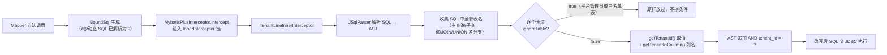

# 多租户 SaaS 预约系统架构设计（N1）：MyBatis-Plus 多租户隔离原理与实战

> **系列导航**：本文是《多租户 SaaS 预约系统：架构设计与核心技术点详解》第 N1 篇。
> 前序：[第 1 篇 · 系统架构设计及原理（总纲）](#)。本篇把总纲第 4 节「多租户数据隔离架构」放大到源码级。
>
> **一句话摘要**：不写一行 `WHERE tenant_id = ?`，让几百个查询自动带上租户条件——靠的是 MyBatis-Plus 拦截器在 SQL 执行前改写 AST。本文拆解它的工作原理、本项目的落地配置，以及五个真实翻车现场。

---

## 一、问题背景：多租户隔离的几条路

先给结论性的对比——**数据隔离没有银弹，只有权衡**：

| 方案 | 隔离强度 | 跨租户统计 | 运维成本 | 本项目是否采用 |
| --- | --- | --- | --- | --- |
| 每租户独立数据库 | 最强（物理隔离） | 极难（跨库 JOIN） | 高（N 套库要维护） | ❌ |
| 独立 Schema（同实例） | 强 | 难（跨 schema） | 中 | ❌ |
| 共享表 + tenant_id 列 | 中（靠应用层保证） | 容易 | 低 | ✅ |
| 手写 `WHERE tenant_id = ?` | 同共享表 | 容易 | **漏一个全盘皆输** | ❌ |
| 视图（每租户一个视图） | 中 | 难 | 高 | ❌ |

选共享表，是因为租户量级（百级）远未到容量瓶颈，而平台运营报表（租户趋势、在线统计、续费预警）必须跨租户聚合。但「共享表」把隔离责任从数据库层**上提到了应用层**——这是所有后续设计的根源：**必须有一个机制，让「忘记加租户条件」这件事在结构上不可能发生**。

于是有了拦截器方案。对比手写：

```java
// 手写派：每个方法都是下次事故的种子
List<User> users = userMapper.selectList(new LambdaQueryWrapper<User>()
        .eq(User::getAccount, account)
        .eq(User::getTenantId, TenantContext.getTenantId())); // 忘了这行 = 跨租户泄露

// 拦截器派：业务代码零侵入，条件由框架在 SQL 层统一追加
List<User> users = userMapper.selectList(new LambdaQueryWrapper<User>()
        .eq(User::getAccount, account));
```

本项目 120+ 个 Mapper 方法、上千处查询，靠 review 保证每人每行都写对，不现实。**把横切关注点交给框架，把「已知会忘」变成机器义务**——这是选型时唯一的决策逻辑。

---

## 二、原理：拦截器在 SQL 生命线的哪一环动手

### 2.1 MyBatis 插件机制与 InnerInterceptor 链

MyBatis 的插件机制基于**责任链 + 动态代理**：`Interceptor` 接口可以对 `Executor`（SQL 执行器）、`StatementHandler`、`ParameterHandler`、`ResultSetHandler` 四大对象的方法做环绕拦截。MyBatis-Plus 在此之上封装了 `MybatisPlusInterceptor`——它本身是一个 MyBatis 插件，内部持有一个**有序的 `InnerInterceptor` 列表**，把分页、租户、动态表名等多个功能编排成一条链。

```java
// 本项目的装配（api/src/main/java/com/reservation/config/MyBatisPlusConfig.java）
@Bean
public MybatisPlusInterceptor mybatisPlusInterceptor() {
    MybatisPlusInterceptor interceptor = new MybatisPlusInterceptor();

    // 多租户拦截器（必须放在分页拦截器之前）
    TenantLineInnerInterceptor tenantInterceptor = new TenantLineInnerInterceptor();
    tenantInterceptor.setTenantLineHandler(/* 自定义租户行处理器 */);
    interceptor.addInnerInterceptor(tenantInterceptor);

    // 分页拦截器
    interceptor.addInnerInterceptor(new PaginationInnerInterceptor(DbType.MYSQL));

    return interceptor;
}
```

关键点：**链是按添加顺序执行的**。每条 SQL 从 Mapper 方法出发，经过动态 SQL 解析、参数绑定，生成 `BoundSql`（此时 `#{}` 已变成 `?`），随后进入拦截器链做最后改写，才交给 JDBC 执行。`TenantLineInnerInterceptor` 干的活，就在这最后一环。

### 2.2 四步改写：从原始 SQL 到带租户条件的 SQL



它的改写对象是 **AST（抽象语法树）**，不是字符串拼接——这是它比「正则替换」可靠的根本原因。看一下实际效果：

```sql
-- Mapper / XML 里写的
SELECT * FROM user WHERE account = ? ORDER BY tenant_id

-- 拦截器改写后实际执行的
SELECT * FROM user WHERE account = ? AND tenant_id = ?
```

覆盖范围包括：SELECT 主查询、子查询、JOIN 的每张表、UNION 的每个分支、UPDATE 与 DELETE 的 WHERE；`INSERT ... SELECT` 的查询部分同样会处理（纯 VALUES 插入不管——这正是 2.5 节要说的写入侧缺口）。

### 2.3 TenantLineHandler：三个契约方法

拦截器本身不知道「当前租户是谁」「哪些表不隔离」，这些由 `TenantLineHandler` 提供，三个方法各司其职：

| 方法 | 返回 | 职责 | 调用时机 |
| --- | --- | --- | --- |
| `getTenantIdColumn()` | `"tenant_id"` | 租户列名，全库统一 | 每次追加条件时 |
| `getTenantId()` | JSqlParser `Expression` | 当前租户的**字面量表达式** | 每个未被忽略的表各一次 |
| `ignoreTable(tableName)` | boolean | 该表是否跳过隔离 | 每个表各一次 |

注意 `getTenantId()` 的返回类型是 JSqlParser 的 `Expression` 而不是 `Long`——拦截器要把这个值直接种进 AST，所以必须已经是「表达式」。本项目返回 `new LongValue(...)`，即一个长整型字面量。

### 2.4 拦截器顺序：为什么租户必须在分页之前

装配代码里那行注释「必须放在分页拦截器之前」不是风格问题，是**功能正确性**问题：

- `PaginationInnerInterceptor` 会为分页查询生成 COUNT SQL、并把 `LIMIT ?, ?` 拼到 SQL 末尾；
- 若租户拦截器排在它**后面**执行，它拿到的已经是拼好 `LIMIT` 的语句，此时再往 WHERE 追加 `AND tenant_id = ?`，条件会落到 `LIMIT` 之后——**直接是非法 SQL**；即便某些形态下不报错，条件也拼在了错误的层级；
- 反过来，租户先执行、分页后执行，分页看到的就是「已经带好租户条件的干净 SQL」，COUNT 与数据页天然一致。

MyBatis-Plus 官方推荐顺序同样是：**多租户 → 动态表名 → 分页**。顺序错了的症状很典型：要么启动正常、查询报语法错误，要么分页总数把别的租户的行数也算进去。

### 2.5 边界：INSERT 为什么不归它管

`TenantLineInnerInterceptor` 只改写**已存在的查询/更新语句**。纯粹的 `INSERT INTO t (...) VALUES (...)` 里没有任何「表条件」可改，租户列的值只能来自实体字段。如果实体 `tenantId` 为 null，MyBatis-Plus 会**显式插入 NULL**，数据库直接报错：

```
Column 'tenant_id' cannot be null
```

这个缺口由 `TenantMetaObjectHandler`（MyBatis-Plus 的 `MetaObjectHandler` 扩展点）在写入侧补上——查询侧拦截 + 写入侧填充，才构成闭环。详见 3.4 节。

---

## 三、源码实现：逐层拆开本项目的配置

### 3.1 IGNORE_TABLES：一张清单，每一条注释都是一次事故

```java
private static final List<String> IGNORE_TABLES = Arrays.asList(
        "sys_tenant", "sys_tenant_package", "sys_package_template",
        "sys_tenant_stats_monthly", "sys_metric_sample", "sys_metric_hourly",
        "sys_system_config", "sys_platform_admin", "sys_dict",
        "user_refresh_token", "sys_user_session",
        "sys_term", "sys_industry", "course_notify_rule_point",
        "wx_userid", "promo_referral", "promo_conversion", "promo_achievement",
        "sys_legal_doc", "sys_legal_accept", "wx_login_state"
);
```

哪些表不该走租户插件？三类，每一类在源码注释里都写明了**不排除会出什么事**：

**（1）平台级表，本来就没有租户归属**：`sys_tenant`（租户自己）、`sys_package_template`（套餐模板）、`sys_industry`（行业字典）…… 这类表要么没有 tenant_id 列，要么是平台共享数据。不排除的后果通常是 `Unknown column 'tenant_id'`——插件拼了列不存在的条件，SQL 直接报错。

**（2）有 tenant_id 列但语义不是「归属租户」**：

- `sys_term`：列值是**作用域维度**（0=平台词，>0=租户词），词表合并要跨作用域查询，走插件会把三级词表查成一级；
- `sys_legal_doc`：同上，`tenant_id` 是「作用域维度」；
- `wx_userid`：语义是「一个微信全局只绑一个账号」（uk 全局唯一），走插件会让平台管理员视角被拼 `tenant_id = 当前租户`，查不到绑定、**静默失败**；
- `promo_referral / promo_conversion / promo_achievement`：推广三表是平台级统计，租户管理员查自己的业绩时要能看全量归因行。

**（3）隔离靠关系间接保证的表**：`course_notify_rule_point`（通知规则的时间点明细）刻意没有 tenant_id 列，规则头才有——隔离通过 `rule_id` 关联规则头实现。

这张清单是多租户架构里**最脆弱的部分**：新增一张表，必须回答「它有没有 tenant_id 列？有，语义是不是归属租户？」。答错不会立刻炸，只会在某个查询上表现为「数据莫名变少」或「莫名变多」。

### 3.2 getTenantId：-1 兜底值的完整推演

```java
@Override
public Expression getTenantId() {
    Long tenantId = TenantContext.getTenantId();
    // 无租户上下文（未登录 / 异步线程 / 定时任务）用 -1 兜底：
    // 既不拼出 tenant_id = NULL，也不会退化成查全量，避免越权
    return new LongValue(tenantId == null ? -1L : tenantId);
}
```

这个 `-1` 不是拍脑袋，是三个选项里唯一正确的：

| 兜底值 | 拼出的 SQL | 后果 |
| --- | --- | --- |
| `null`（返回 null） | `tenant_id = NULL` | **恒不成立，查出 0 条**，且不报错 |
| 不拼条件（视为不过滤） | 无 | **查全量 = 跨租户越权** |
| `-1` | `tenant_id = -1` | 查不到任何数据，与「无上下文不该看到数据」的安全预期一致 |

为什么 `null` 兜底一定不行？项目注释记录了**反编译 mybatis-plus-extension 3.5.7 的结论**：`getTenantId()` 返回非 null 时，插件**无条件**拼 `tenant_id = <值>`，不做 null / NullValue 判断。也就是说兜底路径上返回 null，等于亲手把每条 SQL 变成恒空查询——功能「没报错，就是没数据」，是最难排查的故障形态。

同时注意 `-1` 只是**兜底**，不是常规路径：正常请求的租户 id 来自 JWT（见 3.5 与第 6 节），定时任务异步线程的显式传参（N2 篇细讲）。

### 3.3 ignoreTable：平台管理员「查全量」的唯一正确开关

```java
@Override
public boolean ignoreTable(String tableName) {
    Long tenantId = TenantContext.getTenantId();
    // 平台管理员（tenantId=0）：不拼接租户条件，可查看全部租户数据
    if (tenantId != null && tenantId == 0) {
        return true;
    }
    return IGNORE_TABLES.contains(tableName);
}
```

平台管理员的 token 里 `tenantId = 0`。这里有一个巨大的认知陷阱：**插件对 `tenantId = 0` 的默认行为是拼 `tenant_id = 0`，只会匹配平台自身的数据**——而平台管理员要的是「全部租户」。所以本项目在 `ignoreTable` 里对 `tenantId == 0` **整表短路**：平台管理员视角下，所有表都不拼租户条件。

于是 `UserService.platformAdminPage()`（平台管理员用户管理）可以直接调 `userMapper.listByConditionAll()` 拿到全平台数据，方法注释写得很清楚：

> 前提：调用方必须已是平台管理员（tenantId=0），此时 TenantLineInnerInterceptor.ignoreTable 全表返回 true，本方法取到的是【全平台】user 数据，不含租户条件。

**但这把开关是双刃剑**——它同时意味着：平台管理员访问「本应租户隔离」的接口时，插件不会替他拦。`NotifyRuleService` 因此加了一道硬校验：

```java
// 平台管理员（tenantId=0）时 ignoreTable 全表 true，完全不拼租户条件；
// 而 checkAdmin 是放行平台管理员的。若不拦住，平台管理员调用本接口时
// selectOne 可能读到别的租户的规则行（默认规则用空串做 course_id，跨租户全撞在同一个值上）。
private void requireTenantContext() {
    Long tenantId = TenantContext.getTenantId();
    if (tenantId == null || tenantId == 0L) {
        throw new BusinessException(TermMsg.t("上课通知规则按租户隔离，请以租户管理员身份操作"));
    }
}
```

教训：**插件的短路是为「平台查询接口」设计的，不是为「租户业务接口」设计的**。租户业务接口必须在服务层显式拒绝平台身份，否则「查全量」会从特性变成漏洞。

### 3.4 TenantMetaObjectHandler：写入侧闭环

```java
@Component
public class TenantMetaObjectHandler implements MetaObjectHandler {
    private static final String TENANT_ID = "tenantId";

    @Override
    public void insertFill(MetaObject metaObject) {
        if (!metaObject.hasSetter(TENANT_ID)) return;      // 平台表没有该字段，跳过
        if (getFieldValByName(TENANT_ID, metaObject) != null) return; // 业务已显式赋值，不覆盖
        Long tenantId = TenantContext.getTenantId();
        setFieldValByName(TENANT_ID, tenantId == null ? 0L : tenantId, metaObject);
    }

    @Override
    public void updateFill(MetaObject metaObject) {
        // 更新不修改租户归属
    }
}
```

三个细节：

1. **`hasSetter` 前置检查**：平台表（sys_tenant 等）没有 tenantId 字段，直接跳过，不报错；
2. **不覆盖显式赋值**：审计日志在切面主线程里已解析好租户，自动填充不能抢；
3. **无上下文填 0**：与查询侧的 `-1` 故意不同——写入填 0 表示「平台/历史数据」，是一个可能合法存在的归属；查询兜底 -1 表示「不可能存在，所以查不到」。**一个管「可能是什么」，一个管「不该看见」**。

### 3.5 单方法级豁免：@InterceptorIgnore(tenantLine = "true")

有些查询**天生就要跨租户**。MyBatis-Plus 提供注解级豁免，项目形成了固定的命名约定：方法名以 `IgnoreTenant` 结尾 + 注解声明。

```java
// TeacherPublishedProfileMapper.java —— 教师公开分享页（免登录，无租户上下文）
@InterceptorIgnore(tenantLine = "true")
@Select("SELECT * FROM teacher_published_profile "
      + "WHERE teacher_id = #{teacherId} AND status = 'published' "
      + "ORDER BY published_at DESC LIMIT 1")
TeacherPublishedProfile selectLatestPublishedIgnoreTenant(@Param("teacherId") String teacherId);
```

方法注释把理由写得很完整：公开页的链接是发给家长的，**家长没有租户身份**，`TenantContext` 为 null，插件会兜底拼 `tenant_id = -1`，即便库里有记录也恒不命中——「该教师暂无已发布的个人介绍」就是这么来的。记录自身的归属由 `teacher_id` 精确锁定，豁免不影响正确性。

其他典型场景：

- `listByRoleIgnoreTenant`：消息中心解析接收人，要跨租户查平台管理员/指定租户管理员；
- `listByAccountIgnoreTenant`：平台管理员代查「账号 → 所属租户」；
- `countByTenantAndRoleForUpdate`：自助激活的并发判据，`SELECT ... FOR UPDATE`，**SQL 里显式写 tenant_id**（`tenantId=0` 表示全系统）——因为插件在 0 时短路、无上下文时兜底 -1，两种行为都不是这里要的「按传入值判定」。

**豁免是把双刃剑**：它把租户条件的责任从框架交还给写 SQL 的人。所以项目的约定是——每个 `IgnoreTenant` 方法必须在注释里回答「为什么可以跨租户」，且调用方（而非 Mapper）负责权限收敛（如 `code-by-account` 收敛为 `self || platform_admin`）。

---

## 四、踩坑实录：五个真实故障

### 坑 1：兜底返回 null → 全站查询恒空

**症状**：某次改动后，所有列表接口返回空，接口 200、无异常、日志全绿。
**根因**：`getTenantId()` 的兜底分支返回了 null（而非 LongValue）。反编译确认插件对非 null 返回值无条件拼接，`tenant_id = NULL` 恒不成立。
**修复**：兜底改 `-1`，并把「反编译结论」写进注释，防止后人「顺手改优雅」。
**通用教训**：安全相关的兜底值，优先保证「失败时拒绝服务」而不是「失败时看起来正常」。

### 坑 2：以为 tenant_id = 0 就是平台全量

**症状**：平台管理员打开用户管理，只看到平台账号，看不到租户管理员。
**根因**：插件默认行为是拼 `tenant_id = 0`，语义变成「平台自身的数据」。
**修复**：`ignoreTable` 对 `tenantId == 0` 短路。
**通用教训**：「平台视角」和「平台数据」是两回事，多租户框架的零值语义必须先读源码再使用。

### 坑 3：拦截器顺序错误

**症状**：开发环境分页查询报 SQL 语法错误，或 COUNT 总数包含其他租户行数。
**根因**：装配时把分页拦截器添加在租户拦截器之前。
**修复**：调整顺序（租户 → 分页），并把「必须放在分页拦截器之前」写进装配注释。
**通用教训**：所有「有序插件链」框架，顺序即语义，注释要写在装配处而不是文档里。

### 坑 4：INSERT 撞 `Column 'tenant_id' cannot be null`

**症状**：新增实体能查不能插。
**根因**：租户拦截器不管 VALUES 插入，实体 tenantId 为 null 被显式插入 NULL。
**修复**：配 `TenantMetaObjectHandler` 自动填充。
**通用教训**：查询侧拦截 + 写入侧填充必须成对出现，只做一半等于没做。

### 坑 5：平台管理员身份 + 租户业务接口 = 越权读取

**症状**：平台管理员调用通知规则查询，`selectOne` 读到了别的租户的规则行（默认规则 course_id 为空串，跨租户全撞同一个值）。
**根因**：`ignoreTable` 在 `tenantId=0` 时全表短路，而接口的角色校验放行平台管理员——两层各自「正确」，组合出漏洞。
**修复**：`requireTenantContext()` 硬校验，租户业务接口显式拒绝平台身份。
**通用教训**：**安全属性是组合出来的，不是每个组件各自正确就够**。每个「特权短路」都要问一句：它在哪些接口上会被误用？

---

## 五、落地 Checklist

把本文浓缩成一张可执行的清单，搬进自己的项目时逐项核对：

- [ ] 共享表方案确认：所有业务表统一 `tenant_id` 列名，平台级/语义特殊表建 IGNORE_TABLES 清单并逐条写注释
- [ ] 装配顺序：`TenantLineInnerInterceptor` 必须在 `PaginationInnerInterceptor` **之前**
- [ ] `getTenantId()` 兜底值用「不存在的 id」（如 -1），**绝不返回 null**；如对框架行为有疑问，反编译确认
- [ ] `ignoreTable` 为平台管理员（tenantId=0）提供全量短路，同时在**租户业务服务层**显式拒绝平台身份
- [ ] 配 `MetaObjectHandler` 做 INSERT 侧自动填充，查询/写入两侧成对
- [ ] 跨租户查询用 `@InterceptorIgnore(tenantLine = "true")` + `IgnoreTenant` 命名约定，注释写清「为什么可以跨租户」，权限在调用方收敛
- [ ] 异步/定时任务禁止依赖线程继承传租户（下一篇主题），用显式传参 + 工作线程 set/clear
- [ ] 用 `tools/check-tenant-cross-thread.mjs` 这类守卫钉住「set/clear 必须成对、必须在工作线程」

---

## 小结

`TenantLineInnerInterceptor` 的价值不在「省了几行 WHERE」，而在于把租户隔离从**每人的编码习惯**变成**框架的结构义务**：AST 级改写保证不漏、`ignoreTable` 控制边界、`MetaObjectHandler` 补齐写入、`@InterceptorIgnore` 开受控的豁免口子。但应用层隔离的代价是——**每一处短路、每一个兜底值、每一条白名单，都是安全边界的一部分**，必须有注释、有守卫、有反编译证据。

**下篇预告（N2）**：《租户上下文与跨线程传递》——ThreadLocal 为什么不跨线程、「任务在跑、日志在打、一条通知不发」的静默故障如何发生，以及 `TenantAwareExecutor` 的契约设计。

> 本文涉及的全部源码路径均相对仓库根目录（api/src/main/java/com/reservation/...），代码会持续演进，阅读时以仓库实际结构为准。
