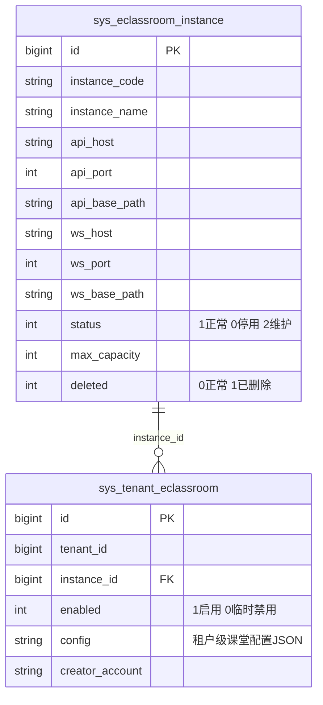
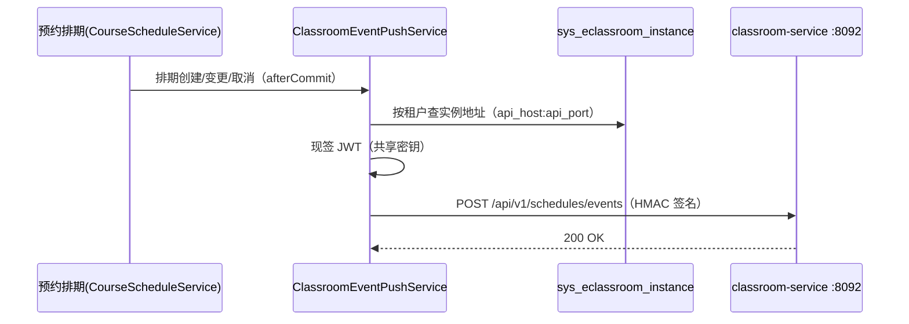
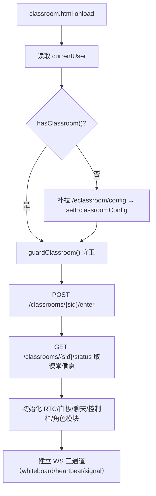
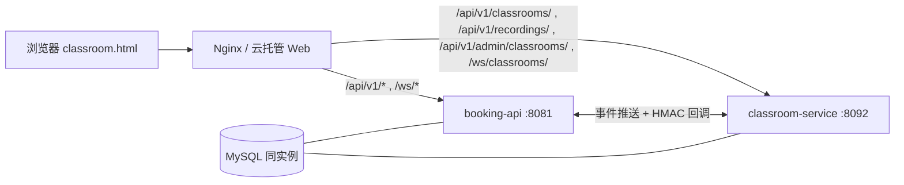

# N10：多租户在线课堂集成——特性开关、服务发现与前端页面分离

> **系列导航**：本文是「SaaS 预约系统开发架构设计 1+N」系列第 N10 篇。
> 上一篇 [N9：消息中心微服务拆分](#) 讲进程级拆分与 SSE 推送；本篇讲**第三个独立服务**——
> 在线课堂（classroom-service）如何在不引入注册中心/配置中心的前提下，做到
> 「按租户开关、按实例寻址、前后端页面分离」。
>
> 文中路径以仓库根为基准，代码片段均来自本仓库真实实现。

---

## 一、问题背景：课堂能力为什么要独立成服务

在线课堂涉及实时音视频、白板协作、心跳在线状态、点名/讲稿/作品/录制回放等**长连接 + 高并发**能力，
与预约系统主服务（booking-api，8081）的 CRUD 定位差异极大。若内嵌主服务：

- 长连接会占用主服务的连接与线程资源，课堂高峰拖垮预约下单；
- 课堂 schema 与业务 schema 混在一起，无法独立扩缩容；
- 课堂能力并非所有租户都需要，必须**按租户灰度**。

因此拆为独立服务 `api/classroom-service`（Spring Boot 3.3.5，端口 8092，独立库 `classroom`），
复用主系统 JWT 密钥域（token 直通校验），共享密钥思想与 N9 一致。

| 维度 | 决策 | 说明 |
| --- | --- | --- |
| 形态 | `api/classroom-service` 独立应用模块 | 自备 pom、启动类、端口、库 |
| 端口 | 8092 | 独立于主服务 8081 与消息服务 8090 |
| 数据库 | 独立库 `classroom` | 与主业务库 `lesson_appointment` 物理隔离 |
| 复用策略 | 复制轻量工具类 + 共享密钥域 | `jwt.secret` / `crypto.aes-key` / `crypto.hmac-key` 与主系统逐字符一致 |
| 实时通道 | 原生 WebSocket（Spring `@EnableWebSocket`） | 白板/心跳/信令三条通道，无额外推送中间件 |
| 服务发现 | **DB 表 `sys_eclassroom_instance` 存实例地址** | 不引入注册中心，地址在管理端维护 |

**两条不选**：不上注册中心/配置中心；不共享主库表（仅对一张守卫表做**跨 schema 只读**）。

---

## 二、多租户特性开关

课堂是**可选模块**，需按租户开启/关闭，且关闭后前端不出现任何课堂入口。

### 2.1 数据模型（主业务库 `lesson_appointment`）

两张表构成「实例目录 + 租户绑定」：



- `sys_eclassroom_instance`：课堂服务实例目录（支持多实例/多区域，含 API 与 WS 地址）；
- `sys_tenant_eclassroom`：租户 ↔ 实例绑定（`enabled=1` 表示该租户启用课堂）。

### 2.2 开关读取：`/api/v1/eclassroom/config`

booking-api 提供 `EclassroomController.getConfig`，任意登录角色可查：

```json
{ "enabled": true, "apiBaseUrl": "http://...:8092", "wsBaseUrl": "ws://...:8092", "config": null }
```

前端登录成功后把它写入 `localStorage.eclassroomConfig`，作为**显隐 UI 的唯一依据**。

### 2.3 前端开关工具：`feature-flags.js`

`frontend/js/public/feature-flags.js` 以 `eclassroomConfig` 为单一事实源：

| 能力 | 函数 | 作用 |
| --- | --- | --- |
| 读开关 | `hasClassroom()` | `config.enabled === true` |
| 取地址 | `getClassroomApiBaseUrl()` / `getClassroomWsBaseUrl()` | 供 ClassroomAPI / ClassroomWS 使用 |
| 存配置 | `setEclassroomConfig(cfg)` | 登录响应 / 补拉时写入 |
| 菜单显隐 | `applyMenuVisibility()` | 未启用则 `display:none` 掉 `[data-module="classroom"]` |
| 页面守卫 | `guardClassroom()` | 未启用则跳回角色首页 |

登录流程（`auth.js`）在拿到响应后调用 `setEclassroomConfig`；已登录刷新但本地无配置时，
`api.js` 的 `autoLoginCheck` 会**补拉**一次 `/eclassroom/config`，避免刷新后开关状态丢失。

### 2.4 后端守卫：`AuthInterceptor` 拦截 403

classroom-service 的鉴权委托给 `AuthInterceptor`（HandlerInterceptor）：JWT 校验通过后，
再查 `TenantEclassroomService.hasClassroomEnabled(tenantId)`，未启用直接 `403`。

- **豁免**：平台管理员（`tenantId=0/-1`）与系统调用（`role=system`）；
- **缓存**：查询结果用**进程内缓存**（`ConcurrentHashMap` + TTL 5 分钟），避免每请求打 DB；
  *原设计用 Caffeine，因 Maven 镜像无法下载该依赖，改为自实现等价缓存（零外部依赖）。*

---

## 三、服务发现：DB 目录 + 动态寻址

不引入注册中心，**实例地址就是一张表**，由平台管理端维护。

### 3.1 服务端：动态查地址后推送

booking-api 侧的 `ClassroomEventPushService` 在排期变更时向 classroom-service 推送事件：



要点：
- 事件推送**延迟到事务提交后**（`afterCommit`），避免主事务回滚但已推送；
- 走 HMAC 签名（`HmacVerifier`）证明来源，与 JWT 口令域分离；
- classroom-service 提供 4 个 HMAC 回调端点（`ClassroomCallbackController`）接收回推。

### 3.2 前端：地址随登录下发

前端不硬编码课堂地址，而是从登录响应/配置接口获得：

- `getClassroomApiBaseUrl()` → `ClassroomAPI.*(apiBaseUrl, ...)` 拼接请求；
- `getClassroomWsBaseUrl()` → `ClassroomWS` 拼 WebSocket base；
- 两者为空时回退**同源**（经 nginx 前缀分流到 8092）。

如此，同一份前端代码可对接不同环境的课堂实例，无需改代码重构建。

---

## 四、前端页面分离

课堂交互模式（全屏、长连接、实时协作）与预约 CRUD 完全不同，因此**独立成页**。

### 4.1 页面与依赖隔离

```
frontend/
├── admin.html / teacher.html / student.html   ← 既有（新增课堂菜单项 + 进入课堂按钮）
├── classroom.html                             ← 新增：全屏课堂页（三角色共用）
├── css/classroom.css                          ← 独立样式，不引 base/admin/teacher/student.css
└── js/
    ├── public/feature-flags.js                ← 开关工具
    ├── public/api.js                          ← 新增 ClassroomAPI
    ├── public/classroom-ws.js                 ← WS 三通道封装
    └── classroom/                             ← 课堂模块（不依赖 admin-*/teacher-*/student-*）
        ├── classroom-main.js
        ├── classroom-rtc.js / whiteboard.js / chat.js
        ├── classroom-controls.js
        └── classroom-teacher.js / student.js / admin.js
```

`classroom.html` 只引入公共工具（axios / utility_request / api / feature-flags）+ 课堂模块，
**不引入**任何现有业务页样式与 sideba/header 组件。

### 4.2 三角色按能力适配

| 功能 | 教师 | 学生 | 管理员 |
| --- | --- | --- | --- |
| 音视频发布 | ✅ | ✅ | ❌ 仅观看 |
| 白板操作 | ✅ | ✅（可只读） | ❌ 仅观看 |
| 全员静音 / 踢出 | ✅ | ❌ | ✅ |
| 开始 / 结束课堂 | ✅ | ❌ | ❌（仅强制结束） |
| 举手 | ❌ | ✅ | ❌ |
| 录制控制 | ✅ | ❌ | ✅ |
| 巡课监控面板 | ❌ | ❌ | ✅ |

底部控制栏（`classroom-controls.js`）按角色动态生成按钮，动作委托到上述模块。

### 4.3 进入课堂的入口

预约/排期卡片在 `hasClassroom()` 为真且符合条件（如已确认/临近开课）时，条件渲染
「进入课堂」按钮，点击 `enterClassroom(scheduleId)` 跳 `classroom.html?scheduleId=...`。

### 4.4 页面初始化流程



> 注：后端 `enter` 返回 `Result<Void>`（不含 rtcConfig），故课堂信息由 `status` 接口补齐；
> RTC 采用**浏览器原生 `RTCPeerConnection` + WS signal 通道**做 Mesh 协商，后端只做广播转发。

---

## 五、实时通道：三条 WebSocket

classroom-service `WebSocketConfig` 注册三条原生 WS 端点（无需 STOMP）：

| 通道 | 路径 | 用途 |
| --- | --- | --- |
| 白板 | `/ws/classrooms/{sid}/whiteboard` | 笔迹/清空广播（归一化坐标） |
| 心跳 | `/ws/classrooms/{sid}/heartbeat` | 在线状态（前端每 15s 发心跳） |
| 信令 | `/ws/classrooms/{sid}/signal` | 聊天/成员状态/上下课/WebRTC 协商（广播转发） |

前端 `classroom-ws.js` 封装三条连接 + 集中 handler 分发；`classroom-main.js` 是唯一的
WS 回调入口，把消息分发给 RTC / 白板 / 聊天 / 学生等模块。

---

## 六、部署拓扑



关键配置：

- **nginx 分流**：`deploy/nginx/booking.conf`、`booking-ip.conf`、`cloudBased/web/nginx.conf.template`
  增加课堂路由；`/ws/classrooms/` 必须带 `Upgrade` + `Connection "upgrade"` 且 `proxy_read_timeout 3600s`；
- **跨 schema 只读**：classroom-service 需只读主库 `lesson_appointment.sys_tenant_eclassroom`，
  要求与 booking-api **同一 MySQL 实例**且账号具备该库 SELECT 权限（`application-cloud.properties` 已注明）；
- **构建脚本**：`cloudBased/scripts/build-all.{sh,ps1}` 已纳入 classroom-service 的
  Maven 打包 + 镜像构建 + `CLASSROOM_UPSTREAM` 传参。

---

## 七、实施清单（阶段 1–9）

| 阶段 | 交付 |
| --- | --- |
| 1 | 特性开关基础设施：DDL、实体、Mapper、Service、Controller、登录响应增强、apiPaths |
| 2 | 服务对接：事件推送、HMAC 回调、DTO、埋点、白名单同步 |
| 3 | classroom-service 守卫：跨 schema 只读 Mapper、缓存守卫服务、AuthInterceptor 403 |
| 4 | 前端工具：feature-flags / auth 改造 / ClassroomAPI / classroom-ws |
| 5 | 课堂页面：classroom.html + css + main + rtc/whiteboard/chat/controls/roles |
| 6 | 预约页嵌入：菜单项（data-module）+ applyMenuVisibility + 进入课堂按钮 |
| 7 | 平台管理端：实例管理 CRUD + 租户课堂绑定 |
| 8 | 部署配置：nginx 路由 + WS 升级 + 跨 schema + 构建脚本 |
| 9 | 文档完善：本篇 |

---

## 八、小结

三个要点：

1. **按租户开关**：DB 绑定表 + `/config` 接口 + 前端 `feature-flags` + 后端 `AuthInterceptor`，
   四层一致，关闭即全链路隐藏；
2. **服务发现**：实例地址存 DB、前端随登录下发、服务端推送前动态查表——**用一张表替代注册中心**；
3. **前端分离**：`classroom.html` 独立全屏页 + 独立模块目录，与预约页仅通过
   「菜单显隐 + 进入课堂按钮」两处弱耦合连接。

延续 N9 的克制哲学：拆进程、拆库、共享密钥域，但**不上注册中心、配置中心、链路追踪**——
对一个三服务系统，Nginx 前缀分流 + DB 目录 + 共享密钥，已解决全部实际问题。