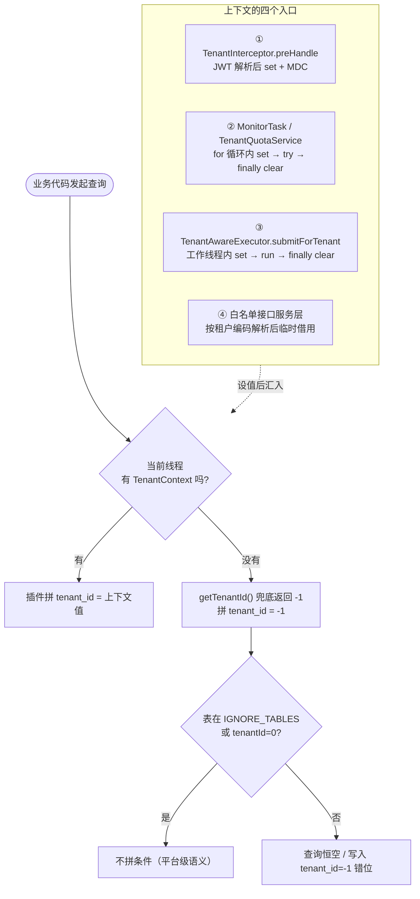

# N2 | 租户上下文与跨线程传递：一个 ThreadLocal 的所有权地图

> 系列第 2 篇。N1 讲了租户插件怎么拼 `tenant_id` 条件，但有一个更基础的问题被刻意留到了本篇：**拼进 SQL 的那个租户 id，究竟从哪来？**
> 答案是 `TenantContext` —— 一个 18 行的 ThreadLocal 包装类。它有多简单，坑就有多深：本系列三个最著名的静默故障（恒空、串租户、假解法）全部与它相关。
>
> 涉及源码：`utils/TenantContext.java`、`interceptor/TenantInterceptor.java`、`task/TenantAwareExecutor.java`、`task/NotifyTask.java`、`task/MonitorTask.java`、`config/MyBatisPlusConfig.java`、`service/UserService.java`、`service/TenantQuotaService.java`、`audit/AuditAspect.java`、`mapper/TeacherPublishedProfileMapper.java`、`tools/check-tenant-cross-thread.mjs`、`api/src/main/resources/application.properties`。

---

## 一、问题背景：上下文是整套隔离的地基

单库多租户架构把「当前操作者是哪个租户」变成了一个**隐形的全局变量**。业务代码从不显式传 `tenant_id`，全靠 `TenantContext` 在幕后供给。这带来了三个工程问题：

1. **谁负责设置？** HTTP 请求、定时任务、白名单接口、公开接口，四类入口的上下文状态完全不同。
2. **谁负责清理？** Tomcat 线程和线程池线程都是**复用**的，上一次请求的租户 id 会残留到下一个任务。
3. **换了线程怎么办？** ThreadLocal 不跨线程，而项目里最慢的操作（逐租户发通知）恰恰必须异步。

先看一张全景表——本项目所有「需要租户上下文」的场景，以及各自的处置：

| # | 场景 | 线程 | 上下文来源 | set / clear 责任方 |
| --- | --- | --- | --- | --- |
| ① | 普通 HTTP 接口 | Tomcat `http-nio-*` | `TenantInterceptor.preHandle` 解析 JWT | 拦截器（preHandle 设 / afterCompletion 清） |
| ② | 定时任务（同步循环） | Spring `sched-*` | 无，循环内显式设 | 任务自己（`set → try → finally clear`） |
| ③ | 定时任务（异步逐租户） | `notify-async-*` | 提交时作为参数传入 | `TenantAwareExecutor`（工作线程内） |
| ④ | 白名单接口（注册/微信注册） | Tomcat | 无，按请求参数解析出租户 | 服务层临时借用（`set → try → finally clear`） |
| ⑤ | 公开接口（分享页/落地页） | Tomcat | 无，且**不应有** | `@InterceptorIgnore` 显式豁免租户条件 |
| ⑥ | 审计日志落库 | `audit-*` 池 | 无，主线程先取好值 | `AuditAspect` 主线程解析，异步只用值 |

**本篇文章要论证的核心主张**：上下文不能靠"隐式传递"（InheritableThreadLocal / TTL / TaskDecorator），必须靠**显式所有权**——谁提交任务，谁把租户 id 作为参数交进去；工作线程自己 set、自己 finally clear。理由不是"这样更优雅"，而是只有这样才**可被静态检查守护**（见第五节守卫）。

最后交代引子。2026-10-09，`NotifyTask`（上课提醒定时任务）从「调度线程内同步发 HTTP」改造为「提交到线程池异步投递」，上线后出现一个诡异故障：

> **任务在跑、日志在打、一条通知都不发，且不报任何错。**

监控全绿，代码能编译，服务正常启动。这个故障长什么样、为什么安静，是本章最重要的案例。

---

## 二、原理：ThreadLocal 为什么不跨线程

### 2.1 ThreadLocal 的本质：每个线程一张私有抽屉

`ThreadLocal` 的常见误解是"这是一个全局变量的容器"。恰恰相反——它的准确语义是：

> 每个线程各持有一份独立的副本，线程之间**互不可见**。

JDK 实现层面，`Thread` 类内部有一个 `ThreadLocals` 字段（类型 `ThreadLocal.ThreadLocalMap`），`ThreadLocal.set(v)` 实际是往**当前线程自己**的 map 里塞一条 `this → v`。于是：

```
线程A: ThreadLocalMap { TenantContext → 16 }
线程B: ThreadLocalMap { }                        ← 空的，不是没初始化，是真的没有这条记录
```

**推论 1**：在 A 线程 `setTenantId(16)` 后切到 B 线程，`getTenantId()` 返回 `null` —— 不是返回 16，也不是抛异常，是安静地返回 null。

**推论 2**：线程池的线程是复用的。如果任务 1 设了值没清理，任务 2 在同一线程上会**读到任务 1 的租户 id**——上一个用户的租户数据算到这一个用户头上，这是跨租户数据泄露，比返回 null 严重得多。

### 2.2 跨线程传递的四种方案

多租户系统绕不开"换线程"，社区有四种解法，逐一对比：

| 方案 | 原理 | 优点 | 致命问题 | 本项目 |
| --- | --- | --- | --- | --- |
| **A. 显式传参** | 提交任务时把 tenantId 作为参数，工作线程自己 set/clear | 所有权清晰、可静态检查、无魔法 | 调用方要改签名 | ✅ 采用 |
| B. InheritableThreadLocal | 子线程**创建时**从父线程复制一份 | 改造最小，一处替换 | **只在创建时复制一次**；池化线程复用后完全不生效，得到"改了没变化"的假象 | ❌ 守卫明令禁止 |
| C. TransmittableThreadLocal（TTL） | 装饰线程池，任务提交时捕获、执行时恢复 | 传递彻底 | 要改**所有** set 点；隐式魔法让"谁在设上下文"变得不可追踪 | ❌ 同上 |
| D. TaskDecorator | Spring 池装饰器，`decorate` 时拷贝、执行前还原 | 与 Spring 集成好 | 表达不了"每租户一个独立上下文"——拷贝的是**同一个**父上下文，而逐租户任务需要的是**每个任务各不相同** | ❌ 语义不匹配 |

为什么 B 是"假解法"值得展开：定时任务线程池（`sched-*`、`notify-async-*`）的线程是**预先创建、长期复用**的。`InheritableThreadLocal` 只在 `new Thread()` 那一刻从父线程拷贝。等工作线程被创建出来、跑第一个任务时，父线程（调度线程）当时的上下文会被永久烙进这个工作线程；之后调度线程再怎么 `setTenantId` 都不会传导过去。症状就是"我明明设了啊"——但数据依旧错位。这种**看起来解决了、实际没解决**的状态，比明确的 null 危险十倍。

D 方案（TaskDecorator）的问题在语义：它拷贝的是"提交那一刻调用线程的上下文"。而 `NotifyTask` 的场景是——调度线程要提交 **N 个不同租户**的任务，每个任务需要**各自不同**的 tenantId。装饰器只能给所有任务同一个父上下文，除非把每个任务的 tenantId 塞进 Runnable 自己带——那绕回来说，不还是显式传参吗？既然如此，不如一开始就显式。

### 2.3 为什么选显式传参：所有权模型

显式方案的所有权契约只有三条，全部可静态验证：

1. **提交时确定**：租户 id 是任务的参数，不依赖调用线程的上下文（调用线程很可能没有）。
2. **工作线程内 set**：`setTenantId(tenantId) → work.run()`。
3. **finally clear**：无论任务体是否抛异常，离开工作线程前上下文必须归零。

这三条恰好就是守卫 `check-tenant-cross-thread.mjs` 检查的三件事（第五节）。**能被静态检查，是选它的真正理由**——其余三个方案的正确性依赖运行时语义和开发者记忆，出了错没有任何工具能发现。

### 2.4 线程池复用的两个方向故障

把"没设"和"没清"放在一起看，故障谱系就完整了：

| 状态 | SQL 实际拼出的条件 | 后果 | 严重度 |
| --- | --- | --- | --- |
| 没 set（读到 null） | `tenant_id = -1`（N1 的兜底） | 查询恒空、写入错位 | 中：可用性故障，用户可见但不泄露数据 |
| 没 clear（残留上一个租户） | `tenant_id = 上一个租户` | **A 租户的任务读写 B 租户的数据** | **高：安全事故，静默越权** |
| clear 不在 finally | 任务抛异常时同"没 clear" | 同上 | 高 |

一个反直觉的结论：**null 兜底 -1 其实救了"没 set"一命**。如果当初兜底设计成 null 就查全量，那"没 set"就不是恒空而是全量泄露。兜底值的选择（恒空而非全量）与上下文的清理义务，是同一套安全设计的两个面。

---

## 三、源码实现：六类场景逐个拆

先看全景图——四类入口、两种责任模式，一张图建立坐标系：



### 3.1 TenantContext：18 行的裸 ThreadLocal

```java
public class TenantContext {
    private static final ThreadLocal<Long> TENANT_HOLDER = new ThreadLocal<>();

    public static void setTenantId(Long tenantId) { TENANT_HOLDER.set(tenantId); }
    public static Long getTenantId() { return TENANT_HOLDER.get(); }
    public static void clear() { TENANT_HOLDER.remove(); }
}
```

三个刻意的设计选择，都有故事：

- **没有 `getOrDefault`**：默认值会诱使调用方"忘了设也能跑"，而这里要的恰恰是没设就恒空的显性失败。
- **`clear()` 用 `remove()` 而非 `set(null)`**：`remove()` 直接把条目从线程的 map 里摘掉，不会残留 `TenantContext → null` 的弱引用链，避免线程长期运行时的内存泄漏争议。
- **静态持有、无单例**：它就是个命名空间，不是对象。

### 3.2 HTTP 请求：拦截器全生命周期（场景①）

`TenantInterceptor` 是全项目**唯一**为普通请求设上下文的地方（`WebMvcConfig` 注册在 `/**`，仅排除 `EXCLUDE_PATTERNS` 白名单路径）：

```java
// preHandle：鉴权 + 设上下文
String token = request.getHeader("Authorization");
if (StrUtil.isBlank(token)) { /* 401 未登录 */ return false; }
Long tenantId = jwtUtil.getTenantId(token);          // 内部 stripBearerPrefix 容忍有无前缀
String userId = jwtUtil.getUserIdFromToken(token);
if (tenantId == null || userId == null) { /* 401 登录态无效 */ }

// 平台管理员（tenantId=0）跳过租户状态校验——sys_tenant 里没有 "platform" 这条记录
if (0L != tenantId) {
    Tenant tenant = tenantService.getById(tenantId);
    boolean invalid = tenant == null || tenant.getDeleted() == 1 || !Integer.valueOf(1).equals(tenant.getStatus());
    if (invalid) { /* 403 租户已停用 */ return false; }
}

TenantContext.setTenantId(tenantId);
MDC.put("tenantId", String.valueOf(tenantId));      // 日志埋点：任何一行日志都能追租户
userSessionService.touch(token);                     // 会话续期，内部节流不是每请求写库
return true;

// afterCompletion：无论 Controller 是否抛异常，出口唯一
public void afterCompletion(...) {
    TenantContext.clear();
    MDC.remove("tenantId");
}
```

三个细节值得注意：

1. **`afterCompletion` 是唯一的清理出口**。Spring 保证它在视图渲染后、异常处理后都会执行——即使 Controller 抛了运行时异常。Tomcat 的 `http-nio-*` 线程是要复用的，少这一行，下一个请求就可能读到上一个请求的租户。
2. **上下文与 MDC 成对出现**。日志里带 `tenantId`，排障时 grep 一下就能看到某个租户的全部请求轨迹；配合 N1 的兜底值，"日志显示租户 16 在跑、库里 tenant_id=-1" 一对比就知道上下文丢了。
3. **拦截器自己读 header、自己解析 JWT**，不依赖 `JwtAuthenticationFilter` 先执行——两个组件各干各的（过滤器管 SecurityContext，拦截器管 TenantContext），互不假设顺序。

### 3.3 定时任务（同步）：for + try/finally（场景②）

定时任务没有 HTTP 请求，`TenantContext` 天然是 null。项目里同步处理的写法统一为「扫出全部租户 → 逐个 set → try → finally clear」，两个样板：

```java
// MonitorTask.snapshotTenantStats（每日 02:05 生成租户月度用量快照）
List<Tenant> tenants = tenantMapper.selectList(wrapper);   // sys_tenant 在 IGNORE_TABLES，无需上下文
for (Tenant tenant : tenants) {
    // 定时任务无 HTTP 上下文，显式设置租户上下文，
    // 否则租户插件按兜底值拼条件，统计结果会恒为 0
    TenantContext.setTenantId(tenant.getId());
    try {
        upsertSnapshot(tenant.getId(), month);
    } finally {
        TenantContext.clear();
    }
}
```

```java
// TenantQuotaService.reconcileAll（每日 03:30 套餐额度对账）
for (Tenant tenant : tenants) {
    TenantContext.setTenantId(tenant.getId());
    try {
        if (reconcile(tenant.getId())) { fixed++; }
    } catch (Exception e) {
        log.warn("租户额度对账失败, tenantId={}, 原因={}", tenant.getId(), e.getMessage());
    } finally {
        TenantContext.clear();     // ← 单租户失败也不能把上下文留给下一个租户
    }
}
```

注意 `reconcileAll` 的结构：**catch 包住业务、finally 包住清理**。单租户对账失败只记日志继续下一个租户，但无论成败，上下文必须还回去。这是"逐租户循环"的标准三段式：`set → try{业务}catch{日志} finally{clear}`。

### 3.4 定时任务（异步）：TenantAwareExecutor（场景③）

同步循环的瓶颈在 `NotifyTask`：每一轮要对每个租户向 message-service 发一次 HTTP，轮耗时 = Σ(各租户 HTTP 耗时)，最坏超过 60s。项目做了两轮改造，正好覆盖两个知识点。

**第一轮，调度池扩容**（`application.properties`）。Spring Boot 的 `TaskSchedulingAutoConfiguration` 默认 `pool.size = 1`——单线程！8 个 `@Scheduled`（`NotifyTask` 1 个 + `MonitorTask` 7 个）全串行在这一条线程上，发通知卡住会连指标采样一起推迟。配置改为：

```properties
spring.task.scheduling.pool.size=4                    # 8 个任务里只有 NotifyTask 与 sampleMetrics 可能长占
spring.task.scheduling.thread-name-prefix=sched-      # 默认 scheduling-1 与业务线程难区分
spring.task.scheduling.shutdown.await-termination=true # 优雅停机：最多等当前轮跑完
spring.task.scheduling.shutdown.await-termination-period=20s
```

`fixedDelay` 语义保证同一任务不会重入（所以 `MonitorTask.lastSampleTime` 这个普通字段不需要加锁）；调大 pool 解决的是**任务之间**的阻塞，不是单轮速度——这是配置注释里专门写明的误区。

**第二轮，逐租户异步化**：`TenantAwareExecutor`，专用、有界、租户感知。

```java
public class TenantAwareExecutor implements DisposableBean {
    private static final int POOL_SIZE = 4;          // 与调度池同量级，不抢业务 HTTP 线程
    private static final int QUEUE_CAPACITY = 64;    // 有界：吸收抖动，不吃光内存

    public TenantAwareExecutor() {
        AtomicInteger seq = new AtomicInteger(1);
        ThreadFactory tf = r -> {
            Thread t = new Thread(r, "notify-async-" + seq.getAndIncrement());
            t.setDaemon(false);                       // 非守护：停机时有被 join 的机会
            return t;
        };
        this.executor = new ThreadPoolExecutor(
                POOL_SIZE, POOL_SIZE, 0L, TimeUnit.MILLISECONDS,
                new ArrayBlockingQueue<>(QUEUE_CAPACITY),
                tf,
                new ThreadPoolExecutor.CallerRunsPolicy());   // 队列满 → 提交者自己跑（背压）
        this.executor.allowCoreThreadTimeOut(false);
    }

    /** 为单个租户提交任务：工作线程内自动 setTenantId → 执行 → finally clear */
    public void submitForTenant(Long tenantId, Runnable work) {
        if (tenantId == null || work == null) {
            log.warn("异步任务参数缺失，已跳过: tenantId={}", tenantId);
            return;
        }
        executor.execute(() -> {
            try {
                TenantContext.setTenantId(tenantId);   // ② 工作线程里设（不是调用线程！）
                work.run();
            } catch (Exception e) {
                // 单租户失败不拖垮池，也不冒到线程池默认处理器
                log.warn("异步任务执行失败: tenantId={}, err={}", tenantId, e.getMessage());
            } finally {
                // ③ 必须 clear：否则线程复用时把数据算到上一个租户头上（跨租户泄露）
                TenantContext.clear();
            }
        });
    }

    @Override
    public void destroy() {   // 优雅停机：最多等 30s，超时 shutdownNow
        executor.shutdown();
        if (!executor.awaitTermination(30, TimeUnit.SECONDS)) {
            executor.shutdownNow();   // 砍掉半途通知，但强于进程直接退出
        }
    }
}
```

`NotifyTask` 的调度线程因此变得极轻——只扫租户、只提交：

```java
@Scheduled(fixedDelay = TICK_MS)   // 60s
public void dispatchLessonReminders() {
    // ...
    List<Tenant> tenants = tenantMapper.selectList(wrapper);   // IGNORE_TABLES 豁免，无需上下文
    List<Long> tenantIds = /* 提取 id */;
    // 逐租户异步投递：注意这里【没有】TenantContext.setTenantId！
    int submitted = tenantAwareExecutor.submitAllForTenants(tenantIds, this::dispatchOneTenant);
    log.info("上课提醒已派发：{} 个租户进入投递队列", tenantIds.size());
}
```

**为什么不用 `@Async`**（类注释里列了三条，每条都对应本项目的一个真实约束）：

1. `@Async` 不传递租户上下文。Spring 的 `TaskDecorator` 能补，但那是把上下文"拷进"子线程；而这里需要的是"每个租户一个独立任务、各自设各自的 id"——装饰器表达不了。
2. `@Async` 标在方法上，而慢操作是 `List<租户>` 循环，注解只能标整个方法，等于没拆。
3. `@Async` 默认与业务 HTTP 线程混用池，定时任务慢会拖慢用户请求。

**幂等为什么敢不去重**：`fixedDelay` 约束的是本方法，异步投出去的任务不受约束，可能出现"上一轮异步任务还在跑、这一轮又扫了一遍"。项目刻意不做去重——幂等由数据库唯一键 `uk_dispatch_once(appointment_id, seq, receiver_user_id, dedup_key)` 保证，`NotifyDispatchService` 靠"先插流水、撞键就跳过"（catch `DuplicateKeyException`）天然幂等。再加一层内存去重只会引入"上一轮还在跑、这轮被跳过 → 通知延迟"，两个真相源反而更危险。

**拒绝策略选 CallerRuns** 而不是 Abort/Discard：队列满时由**提交者（调度线程）自己跑**这一条，看起来"退化成同步"，实际是最安全的降级——不丢任务，施加背压让调度线程变慢，而不是静默丢弃通知。

### 3.5 白名单接口：临时借用（场景④）

注册接口在免登录白名单里，`TenantInterceptor` 被排除，请求到达 Service 时上下文是 null。但注册**必须**知道租户（查重要按租户隔离、额度要记到租户头上）。`UserService.Register` 的写法是"临时借用"：

```java
Long regTenantId = TenantContext.getTenantId();        // 已登录管理员在后台添加用户时取上下文
String regRole = user.getRole() == null ? "student" : user.getRole();
if (RoleConst.PLATFORM_ADMIN.equals(regRole)) {
    regTenantId = 0L;                                  // 平台管理员固定 0，与登录分支对齐
} else if (regTenantId == null || regTenantId <= 0) {
    Tenant tenant = resolveTenantByCode(user.getTenantCode());   // 自助注册按租户编码解析
    if (tenant == null) { return Result.fail(403, "租户编码无效或已停用，请检查注册链接"); }
    regTenantId = tenant.getId();
}
user.setTenantId(regTenantId);
// 注册接口在白名单内没有租户上下文，这里显式设置，
// 否则租户插件按兜底值拼接条件，账号查重与额度统计都会失效
TenantContext.setTenantId(regTenantId);
try {
    if (existAccount(user.getAccount(), regTenantId)) { return Result.fail(400, "该账号已注册..."); }
    Result<Object> roleGuard = applyRoleAdmission(user, regTenantId, approvedByAdmin);  // 角色准入
    // ... 密码加密、生成 userId、doRegister
} finally {
    TenantContext.clear();     // 借了就必须还——该方法可能返回普通 Result（非异常），finally 是唯一可靠出口
}
```

`wechatRegister`（微信扫码注册）是同一模式：解析租户 → `setTenantId` → `acquire` 额度 + `insert` + 发 token → `finally clear`。

这类"借用"的纪律：**借用的范围要小到肉眼可审查**——从 set 到 clear 之间只做与租户归属直接相关的读写，不调无关服务（否则无关服务也会在错误上下文里跑）。

### 3.6 公开接口：显式豁免（场景⑤）

分享页、落地页是免登录的对外链接（发给家长的），请求方**没有也不应该有**租户身份。如果放任上下文为 null，插件兜底拼 `tenant_id = -1`，公开页直接死。`TeacherPublishedProfileMapper` 展示了正确姿势：

```java
/**
 * 按教师取「最新已发布版本」——忽略租户隔离。
 * 为什么必须忽略：公开页是免登录的对外分享链接，TenantContext.getTenantId() 为 null，
 * 插件会把 null 兜底成 -1，SQL 被追加 tenant_id = -1，恒不命中——
 * 即便库里确有已发布记录，公开链接也会报「该教师暂无已发布的个人介绍」。
 * 记录自身的归属仍由 teacher_id 精确锁定，不依赖租户条件。
 */
@InterceptorIgnore(tenantLine = "true")
@Select("SELECT * FROM teacher_published_profile WHERE teacher_id = #{teacherId} AND status = 'published' ...")
TeacherPublishedProfile selectLatestPublishedIgnoreTenant(@Param("teacherId") String teacherId);
```

豁免的合法性论证必须写在注释里：**这条查询为什么不需要租户语义**（本案例：归属由 `teacher_id` 精确锁定，链接是发给家长的，家长没有租户身份）。没有这个论证的 `@InterceptorIgnore` 就是越权开口子。N1 讲过豁免的四种典型场景，这里补上判据：豁免是「语义上跨租户」的查询专用工具，不是「图方便」的工具。

### 3.7 审计日志：主线程取值、异步用值（场景⑥）

`AuditAspect` 面对的是另一个问题：审计记录要落库（需要 tenant_id 列），但落库本身在异步线程（`auditExecutor`，2 线程固定池）。它的解法是「**主线程把值取出来，异步只用值**」：

```java
/**
 * 解析租户ID：优先取 Token，其次取租户上下文，都没有则归为 0。
 * 必须在主线程调用（saveAsync 在异步线程，ThreadLocal 取不到）
 */
private Long resolveTenantId(HttpServletRequest request) {
    if (request != null) {
        String token = extractToken(request);
        if (token != null) {
            Long tenantId = jwtUtil.getTenantId(token);      // ① Token 优先：异步线程不依赖 ThreadLocal
            if (tenantId != null) return tenantId;
        }
    }
    Long contextTenantId = TenantContext.getTenantId();      // ② 上下文兜底
    return contextTenantId == null ? 0L : contextTenantId;   // ③ 归 0（平台级）
}

private void saveAsync(AuditLog record) {
    auditExecutor.submit(() -> {
        try { auditLogMapper.insert(record); }               // record 里 tenantId 已是普通字段
        catch (Exception e) { log.error("审计日志保存失败: {}", e.getMessage()); }
    });
}
```

注意审计表**不走租户插件的上下文隔离**——`record` 的 `tenantId` 是主线程解析好的普通字段，insert 时由 `TenantMetaObjectHandler` 或显式 set 带入。这是「值传递替代上下文传递」的通用范式：**跨线程时，把 ThreadLocal 里要用的值在边界上取出，变成普通参数**。它和 `submitForTenant(tenantId, work)` 本质相同——都是显式传值，只是一个传的是"用于设上下文"，一个传的是"直接就是数据"。

---

## 四、踩坑实录：六个真实故障

### 4.1 异步化的静默故障：setTenantId 写错了线程

**故障现象**：`NotifyTask` 异步化上线后，上课提醒一条不发。任务每分钟照跑，日志显示「N 个租户进入投递队列」，`message-service` 的接收记录为空。无异常、无错误日志、监控全绿。

**根因**：改造时 `TenantContext.setTenantId(tenant.getId())` 留在了**调度线程**的循环里（原同步写法就是这样，correct）。异步化后，`work.run()` 跑在 `notify-async-*` 工作线程——工作线程的 ThreadLocal map 里没有这条记录，`getTenantId()` 返回 null，插件兜底拼 `tenant_id = -1`：

```sql
-- 实际执行的 SQL（工作线程内）
SELECT ... FROM appointment WHERE tenant_id = -1 AND ...
```

恒空。查询空 → 没有候选 → `dispatchDueNotifications` 返回 0 → 日志连"本租户共 0 条"都不打（代码里 `sent > 0` 才打日志）——**连"发了 0 条"这个信号都没有**，这是静默的最后一块拼图。

**修复**：删掉调度线程的 set/clear，上下文所有权整体移交给 `TenantAwareExecutor`——提交时 tenantId 作为参数，工作线程内 `set → run → finally clear`。

**通用教训**：**ThreadLocal 的 set 点必须与使用点在同一条线程**。异步化改造时，"原来那行 setTenantId 怎么办"是必答题，答案通常是"删掉它，让执行器负责"。判断方法很简单：问自己"这行代码跑的线程，和后面查库的线程，是同一条吗？"

### 4.2 只 set 不 clear：比恒空严重得多的泄露

**设想故障**：某次改造给 `TenantAwareExecutor.submitForTenant` 加了上下文设置，但漏了 finally clear。前几个租户一切正常——直到线程池复用：`notify-async-1` 跑完租户 16 的任务后归还池中，线程的 ThreadLocal map 里仍烙着 `TenantContext → 16`；下一个提交进来的任务（哪怕是租户 21 的）在这个线程上跑，如果**它自己**的 setTenantId 因为某种原因没执行（比如参数为空被 skip），读写就会落在租户 16 上。

**为什么比 4.1 严重**：恒空是可用性故障——数据没丢、没混，只是没发通知，用户会投诉"没收到提醒"；串租户是**安全事故**——A 租户的操作改写了 B 租户的数据，没有任何用户会察觉，也没有任何日志会记录（日志里两个租户的记录看起来都"正常"）。多租户系统里，**静默的越权比显式的故障更致命**。

**修复与防护**：clear 放 finally；守卫第②条铁律专门检查 `finally{...clear}` 的**位置**（正则要求 clear 在 finally 块内，光有 clear 不够）。

**通用教训**：ThreadLocal 的清理义务与设置义务**同等重要**。判断标准：任何 `setTenantId` 的调用点，视线内必须能看到同一方法的 finally 清理（或明确的文档说明清理在别处）。

### 4.3 InheritableThreadLocal 假解法：改了没变化

**设想故障**：有人嫌每个任务显式传 tenantId 麻烦，把 `TenantContext` 改成继承 `InheritableThreadLocal`，"这样父子线程自动共享"。上线后发现：任务照旧恒空或错位，"我明明设了啊"。

**根因**（2.2 已展开）：`InheritableThreadLocal` 只在子线程**创建那一刻**从父线程拷贝。线程池的工作线程在池初始化时就创建好了，之后的复用完全不触发拷贝。调度线程里再 set 多少遍，工作线程的 map 都不会更新。

**项目处置**：不是写文档劝退，而是**守卫直接禁止**——`check-tenant-cross-thread.mjs` 第④条扫描 `api/.../task/` 下所有 `.java`，一旦出现 `TransmittableThreadLocal` / `InheritableThreadLocal` / `TaskDecorator` 即判红，并要求"若确需引入，必须同时改造所有 setTenantId 调用点，否则更危险（看起来解决了实际没有）"。

**通用教训**：对"隐式魔法"类方案，团队级纪律是**默认禁止、例外需论证**。魔法的成本不在引入那天，而在每个新人每次调试都要重新推理它的边界那天。

### 4.4 注册接口忘借上下文：查重与额度双双失效

**故障现象**（UserService 注释里的历史记录）：某次注册链路改造后，账号查重出现跨租户误判——A 租户已注册的账号，B 租户能重复注册（或反过来，合法注册被拒）；套餐额度统计不计入新用户。

**根因**：注册接口在白名单，无 HTTP 上下文。`existAccount(account, regTenantId)` 与 `tenantQuotaService.acquire` 内部依赖插件拼 `tenant_id`。上下文为 null → 兜底 -1 → 查重查询恒空（"没注册过"）→ 重复账号落库；额度表的 where 同样恒空 → 计数不动。

**修复**：3.5 节的临时借用模式——解析出 `regTenantId` 后显式 `setTenantId`，`try` 内做全部读写，`finally clear`。

**通用教训**：**白名单接口 = 无上下文接口 = 用库前先问"我的 tenant_id 从哪来"**。这类接口的租户来源只有两种：请求参数里的租户编码（注册链接携带），或已登录管理员的上下文（后台添加用户）。两条路都要走"显式借用"，没有第三条路。

### 4.5 公开页被 -1 杀死：兜底值不是 null

**故障现象**：教师分享页（`teacherPublishedProfile.html`）打开后提示「该教师暂无已发布的个人介绍」，但数据库里 `teacher_published_profile` 确有 `status='published'` 的记录。

**根因**：公开页免登录 → 无上下文 → 插件兜底 `tenant_id = -1` → 恒不命中。注意这里的表**有** `tenant_id` 列（按租户隔离的业务表），所以逃不出插件的条件拼接。

**修复**：`@InterceptorIgnore(tenantLine = "true")` 显式豁免，归属由 `teacher_id` 精确锁定（3.6 节）。

**通用教训**：**「兜底 -1」对普通接口是安全阀，对公开接口是杀手**。设计公开端点时先分类：这条查询需要租户语义吗？需要 → 走临时借用（4.4）；不需要 → 走豁免（本节），并在注释里写下不需要的理由。

### 4.6 clear 不在 finally：异常路径的残留

**设想故障**：某次重构把清理写成这样：

```java
TenantContext.setTenantId(tenantId);
try {
    work.run();
} catch (Exception e) {
    log.warn("失败: {}", e.getMessage());
}
TenantContext.clear();     // ← 不在 finally
```

`work.run()` 正常时一切正确；一旦抛异常被 catch 住，`clear()` 被跳过，上下文残留在复用线程上——下一位受害者就是 4.2。

**防护**：守卫第②条用正则 `finally\s*\{[\s\S]*?TenantContext\.clear\(\)` 校验位置，clear 存在但不在 finally 里同样判红，报错信息直指后果："任务体抛异常时 clear 不会执行，租户上下文残留在被复用的线程上"。

**通用教训**：清理代码的默认位置是 finally，没有"因为不可能抛异常所以放外面"这回事——不可能抛异常的代码，放在 finally 里也没有任何成本。

---

## 五、守卫：tenant-xt 与它的反向测试

前面每个坑都有一条守卫规则兜底。`tools/check-tenant-cross-thread.mjs`（`npm run check:tenant-xt`）校验四条铁律：

| # | 规则 | 防的坑 |
| --- | --- | --- |
| ① | `NotifyTask` **不得**直接调用 `TenantContext.setTenantId/clear`（去注释后用正则扫代码） | 4.1：set 点留在调度线程 |
| ①' | `NotifyTask` 必须真的调用了 `tenantAwareExecutor.submitXxx` | "以为改了"——异步化没落地 |
| ② | `TenantAwareExecutor` 必须同时有 `setTenantId` 与 **finally 内**的 `clear()` | 4.2 / 4.6：残留与泄露 |
| ③ | `MonitorTask` 仍是同步，其 set/clear 是正确的；若检测到异步提交但无 set 则判红 | 同步任务被误改异步 |
| ④ | `task/` 目录下禁止出现 `TransmittableThreadLocal` / `InheritableThreadLocal` / `TaskDecorator` | 4.3：假解法 |

两个工程细节：守卫先用 `codeOnly()` **剥掉块注释与行注释**再匹配——注释里写"这里不设 TenantContext"是正常的文档，不算违规；逃生阀 `SKIP_TENANT_XT=1` 与其他守卫一致。

**为什么这个守卫必须配反向测试**：它守护的是「三无」故障——无异常、无错误日志、无数据异常，只有用户收不到通知。这种故障一旦发生，守卫很可能已经悄悄腐烂成"永远绿"（比如正则失效、文件被重命名），而**没人会发现一个永远绿的守卫有问题**。所以 `tests/check_tenant_cross_thread_guard.js`（`npm run test:tenant-xt-guard`）用 10 个反向用例证明它真会红：

- ② `NotifyTask` 里加回 `setTenantId`（模拟"忘了删"）→ 判红
- ③ 加孤立的 `clear()`（异步化残留）→ 判红
- ④ 删掉提交异步那行（改造没落地）→ 判红
- ⑤ 执行器里删掉 `setTenantId` → 判红
- ⑥ 去掉 finally（clear 不在 finally）→ 判红
- ⑦ 引入 `InheritableThreadLocal`（假解法）→ 判红
- ⑧ `MonitorTask` 检测到异步但无上下文 → 判红
- ⑨ 还原后 exit 0 且**源码零污染**（变异前归一行尾、还原后逐字节校验）
- ⑩ `SKIP_TENANT_XT=1` → exit 0

注意 ⑨：反向测试会临时改源码，还原不是"写回原始字符串"就行——CRLF 毒害（`core.autocrlf=true` 下按 `\n` 写锚点的匹配会静默失败）要求变异前归一化、还原走原始 Buffer，否则测试自己会把源码改花。这是 N23（测试体系与排障实录）的主题，这里先埋个伏笔。

---

## 六、落地 Checklist

把本篇压缩成一张可执行的核对清单。新增/改动任何"查库的代码"前过一遍：

**上下文来源**
- [ ] 这段代码跑在哪个线程？Tomcat / sched / notify-async / audit / 其他？
- [ ] 该线程的 `TenantContext` 从哪来？拦截器 / 显式 set / 任务参数 / **没有（需要豁免或借用）**？

**set 与 clear**
- [ ] 每个 `setTenantId` 的视线内（同一方法）有 finally 里的 `clear()`？
- [ ] set 的线程 === 查库的线程？（异步边界上，set 必须搬进工作线程）
- [ ] 逐租户循环是标准三段式：`set → try{业务}catch{日志} finally{clear}`？

**跨线程边界**
- [ ] 提交异步任务时，tenantId 是**显式参数**，不依赖调用线程上下文？
- [ ] 没有引入 InheritableThreadLocal / TTL / TaskDecorator？（守卫会拦）
- [ ] 只需要"值"的场景（审计、统计），是否在主线程取好值、异步只用值？

**豁免与借用**
- [ ] `@InterceptorIgnore` 的注释里写明了"为什么不需要租户语义"？
- [ ] 豁免查询的归属由业务键（teacher_id 等）精确锁定，而不是"查全量"？
- [ ] 白名单接口的租户来源已显式解析（租户编码 / 管理员上下文），且 set→finally clear 包住全部读写？

**验证**
- [ ] `npm run check:tenant-xt` 通过；改动守卫相关代码后 `npm run test:tenant-xt-guard` 10 项全绿？

---

## 下篇预告

**N3 | 租户与套餐三层数据模型：模板 → 租户 → 实例**：上下文解决"当前是哪个租户"，下一篇解决"这个租户有什么套餐、配额怎么计数、对账怎么纠偏"——`sys_package_template`（模板）→ `sys_tenant.package_id`（绑定）→ `sys_tenant_package`（每租户实例）的三层设计，以及 `TenantQuotaService` 的 acquire/release/reconcile 三件套如何在无上下文与有上下文两种场景下都对得上账。

> 本文涉及的所有源码位置与配置均来自项目仓库实测（mybatis-plus 3.5.7 / Spring Boot 3.3.5 / Java 21）。系列导航见第 1 篇文末。
