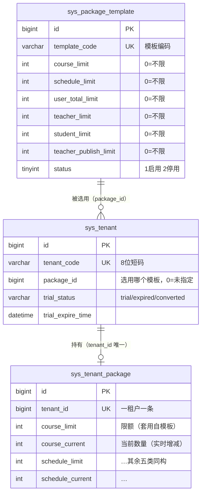

# N3 | 租户与套餐三层数据模型：模板 → 租户 → 实例

> 系列第 3 篇。N1 讲了条件怎么拼，N2 讲了 tenant_id 从哪来，本篇讲**租户的"规格"怎么管**：一个租户能用多少课程、多少老师、多少学生，超限时在哪里被拦住。
> 项目的数据模型分三层：`sys_package_template`（套餐模板）→ `sys_tenant.package_id`（租户选用的模板）→ `sys_tenant_package`（每租户一条的实例，限额 + 当前数量）。本篇拆解为什么必须三层、额度怎么做到并发安全、对账为什么存在，以及一个藏在注释里的指针语义漂移。
>
> 涉及源码：`entity/PackageTemplate.java`、`entity/Tenant.java`、`entity/TenantPackage.java`、`entity/TenantStatsMonthly.java`、`service/PackageTemplateService.java`、`service/TenantPackageService.java`、`service/TenantQuotaService.java`、`service/TenantService.java`、`service/CourseService.java`、`service/PromoService.java`、`controller/TenantController.java`、`controller/TenantPackageController.java`、`config/MyBatisPlusConfig.java`、`api/sql/schema/20261013-0400-lesson_appointment-schema.sql`。

---

## 一、问题背景：为什么是三层，不是一张表

### 1.1 一张表的反例

最直觉的设计是一张表搞定：`sys_tenant_package(tenant_id, course_limit, course_current, ...)`，每租户一行，限额直接维护。小规模下没问题，三个问题会依次暴露：

1. **模板改版不回填**。平台把「标准版」的课程额度从 10 调到 20，历史租户怎么办？逐行 UPDATE 是平台操作，容易漏、无法审计"这个租户什么时候从哪个版本换过来的"。
2. **限额被手改漂移**。运营给某个租户"特批" 50，直接在实例行上改。三个月后没人说得清这个 50 是特批还是模板如此。
3. **商品目录无处安放**。套餐是要在购买页展示的（名称、编码、状态），这些字段塞进每租户一行的实例表就是冗余。

### 1.2 三层各自回答一个问题



三层职责一句话各记：

| 层 | 表 | 回答的问题 |  cardinality |
| --- | --- | --- | --- |
| 模板（规格） | `sys_package_template` | 「标准版/旗舰版分别是什么规格」 | 全平台少数几行，`uk_template_code` 唯一 |
| 绑定（选用） | `sys_tenant.package_id` | 「这个租户买的是哪个规格」 | 每租户一个指针，`DEFAULT 0` = 未指定 |
| 实例（持有） | `sys_tenant_package` | 「这个租户此刻用多少、上限多少」 | 每租户一行，`uk_tenant_id` 唯一 |

**实例上的限额是模板的"套用快照"**，不是引用。`PackageTemplateService.applyLimitsTo` 把模板的六个限额字段拷到实例行上。这个"拷贝而非引用"是关键决策：模板改版不影响存量租户（想变？走 `switchTemplate`），实例限额允许运营在拷贝基础上微调（`updatePackage`）。

### 1.3 三张表都不走租户插件

一个容易困惑的点：`sys_tenant_package` **有** `tenant_id` 列，但它出现在 `MyBatisPlusConfig.IGNORE_TABLES` 里，与 `sys_tenant`、`sys_package_template`、`sys_tenant_stats_monthly` 并列。原因：这三张表属于**平台管理面**——平台管理员（tenantId=0）要跨租户查询，租户管理员要看自己。若走插件，平台管理员视角下 `sys_tenant_package` 会被短路成"查全量"（`ignoreTable` 对 0 短路），但租户视角又依赖插件拼 `tenant_id`——两种视角在同一张表上打架。

所以隔离策略改为：**插件放行，业务层显式过滤**。所有查询都自带 `tenant_id` 条件（`getByTenantId` 的 `wrapper.eq(TenantPackage::getTenantId, tenantId)`），所有写操作都显式带 tenantId。这符合 N1 的原则：`IGNORE_TABLES` 不只是"平台表"，也包含"语义上平台管理"的表——代价是每次查询都要自己记得带条件，好处是访问路径只有一条，没有插件与显式条件的叠加歧义。

---

## 二、原理：三条设计主线

### 2.1 「0 = 不限」与「无记录 = 不限」

额度系统有两条"不限"语义，分散在三处，必须一起记：

| 语义 | 出现位置 | 行为 |
| --- | --- | --- |
| `limit = 0` | 模板与实例的限额字段 | 该类型资源不限额 |
| 无套餐记录 | `sys_tenant_package` 没有该租户的行 | **整个租户**不限额（试用期外的灰度窗口） |
| `tenantId <= 0` | `tryAcquire` 入口 | 平台侧不限额 |

DDL 里六个限额列都是 `NOT NULL DEFAULT '0'`，实体注释统一标注「0=不限」。这条约定让"不限"成为默认值而非特殊值——新租户没建套餐时天然无限额，平台侧（tenantId=0）也不受额度约束。

### 2.2 计数为什么有两套：current 与真实统计

实例行上的 `course_current` 是**增量维护的计数**（每次创建 +1、删除 -1）；`TenantQuotaService.countUsage` 是**实时统计**（`selectCount`）。两套并存的原因是性能：超限校验在每次创建时都要跑，不能每次都扫全表 count。

但增量计数会漂移——异常回滚的边界情况、手工改库、漏调 release。所以系统引入**对账**（`reconcile`）：把 current 校正为真实统计值。这就是第二套计数的用途：**current 用于快速校验，countUsage 用于真相仲裁**。

一条重要的分工纪律写在代码注释里：`reconcile` 的偏差日志用 `type.name()`（枚举名，中性）而不是 `type.getLabel()`（用户话术，按当前租户渲染术语）——「同一事件在不同租户下显示成不同文字，不利排障」。这是日志可观测性与前端话术的分离。

### 2.3 并发安全：为什么必须是条件 UPDATE

超限校验的本质是「检查并递增」（check-and-increment）。天真的写法是先查后改：

```java
// 错误示范：先查后改
TenantPackage pkg = getByTenantId(tenantId);
if (pkg.getCourseCurrent() + 1 > pkg.getCourseLimit()) throw ...;
update(pkg.setCourseCurrent(pkg.getCourseCurrent() + 1));
```

两个线程同时读到 `current=9, limit=10`，双双通过校验，双双 +1 → 实际 11，超卖 1。这和座位超卖（N12 的主题）是同一类竞态，解法也同源：**把校验下推进 UPDATE 的 WHERE 子句，让数据库行锁来裁决**。

```sql
UPDATE sys_tenant_package
SET course_current = course_current + 1
WHERE tenant_id = 16
  AND (course_limit = 0 OR course_current + 1 <= course_limit)
```

影响行数 = 0 即被拒。数据库对同一行的 UPDATE 串行化，`course_current + 1 <= course_limit` 的判断在持锁状态下进行，竞态窗口为零。

---

## 三、源码实现：从模板到实例的完整链路

### 3.1 模板层：`PackageTemplateService`

模板 CRUD 本身平淡，两个设计点值得记录：

**删除保护**（`deleteTemplate`）：模板被租户引用时拒绝删除，先 `countTenantUsing` 统计：

```java
long used = countTenantUsing(id);   // wrapper.eq(Tenant::getPackageId, templateId).eq(deleted, 0)
if (used > 0) {
    throw new BusinessException("仍有 " + used + " 个租户选用该模板，请先变更这些租户的套餐");
}
```

注释还交代了级联登记的结论：`cascade: none`——无引用时 `sys_package_template` 是叶子表，"租户侧存的是 package_id 指向模板，但那条路径已被这个前置校验堵住"。这是 CascadeRules 的正确用法：**能用前置校验堵住的引用，不劳级联删除大驾**。

**套用语义**（`applyLimitsTo`）：模板 → 实例的字段拷贝，`nz()` 把 null 归 0。只碰 limit 字段，不碰 current——注释「不覆盖当前数量」是实例层铁律的一部分。

### 3.2 实例层：`TenantPackageService`

三条铁律，全部有代码强制：

```java
public Long insertPackage(TenantPackage pkg) {
    if (pkg.getTenantId() == null) throw new BusinessException("租户ID不能为空");
    if (tenantService.getById(pkg.getTenantId()) == null) throw new ResourceNotFoundException("指定租户不存在");
    if (getByTenantId(pkg.getTenantId()) != null) throw new BusinessException("该租户已存在套餐记录，请直接修改");
    resetCurrent(pkg);   // current 一律从 0 开始，不接受调用方传入
    defaultLimit(pkg);   // limit 缺省 0（不限）
    tenantPackageMapper.insert(pkg);
    ...
}
```

1. **一租户一条**：`insertPackage`/`createFromTemplate` 都先查 `getByTenantId`，已存在即抛。DB 层还有 `uk_tenant_id` 唯一键兜底。
2. **current 不可由调用方设定**：`resetCurrent` 无条件清零；`updatePackage` 更狠——把 exist 的六个 current 值覆盖回 pkg：

```java
// updatePackage：不允许变更租户归属与当前数量
if (pkg.getTenantId() != null && !pkg.getTenantId().equals(exist.getTenantId())) {
    throw new BusinessException("不允许变更套餐所属租户");
}
pkg.setTenantId(exist.getTenantId());
pkg.setCourseCurrent(exist.getCourseCurrent());   // 六个 current 全部回填 exist 值
// ... limit 字段 null 才回落 exist
```

这条铁律防的是**前端篡改**：管理界面只应改限额，若 DTO 里夹带 current 或 tenantId，服务层直接无视。`updatePackage` 是"显式白名单更新"的样板——可改的（limit）null 回落，不可改的（tenantId/current）强制覆盖。

3. **删除是叶子**：`deletePackage` 注释登记 `cascade: none`，并说明"删除后该租户视为不限额"——删除不是软删除，是回到 2.1 的"无记录 = 不限"语义。

### 3.3 额度原子占用：`tryAcquire` / `release`

核心方法，全文最值得逐行读的一段：

```java
public boolean tryAcquire(Long tenantId, QuotaType type, int delta) {
    if (tenantId == null || tenantId <= 0 || delta <= 0) {
        return true; // 平台/未识别租户不限额
    }
    if (getByTenantId(tenantId) == null) {
        return true; // 未配置套餐 = 不限额
    }
    String cur = type.currentColumn;   // 枚举内部常量，非用户输入
    String lim = type.limitColumn;
    UpdateWrapper<TenantPackage> uw = new UpdateWrapper<>();
    uw.setSql(cur + " = " + cur + " + {0}", delta)
      .eq("tenant_id", tenantId)
      .apply("(" + lim + " = 0 OR " + cur + " + {0} <= " + lim + ")", delta);
    int rows = tenantPackageMapper.update(null, uw);
    if (rows == 0) {
        log.info("额度占用被拒, tenantId={}, type={}, delta={}", tenantId, type.name(), delta);
    }
    return rows > 0;
}
```

四个细节：

- **列名来自枚举常量**。`QuotaType` 枚举把 `currentColumn`/`limitColumn` 写死在定义里（`COURSE("course_current", "course_limit", "{course}")`），拼进 `setSql` 的不是用户输入，无注入面。注释专门声明了这一点。
- **两个短路在最前面**。平台（tenantId<=0）与无套餐记录直接 `return true`——注意短路发生在**任何 SQL 之前**，不是 UPDATE 影响 0 行的模糊语义。
- **`limit = 0 OR ...`** 把「0=不限」编进 WHERE，不限的类型不参与比较。
- **`rows == 0` 记 info 而非 warn**。超限是正常业务结果（用户买满了），不是系统故障。

`release` 是同构的反操作，多一道防负：

```java
uw.setSql(cur + " = " + cur + " - {0}", delta)
  .eq("tenant_id", tenantId)
  .apply(cur + " >= {0}", delta);   // 当前数量不足 delta 时不减，防止负数
```

`current >= delta` 这个条件让 release 天然幂等且防过冲——重复调用第二次时 `current` 已减过，条件不成立，`rows=0`，静默跳过。

### 3.4 业务入口：acquire 与业务写入同事务

`TenantQuotaService.acquire` 只是 `tryAcquire` 的薄封装，失败即抛：

```java
public void acquire(Long tenantId, QuotaType type) {
    if (!tenantPackageService.tryAcquire(tenantId, type, 1)) {
        throw new BusinessException(type.getLabel() + "数量已达套餐上限，请联系管理员升级套餐");
    }
}
```

注意异常话术走 `type.getLabel()`——这是 `TermMsg.t(label)` 的术语渲染结果（`{course}` 会按当前租户的行业话术渲染成「课程」或律师行业的对应词）。**用户看到的提示是按租户语言/术语定制的，日志用 name()**，又是 2.2 的分工。

调用方的纪律是「acquire 与 insert 同事务」：

```java
// CourseService.addCourse
@Transactional(propagation = Propagation.REQUIRED, rollbackFor = Exception.class)
public Map<String, String> addCourse(Course course) {
    // ...模板校验
    Long tenantId = TenantContext.getTenantId();     // N2：上下文来租户
    tenantQuotaService.acquire(tenantId, TenantQuotaService.COURSE);   // 超限抛异常 → 整个事务回滚
    course.setCourseId(UUID.randomUUID().toString().replace("-", ""));
    courseMapper.insert(course);
    ...
}
```

顺序不能反：先 acquire 后 insert。acquire 抛出的 `BusinessException` 让 `@Transactional` 回滚，额度不会出现"占了没写"。反过来若先 insert 后 acquire，插入成功但额度超限抛异常，回滚虽然也能撤销插入，但异常路径更绕。`UserService.Register` 里 USER/TEACHER/STUDENT 的多次 acquire、`CourseScheduleService` 的 SCHEDULE、`TeacherPublishedProfileService` 的 TEACHER_PUBLISH，都是同一个模式。

### 3.5 换模板：`switchTemplate` 的完整事务

```java
@Transactional(propagation = Propagation.REQUIRED, rollbackFor = Exception.class)
public Long switchTemplate(Long tenantId, Long templateId) {
    PackageTemplate template = packageTemplateService.getById(templateId);
    if (template == null) throw new ResourceNotFoundException("指定的套餐模板不存在");
    TenantPackage pkg = tenantPackageService.getByTenantId(tenantId);
    if (pkg == null) {
        return tenantPackageService.createFromTemplate(tenantId, templateId);   // 没实例直接按模板建
    }
    validateAgainstTemplate(tenantId, template);        // 降级校验：已用量不得超新限额
    packageTemplateService.applyLimitsTo(template, pkg);
    // 只更新限额，不触碰当前数量
    TenantPackage update = new TenantPackage();
    update.setId(pkg.getId());
    update.setCourseLimit(pkg.getCourseLimit());         // 六个 limit 显式拷贝
    // ...
    tenantPackageMapper.updateById(update);
    tenantService.changePackage(tenantId, templateId);   // 更新 sys_tenant.package_id 指针
    return pkg.getId();
}
```

三个决策：

1. **降级校验用真实统计而非 current**。`validateAgainstTemplate` 内部对六类资源逐一 `check(template.getXxxLimit(), countUsage(tenantId, type), type)`——`countUsage` 是实时 `selectCount`。若用 current，漂移会让校验失真（current 偏高误拒、偏低放过超限租户）。用真实值，`current > limit` 才抛。
2. **限额更新用全新实体**。不是 `updateById(pkg)`（pkg 带着 current，有覆盖风险），而是构造只含 id + 六个 limit 的 update 对象。又是 3.2 铁律的延续：**改限额的路径上物理上碰不到 current**。
3. **最后才动指针**。`changePackage` 更新 `sys_tenant.package_id` 放在实例限额落库之后——若中途抛异常，整个事务回滚，不会出现"指针指向新模板、限额还是旧的"的中间态。

### 3.6 用量视图：`getUsage` 与告警阈值

```java
int warn = sysConfigService.getInt(SysConfigService.KEY_QUOTA_WARN, 80);     // 80%
int danger = sysConfigService.getInt(SysConfigService.KEY_QUOTA_DANGER, 95); // 95%
// fill()：limit = pkg == null ? 0 : limitOf(pkg, type)
//        percent = (limit <= 0 || current == 0) ? 0 : min(999, current*100/limit)
dto.setQuotaLevel(pkg == null ? "unlimited" : "normal");
if (maxPercent >= danger) dto.setQuotaLevel("danger");
else if (maxPercent >= warn) dto.setQuotaLevel("warn");
```

注意 `unlimited` 与 `normal` 的区分粒度：无套餐记录是租户级 unlimited，某类资源 limit=0 只影响该类 percent（算 0）。百分比上限 999 的钳位防的是 limit 极小（比如 1）时的展示爆炸。

### 3.7 对账与快照：N2 与 N3 的交叉点

`reconcile` / `reconcileAll` 已在 N2 作为上下文样板出现过，这里补额度视角：`reconcileAll` 的注释把风险说得很直白——「否则租户插件会按兜底值拼接条件，导致统计恒为 0（**进而把额度误清零**）」。current 被纠成 0 意味着该租户从此可以无限创建（校验永远通过），这是比"恒空"更隐蔽的事故——数据没丢，限额静默失效。上下文纪律在这里不只是防查询为空，是防**纠错机制本身作恶**。

快照侧（`buildMonthlySnapshot`）统计 teacher/student/course/schedule/booking 五类，由 `MonitorTask.snapshotTenantStats` 每日 02:05 落 `sys_tenant_stats_monthly`，「与上月的变化」以上月快照为基准——所以快照必须**早于**当月任何统计口径调整，这是 cron 定在凌晨的原因之一。

### 3.8 试用套餐与缴费钩子

推广路径自助建租户时（`PromoService.registerTenant`），套餐是**配置驱动直接建实例**，不走模板：

```java
TenantPackage pkg = new TenantPackage();
pkg.setTenantId(tenantId);
pkg.setCourseLimit(sysConfigService.getInt("promotion.trial.course.limit", 5));
pkg.setScheduleLimit(0);   // 不限
pkg.setUserTotalLimit(sysConfigService.getInt("promotion.trial.user.limit", 10));
pkg.setTeacherLimit(0); pkg.setStudentLimit(0); pkg.setTeacherPublishLimit(0);
Long pkgId = tenantPackageService.insertPackage(pkg);
tenantService.bindPackage(tenantId, pkgId);
```

「先建套餐再建账号」的顺序注释写明了原因：让首管理员的名额占用走额度校验（`Register` 内部 acquire USER 时套餐行已存在）。试用期默认 14 天（`promotion.trial.days`）。

缴费成功的钩子链在 `TenantController.changePackage`：

```java
permissionCheck.checkPlatformAdmin(token);
tenantQuotaService.switchTemplate(id, templateId);       // 主流程
try {
    promoService.onPaid(id);                            // 记账：conversion 置 paid、推广业绩 +1
} catch (Exception e) {
    log.warn("推广缴费记账失败（不影响套餐变更）, tenantId={}, err={}", id, e.getMessage());
}
```

`promoService.onPaid` 内部 `tenantService.markTrialConverted`，而后者是**条件更新**：

```java
uw.eq(Tenant::getId, id)
  .eq(Tenant::getTrialStatus, "trial")      // 只从 trial 推进
  .set(Tenant::getTrialStatus, "converted");
```

幂等：重复调用第二次时 `trial_status` 已是 `converted`，WHERE 不命中，`rows=0`。这是「状态机单调推进 + 条件更新」的标准式，N19（推广双码）会完整展开。

---

## 四、踩坑实录

### 4.1 `package_id` 指针语义漂移：一列，两种解读

这是本篇最值得写的坑，因为它**此刻无害，但无害靠的是巧合**。

三份「文档」对 `sys_tenant.package_id` 指向谁，给出了不同答案：

| 来源 | 说法 |
| --- | --- |
| DDL 注释（schema dump） | 「套餐模板ID（`sys_package_template.id`，0=未指定模板）」 |
| `TenantQuotaService` 类注释 | 「`sys_tenant.package_id` —— 租户选用的「套餐模板ID」」，`getTemplateOfTenant` 也确实走 `packageTemplateService.getById(tenant.getPackageId())` |
| `Tenant` 实体字段注释 | 「关联套餐ID（`sys_tenant_package.id`，0=未指定套餐即不限额）」 |
| `PromoService.registerTenant` 实际代码 | `tenantService.bindPackage(tenantId, pkgId)` —— `pkgId` 是 **`sys_tenant_package.id`**（上一段刚 `insertPackage` 拿到的） |

也就是说：**平台管理员路径**（`TenantController.changePackage` → `switchTemplate` → `changePackage(id, templateId)`）往里存的是模板 ID；**推广自助路径**往里存的是实例 ID。而读取侧 `getTemplateOfTenant` 只按模板 ID 解析——一个推广来的租户查 `getTemplateOfTenant`，会拿 `sys_tenant_package.id`（比如 31）去 `sys_package_template` 里查，当前返回 null（模板 id 空间是 1–4，dump 显示 `AUTO_INCREMENT=5`；实例表 `AUTO_INCREMENT=31`）。

**为什么现在没出事**：两个表的自增 id 空间不重叠，查不到而已。**什么时候会出事**：哪天模板表 id 涨到 31+（模板建建删删完全可能），某个推广租户的 `package_id=31` 就会被误读成"选用了 31 号模板"——`getTemplateOfTenant` 返回一个错误的模板，任何依赖"租户选用什么规格"的展示都会张冠李戴。

**通用教训**：**一个指针列只能有一种语义**。三层模型里 `sys_tenant` 上的 `package_id` 到底指向模板还是实例，必须在字段注释、类注释、DDL 注释、所有写入点四方统一。修复方向（留作 TODO，不改代码）：要么试用路径也建一个「试用模板」行并绑模板 ID（保持"package_id 永远指向模板"），要么把实体注释改成实例语义并给 `getTemplateOfTenant` 加存在性校验。**当两份注释说法不一，以 DDL 和实际行为为准，但别让这种状态存活**——它不会报错，只会在某个凌晨悄悄给出错误答案。

### 4.2 对账把额度"纠"成 0：纠错机制作恶

设想 `reconcileAll` 在某个线程上没有租户上下文（N2 的场景）：`countUsage` 恒 0，`reconcile` 逐类型比对 `real(0) != cur(N)`，然后**理直气壮地把 current 全部更新为 0**。日志还会打一堆「套餐额度对账发现偏差」——看起来像正常校正。

后果：该租户 current 归零，此后所有 `tryAcquire` 的 `current + delta <= limit` 永远成立，**限额静默失效**，直到次日对账再次"纠正"（如果那时上下文正常，会把 current 纠回真实值，掩盖事故）。

这就是为什么 `reconcileAll` 的注释把"恒 0 → 误清零"单独拎出来说。**通用教训：凡是以"校正"为职责的代码，必须假设自己的输入可能是垃圾**。校正型任务比查询型任务更需要上下文纪律——查询恒空只是没数据，校正恒空是主动破坏数据。防御上除了上下文三段式，还可以给 reconcile 加"真实值全为 0 且记录值非 0 时拒绝校正并告警"的护栏（当前未实现，是可改进项）。

### 4.3 「无套餐 = 不限」的灰度窗口

新租户从 `insertTenant` 到 `insertPackage` 之间有一个窗口（`registerTenant` 里两步相邻，但平台手工建租户时可能间隔很久）。窗口期内 `tryAcquire` 走"无套餐记录 → 不限额"短路——租户可以无限创建。试运营期这是特性（先让人用起来），但对正式付费租户，忘记建套餐 = 忘记限额。

**通用教训**：「缺省即不限」要配合开通流程的原子性。`registerTenant` 把套餐创建和首管理员注册放进同一事务（套餐建失败 → 回滚 → 不留下孤儿租户），是正确的示范；平台侧手工开通则应把 createFromTemplate 设为必填步骤，或在前端用量页对"无套餐"租户显著标注 `unlimited`（`getUsage` 的 `quotaLevel` 已经提供了这个信号）。

### 4.4 降级校验为什么不能用 current

`validateAgainstTemplate` 用 `countUsage` 而非 `pkg.getXxxCurrent()`，前面 3.5 说过理由，这里补一个反例：若某租户 current 因 4.2 类故障偏高（比如 100 门课实际只有 60），用 current 校验会把「降级到限额 80」误拒（100 > 80），运营工单进来手工核数；用真实统计则正确放行（60 ≤ 80）。**校验要用真相，计数只用于快速拦截**——两套计数的分工在任何配额系统里都值得画清楚。

---

## 五、落地 Checklist

**建模**
- [ ] 三层边界清晰：模板只放规格（无 tenant_id）、实例只放"限额快照 + current"、租户只放指针？
- [ ] 指针列（`package_id`）的语义在 DDL 注释、实体注释、所有写入/读取点**四方一致**？
- [ ] 「不限」语义统一：limit=0 / 无记录 / 平台侧三条路径都显式短路？

**并发与事务**
- [ ] 超限校验是条件 UPDATE（`current + delta <= limit` 进 WHERE），不是先查后改？
- [ ] acquire 与业务 insert 在同一 `@Transactional`，且 acquire 在前？
- [ ] release 带 `current >= delta` 防负，重复调用幂等？
- [ ] 改限额的路径物理上碰不到 current 与 tenantId（显式白名单实体）？

**对账与监控**
- [ ] reconcile 的调用线程有租户上下文（N2 三段式）？
- [ ] 考虑过"真实值全 0 时拒绝校正"的护栏？
- [ ] 用量页对无套餐租户展示 unlimited 而非"额度充足"？

**变更与钩子**
- [ ] 换模板是单事务：限额落库 → 指针更新，中途失败不留中间态？
- [ ] 降级校验用真实统计（countUsage）不用 current？
- [ ] 模板删除前 `countTenantUsing` 拦截存量引用？
- [ ] 状态机推进（trial → converted）用条件更新保证幂等？

---

## 下篇预告

**N4 | sys_term 多语言与三级作用域：平台词 → 行业词 → 租户词的命中优先级**：N3 的 `QuotaType.getLabel()` 已经多次引用 `TermMsg.t()` 的术语渲染，下一篇拆 `sys_term` 表的 `language` 字段与「租户 > 行业 > 平台」的三级合并算法——为什么语言优先于作用域、`tenant_id` 在这张表里为什么是"作用域维度"而不是隔离维度、`/term/map` 的合并查询怎么写。

> 本文涉及的所有源码位置与配置均来自项目仓库实测（mybatis-plus 3.5.7 / Spring Boot 3.3.5 / Java 21 / MySQL 8.4）。系列导航见第 1 篇文末。
