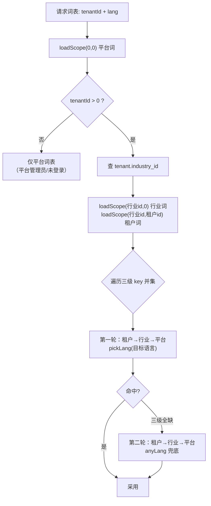
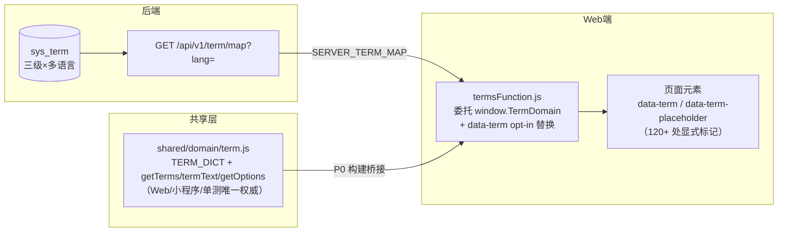

# N4 | sys_term 多语言与三级作用域：平台词 → 行业词 → 租户词

> 系列第 4 篇。前三篇讲隔离（数据按租户切开），本篇讲**反隔离**——有些数据要跨租户共享，还要按行业/租户/语言三个维度变化。
> 「课程」在教育行业这么叫，律师咨询行业叫「咨询话题」，健身行业叫「健身科目」；某个律所还可以自定义成「咨询服务」；英语界面要显示 "Topic"。这套词表系统的完整设计在 `sys_term` 一张表里：三级作用域 × 多语言，外加一条「语言优先于作用域」的合并算法。
>
> 涉及源码：`entity/Term.java`、`service/TermService.java`、`controller/TermController.java`、`utils/TermMsg.java`、`config/MyBatisPlusConfig.java`、`shared/domain/term.js`、`shared/terms.js`、`frontend/js/public/termsFunction.js`、`api/sql/schema/20261013-0400-lesson_appointment-schema.sql`。

---

## 一、问题背景：一套系统，四种行话

预约系统的业务实体是通用的（课次、排期、师生），但**显示词是行业私有的**：

| 行业 | course | teacher | student | lesson |
| --- | --- | --- | --- | --- |
| 教育 | 课程 | 教师 | 学生 | 上课 |
| 法律咨询 | 咨询话题 | 律师 | 咨询者 | 咨询 |
| 心理咨询 | 咨询项目 | 咨询师 | 来访者 | 咨询 |
| 健身 | 健身科目 | 教练 | 训练者 | 训练课程 |

三条路可走，前两条都被现实堵死：

1. **每行业部署一套代码**。四个行业四份分支，任何 bug 修复都要合四次，术语散落在几百个 HTML/JS 文件里——这就是项目早期的真实状态。
2. **前端常量映射**。`TERM_DICT` 写死在 JS 里（今天它仍然存在，但角色变了，见 3.5）。问题：租户想自定义「把学生叫学员」改不了；加语言要发版。
3. **词表入库**。术语变成数据：平台按行业维护、租户可覆盖、按语言取词——`sys_term` 的选择。

需求拆成三个维度，正好对应三级作用域：

- **平台词** `(industry_id=0, tenant_id=0)`：全系统默认兜底，平台管理员维护；
- **行业词** `(行业id, 0)`：平台管理员按行业定制；
- **租户词** `(租户id, 行业id)`：租户管理员自定义/覆盖，优先级最高。

再叠加一个**语言维度**（`language`，ISO 639-1）：同一个 key 同一个作用域可以维护 zh/en/fr 多个版本。

---

## 二、原理：三个关键设计

### 2.1 `tenant_id` 在这张表里不是隔离维度，是作用域维度

这是最容易踩的认知陷阱，值得和 N1 对照着记：

| | 业务表（course/booking…） | `sys_term` |
| --- | --- | --- |
| `tenant_id` 语义 | **隔离维度**：你是谁，就只能看自己的行 | **作用域维度**：这行词归谁管 |
| `tenant_id=0` | 平台管理员（身份） | 平台/行业级词条（哨兵值） |
| 谁来拼条件 | 租户插件自动拼 | **插件放行**（IGNORE_TABLES），业务层显式拼 |
| 查询目标 | 「我的数据」 | 「三级合并后对我生效的词」 |

`sys_term` 在 `MyBatisPlusConfig.IGNORE_TABLES` 里（N1 讲过原因：词表是共享词表，租户端也要消费平台词）。代价是所有查询必须显式带 `industry_id + tenant_id`——`TermService` 类注释把这条纪律写在了醒目位置。

注意 `tenant_id=0` 的**语义分裂**：在租户插件里它是「平台管理员，查全量」；在 `sys_term` 里它是「平台词，租户不可见其专属层但可继承」。同一个字面值在两个上下文里含义不同——读代码时永远要问「这是哪张表的 0」。

### 2.2 合并算法：语言优先于作用域

显示优先级直觉上是「租户词 > 行业词 > 平台词，逐级回退」。加上语言后出现一个真问题。**旧实现**的算法是：按作用域逐级 pick，层内再回退语言：

```
for scope in [租户, 行业, 平台]:
    if key in scope: return pick(scope[key], lang) or any(scope[key])
```

看起来合理，直到健身行业（industry=7）只登记了 `schedule` 的 en/fr 两个版本（没登记 zh）。中文界面的请求走查：租户层没有 `schedule` → 行业层有！→ 层内按 zh 找不到 → 层内 anyLang 兜底 → **返回英文 "Schedule"**。法语租户更糟：行业层有词，层内按 fr 居然找到了（行业层登记了 fr）——但那是行业层的法语，顶掉了平台层的中文词，整句渲染得牛头不对马嘴。

**新实现**（`getTermMap`）把优先级倒过来：**语言优先于作用域**——

```
# 第一轮：目标语言，按作用域链
name = pickLang(tenantScope[key], lang)
     ?? pickLang(industry[key], lang)
     ?? pickLang(platform[key], lang)
# 第二轮：目标语言三级全缺，才 anyLang 兜底（仍然租户 > 行业 > 平台）
name ??= anyLang(tenantScope[key]) ?? anyLang(industry[key]) ?? anyLang(platform[key])
```

设计决策一句话：**词表缺该语言的词，宁可回退到上一级作用域的同语言词，也不要给用户混进另一种语言**。语言一致性高于行业定制——用户看到半个中文半个英文的界面，比看到上一级的统一中文更困惑。

### 2.3 占位符渲染，禁止子串替换

服务端生成的文案（消息通知、报表标题）不经过前端 DOM，`data-term` 机制覆盖不到，需要服务端取词。做法是**模板占位符**：`"正式获得该{course}名额"` → 渲染时把 `{course}` 换成当前租户的词。

为什么**不能**对渲染完的整串做「锚点词 → 行业词」的子串替换：文案里既有模板固定文字，也有动态数据（课次时间、课程名、人名）。若做全局子串替换，动态数据里恰好出现锚点词就被误改——排期名就叫「课程A」，会被改成「咨询话题A」。所以规矩是：**只有模板里显式写出的 `{key}` 参与取词，传入的数据值一律原样保留**。前端 `termsFunction.js` 的 `applyTerms` 立了同样的规矩（只处理 `data-term` 显式标记，绝不做全局文本替换），两端一致。

---

## 三、源码实现：从入库到渲染的完整链路

### 3.1 数据模型

```sql
CREATE TABLE `sys_term` (
  `id` bigint unsigned NOT NULL AUTO_INCREMENT,
  `term_key` varchar(64) NOT NULL COMMENT '词条编码（业务标识，如 course/teacher/student）',
  `term_name` varchar(64) NOT NULL COMMENT '显示词（该作用域下的词汇值）',
  `language` varchar(16) NOT NULL DEFAULT 'zh' COMMENT 'ISO 639-1：zh/en/fr',
  `term_type` varchar(32) NOT NULL DEFAULT 'label' COMMENT 'label/menu/button/tip',
  `industry_id` bigint NOT NULL DEFAULT '0' COMMENT '0=平台级，>0=该行业',
  `tenant_id` bigint NOT NULL DEFAULT '0' COMMENT '0=平台/行业级，>0=租户自定义',
  `sort_order` int NOT NULL DEFAULT '0',
  `status` tinyint NOT NULL DEFAULT '1' COMMENT '1启用 0停用（停用=该级回退下一级）',
  `remark` varchar(255) DEFAULT NULL,
  PRIMARY KEY (`id`),
  UNIQUE KEY `uk_scope_key` (`term_key`,`industry_id`,`tenant_id`,`language`),  -- 四列唯一
  KEY `idx_tenant` (`tenant_id`),
  KEY `idx_industry` (`industry_id`)
) COMMENT='行业专业词汇表';
```

`uk_scope_key` 把「同一作用域同一 key 同一语言只能有一条」钉在 DB 层——应用层 `existsInScope` 是先查校验（返回友好错误），DB 是最后防线。`term_key` 是业务标识（`course`/`teacher`/`classType1`），`term_name` 才是显示词；`term_type`（label/menu/button/tip）给前端按用途筛选留了口子。

### 3.2 `getTermMap`：三级合并的完整实现

```java
public Map<String, String> getTermMap(Long tenantId, String lang) {
    String language = normalizeLang(lang);          // null/空 → zh，统一小写去空白
    // 三级词表：key -> (lang -> name)，逐级加载
    Map<String, Map<String, String>> platform = new LinkedHashMap<>();
    Map<String, Map<String, String>> industry = new LinkedHashMap<>();
    Map<String, Map<String, String>> tenantScope = new LinkedHashMap<>();

    loadScope(0L, 0L, platform);                    // 平台词永远加载
    Long industryId = 0L;
    if (tenantId != null && tenantId > 0) {
        Tenant tenant = tenantService.getById(tenantId);
        if (tenant != null && tenant.getIndustryId() != null && tenant.getIndustryId() > 0) {
            industryId = tenant.getIndustryId();
            loadScope(industryId, 0L, industry);    // 行业词：租户的 industry_id 决定
        }
    }
    if (tenantId != null && tenantId > 0) {
        loadScope(industryId, tenantId, tenantScope);   // 租户词：挂在租户所属行业下
    }

    // 按 key 输出：语言优先于作用域（见 2.2）
    Map<String, String> out = new LinkedHashMap<>();
    Set<String> keys = new LinkedHashSet<>();       // 三级 key 的并集，保持插入序
    keys.addAll(platform.keySet()); keys.addAll(industry.keySet()); keys.addAll(tenantScope.keySet());
    for (String key : keys) {
        String name = pickLang(tenantScope.get(key), language);   // 第一轮：目标语言
        if (name == null) name = pickLang(industry.get(key), language);
        if (name == null) name = pickLang(platform.get(key), language);
        if (name == null) name = anyLang(tenantScope.get(key));   // 第二轮：任意语言兜底
        if (name == null) name = anyLang(industry.get(key));
        if (name == null) name = anyLang(platform.get(key));
        if (name != null) out.put(key, name);
    }
    return out;
}
```

流程图化：



几个实现细节：

- **`loadScope` 带 `status=1` 过滤**：停用的词条根本不进词表，天然实现「停用 = 该级回退下一级」（无需在合并时判断 status）。
- **租户词的 `industry_id` 取租户所属行业**（`resolveTenantIndustry`），不是 0——这样「行业词 + 租户词」的作用域链才连续：租户换行业时，旧行业下的租户词自然失效（`loadScope(新行业, 租户)` 查不到）。
- **`pickLang` 严格不回退**：注释写明「没有该语言就返回 null，回退由调用方按作用域链处理」——语言回退策略集中在 `getTermMap` 一处，不在底层方法里散落。
- **key 顺序用 `LinkedHashSet`/`LinkedHashMap`**：前端首次 `applyTerms` 的遍历顺序稳定，菜单词（`sort_order`）的顺序感保留。
- **平台管理员（tenantId=0/null）只拿平台词表**——不与任何行业/租户词混合，符合「平台视角看基准配置」的语义。

### 3.3 `TermController`：三个角色的权限矩阵

| 端点 | 平台管理员 | 租户管理员 | 未登录 |
| --- | --- | --- | --- |
| `GET /term/map?lang=` | 平台词表 | 三级合并词表 | 平台词表（token 可选，解析失败退回） |
| `GET /term/list` | ✅ 平台/行业词 | ❌ | ❌ |
| `GET /term/tenant/list` | ❌ | ✅ 仅本租户（tenantId 从令牌取） | ❌ |
| `POST /term/insert` | ✅ tenantId 强制 0，scope 由 industryId 决定 | ✅ tenantId **强制为本租户**，industryId 取租户行业 | ❌ |
| `POST /term/update` | ✅ 任意词条 | ✅ 仅本租户词条（exist.tenantId 比对，403） | ❌ |
| `POST /term/copy` | ✅ 行业词批量复制 | ❌ | ❌ |

两个安全设计值得点名：

**`/term/map` 是公开端点**（登录页、小程序未登录时也要渲染行业词）。它在 `WebMvcConfig.EXCLUDE_PATTERNS` 里（N1 讲的「白名单四处同心圆」第四处），token 可选：带合法 token 按租户合并，token 缺失/非法退回平台词表。因为 `sys_term` 不走插件，不存在 N2 的「-1 兜底杀死公开页」问题——这是 IGNORE_TABLES 的又一个甜果。

**租户词的作用域全部服务端派生**：`insert` 时租户管理员的 `tenantId = permissionCheck.getTenantIdFromToken(token)`、`industryId = resolveTenantIndustry(tenantId)`，**不接受客户端传值**。和推广三期的「target 服务端派生」同一模式（N19 展开）：作用域字段永远是安全边界，不能信请求体。

### 3.4 `TermMsg`：静态门面与它的退化哲学

业务代码里 `Result.success(data, msg)` 和 `throw new BusinessException(msg)` 都是静态调用点，拿不到 Spring 容器里的 `TermService`。`TermMsg` 用一个静态 holder 暴露 `t(...)`：

```java
@Component
public class TermMsg {
    private static final String LANG = "zh";          // 项目暂只做中文；多语言改造只改这一处
    private static TermService termService;

    @Autowired
    public void setTermService(TermService svc) { TermMsg.termService = svc; }

    public static String t(String template) {
        if (template == null || template.isEmpty()) return template;
        TermService svc = termService;
        if (svc == null) return template;              // 容器未就绪 → 原样返回，不抛错
        return svc.renderTemplate(template, TenantContext.getTenantId(), LANG);
    }
}
```

四个设计点：

1. **不能加私有构造器**——类必须能被 Spring 扫描实例化，静态字段才有值（setter 注入的代价）。
2. **渲染用哪套词由 `TenantContext` 决定**，与业务代码是否显式传租户无关——请求入口已由 `TenantInterceptor` 设好（N2），异步任务里则由执行器设好。这就是 N2 上下文纪律的「正向价值」场景：术语渲染是隐式依赖上下文的众多业务之一。
3. **容器不可用时原样返回模板**，退化为「未做术语转换」而不是抛异常打断业务——文案问题永远不该阻断主流程。
4. **`LANG` 固定 zh 是明确的已知缺口**：项目尚无「请求语言」上下文，前端靠 `GET /term/map?lang=` 显式传参，后端自己渲染文案时无从得知请求语言。扩展点唯一：`Accept-Language` 解析或让 `TenantInterceptor` 把语言一并放进上下文。注释把这一点写清楚了，避免后人误以为「多语言已完工」。

带动态数据的重载 `t(template, vars)` 把术语词与数据合并进同一张 Map 一次渲染：先 `putAll` 术语词再 `putAll` 动态数据（**后放的优先，调用方显式数据覆盖同名术语 key**），避免「先渲染术语、再插入数据」的两趟陷阱——数据值里若含 `{xxx}` 会被第二趟二次展开。

### 3.5 前端三层：权威源 → 委托 → opt-in 标记

术语体系横跨三个代码位置，职责层层递减：



- **`shared/domain/term.js`**：纯逻辑零依赖，`TERM_DICT` 内置四行业词典（education/legal/counseling/exercise）作**本地锚点兜底**，`getTerms(ctx)` 的规则是「服务端合并词表逐 key 覆盖本地词典」（`Object.assign({}, base, serverMap)`）。语言维度由服务端处理，客户端不感知语言分支。
- **`termsFunction.js`**：Web 端适配层，`getTerms/termText/getOptions` 全部委托 `window.TermDomain`（P0 桥接），自己只做三件事：拉服务端词表（`loadTermMapFromServer`，lang 从 `localStorage.lang` 读，缺省 zh）、`applyTerms` 的 DOM 替换、反归一。
- **`applyTerms` 是 opt-in**：只处理显式标记 `data-term="key"` / `data-term-placeholder="key"` 的元素（`el.textContent = terms[key]`），绝不做全局文本子串替换——理由同 2.3：数据库读出的数值（课程名含「课程」）不能被污染。
- **反归一化**（`normalizeTermText` / `restoreAnchorTerms`）：菜单导航的 `switch` 按文字匹配（`case '课程排期'`），而 `applyTerms` 已把菜单文字换成行业词——匹配前先把行业词还原成锚点词（education 默认词）。替换表按长度降序排列（先长后短，防「课程」先替换掉「课程排期」的前缀）。

### 3.6 批量复制与对账友好的设计

`copyIndustry(from, to)` 把行业词复制到另一个行业，目标已有同 `key|lang` 跳过（不覆盖），返回 copied/skipped 统计——新建行业时的冷启动工具。`existsInScope` 则是唯一键的应用层校验（insert/update 改语言时都要过）。

---

## 四、踩坑实录

### 4.1 语言回退顺序：行业层的其它语言顶掉平台层的目标语言

即 2.2 的健身行业案例。旧实现按「作用域优先、层内回退语言」，症状：中文界面出现英文菜单词、法语租户的句子混进中文。**这个 bug 的隐蔽性在于它只在「部分语言缺词」时出现**——全配齐或全不配都看不出问题，恰是灰度期最容易漏的场景。

修复后的算法（语言优先于作用域）用六行代码解决，但**决策成本在认知**：要先承认「语言一致性 > 行业定制」这条产品级原则，才写得出那个倒过来的循环。代码注释把整个推理过程留在了 `getTermMap` 上方——这是本项目注释的典型风格：**结论会过时，推理过程不会**。

### 4.2 子串替换污染数据：课程名「课程A」的遭遇

早期实现（前端）做过「全局文本替换」：把页面所有文本里的「课程」替换成行业词。直到一个排期名叫「课程A」的页面在律师行业显示成「咨询话题A」——用户以为系统改了数据。修复转向 opt-in 的 `data-term` 标记（今天 120+ 处显式标记就是这么来的），服务端同纪律转向 `{key}` 占位符。

**通用教训**：本地化替换的作用域必须是「模板文本」，不能是「渲染后的全文」。凡是可能混入用户数据的内容，都要假设数据里恰好含有锚点词。

### 4.3 未命中 key：静默清空 vs 保留原文

`renderTemplate` 的替换分支：

```java
String name = (vars == null) ? null : vars.get(m.group(1));
// 命中则取词；未命中保留原文（{key}），便于暴露拼写错误
m.appendReplacement(sb, Matcher.quoteReplacement(name != null ? name : m.group(0)));
```

词表里没有的 key **原样保留 `{key}`**，而不是替换成空串。理由：拼错 key（比如把 `{cource}` 写进模板）在开发/测试期一眼可见；静默清空会让「文案少了一个词」这种故障极难定位——界面看起来只是有点怪。占位符语法还刻意限制为 `\{([A-Za-z][A-Za-z0-9_]*)\}`——key 必须以字母开头、只含字母数字下划线，避免误伤 JSON/正则里的花括号。

### 4.4 静态 holder 的静默退化：测试环境看不到术语转换

`TermMsg.t()` 在 `termService == null`（非 Spring 上下文，如纯单元测试）时原样返回模板。好处是业务不被打断，代价是：**测试环境里断言「返回咨询话题」会静默失败成「返回 {course}」或中文**，而测试还绿着。项目的应对是集成测试走真实 Spring 上下文（`browserless-frontend-itest` 链路起真服务），不依赖单测验证术语。

**通用教训**：静态 holder + 静默退化的组合，必须配至少一条「容器就绪时术语真的生效」的集成测试，否则退化分支会吞掉所有断言。

### 4.5 `status=0` 是「该级停用」，不是「全局删除」

词条停用（`changeStatus` 置 0）后，`loadScope` 的 `status=1` 过滤直接把它排除出词表，该级回退到下一级——比如租户停用自己的「学员」覆盖，界面回到行业词「学生」。删除（物理删除 + 审计）才是彻底没有了。两者服务于不同场景：停用是「 temporarily 让上级话术生效」，删除是「这个词条建错了」。给运营的界面文案必须把区别说清，否则会有人用停用达到删除目的、又困惑为什么词还在列表里。

---

## 五、落地 Checklist

**建模与作用域**
- [ ] `sys_term` 的所有查询显式带 `industry_id + tenant_id`（插件不参与）？
- [ ] 租户词的作用域 `industry_id` 取租户所属行业（不是 0）？
- [ ] 新增词条走 `existsInScope` 预检 + `uk_scope_key` 兜底？
- [ ] 租户词的 `tenant_id`/`industry_id` 全部服务端派生，不信请求体？

**合并算法**
- [ ] 合并顺序是「目标语言按作用域链 → 任意语言按作用域链」（语言优先）？
- [ ] `loadScope` 带 `status=1` 过滤，停用词条不进词表？
- [ ] `normalizeLang` 兜底 zh，统一小写去空白？
- [ ] 平台管理员（tenantId=0/null）只返回平台词表，不与行业词混合？

**渲染纪律**
- [ ] 服务端文案一律 `{key}` 占位符，禁止对整串做子串替换？
- [ ] 未命中 key 保留 `{key}` 原文（不静默清空）？
- [ ] 动态数据与术语词合并进同一 Map 一次渲染（数据 key 优先）？
- [ ] 前端只替换显式 `data-term` / `data-term-placeholder` 标记元素？
- [ ] 菜单等文字匹配逻辑先反归一（行业词 → 锚点词）再匹配？

**多语言缺口（已知，见 3.4）**
- [ ] 后端 `TermMsg.LANG` 仍固定 zh——若要做真正的多语言推送/通知，扩展点是 `Accept-Language` 或上下文带语言，别在各调用点散传 lang？

---

## 下篇预告

**N5 | JWT 双令牌与无感刷新：access + refresh 的协作契约**：词表解决了「同一套系统说不同行业的话」，下一篇回到安全基础设施——短寿命 access token（15 分钟）+ 长寿命 refresh token（7 天）怎么分工、刷新端点为什么必须在白名单里、`user_refresh_token` 表为什么在 IGNORE_TABLES、以及「Bearer 前缀不带就静默 401」那个设计的来龙去脉。

> 本文涉及的所有源码位置与配置均来自项目仓库实测（mybatis-plus 3.5.7 / Spring Boot 3.3.5 / Java 21 / MySQL 8.4）。系列导航见第 1 篇文末。
