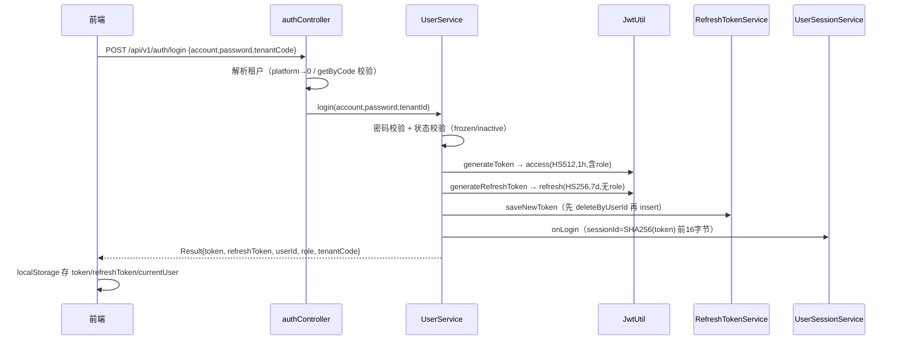
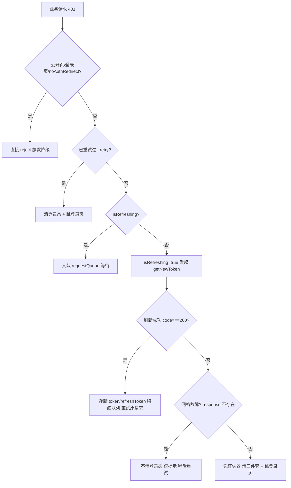

# N5 JWT 双令牌与无感刷新：从「每小时踢一次登录」到可注销的会话体系

> 系列导航：第 1 篇《系统架构设计及原理》｜N1 多租户隔离｜N2 租户上下文｜N3 三层套餐模型｜N4 多语言词表｜**N5（本篇）**｜N6 免登录白名单
> 阅读准备：了解 JWT 基本结构（header.payload.signature），不需要深入 Spring Security。

---

## 1. 问题背景：无状态 JWT 的三个软肋

选 JWT 的理由人人会讲：服务端不存会话、水平扩展无亲和性、跨服务（api 与 message-service）共享同一密钥域即可互验。但真正把系统跑起来之后，JWT 的三个软肋才会一个一个找上门：

| 软肋 | 症状 | 本项目中的具体表现 |
| --- | --- | --- |
| **过期即失效** | access token 到期后用户操作全部 401，正在填的表单被打断 | access token 寿命 1 小时（`jwt.expiration=3600000`），老师下午排课必然跨越至少一次过期点 |
| **无法注销** | 用户改密码、被盗号、管理员踢人，旧 token 在签名有效期内照样通行 | 冻结账号（status=frozen）只挡登录，已发出的 token 挡不住 |
| **载荷裸露** | payload 只是 Base64，role/tenantId 对客户端透明 | 客户端能看到自己是哪个租户的什么角色——这不是漏洞，但意味着**任何「信客户端字段」的设计都是在裸奔** |

业界标准解法是**双令牌（Dual Token）**：

- **access token**：短命（1 小时），每次请求都带，只负责「证明你是你」；
- **refresh token**：长命（7 天），只在刷新接口带，唯一职责是「换一对新令牌」。

本项目在这个标准结构上还叠了三个自己的约束：

1. **多租户**：`tenantId` 必须进两个 token 的 claims——access token 里的 `tenantId` 最终会流向 `TenantContext`（见 N2），refresh token 里的用于刷新时重建上下文；
2. **可注销**：refresh token 必须落库（`user_refresh_token` 表），否则「踢人」只能靠改密钥这种自杀式操作；
3. **单设备登录**：同一用户只保留一个有效 refresh token（`saveNewToken` 先删后插）。

下面按「原理 → 源码 → 踩坑」三段式拆解，**先说结论：这套体系的刷新链路里埋了两个高危疑点**（§4.1 刷新接口取不到租户 ID、§4.2 刷新接口信任客户端角色），都有完整证据链，文末给出修复方案。

---

## 2. 原理：双令牌体系的五个关键决策

### 2.1 两个令牌的分工不是「长短不同」这么简单

| 维度 | access token | refresh token |
| --- | --- | --- |
| 寿命 | 1 小时（`jwt.expiration`） | 7 天（`JwtUtil.REFRESH_EXPIRE`，硬编码常量） |
| 签名算法 | HS512 | HS256 |
| claims | subject(userId) + role + tenantId + iat + exp | subject(userId) + tenantId + exp（**无 role**） |
| 传输方式 | 每个请求的 `Authorization: Bearer ` 头 | 只在 POST `/auth/refreshToken` 的 body 里 |
| 存放 | localStorage（与 refresh 同源，泄露面等同） | localStorage |
| 可否撤销 | 否（无状态，到期自然作废） | **是**（数据库删行即失效） |
| 用途 | 访问业务接口 | 只在刷新接口消费 |

三个容易忽略的设计点：

- **refresh token 不带 role**：刷新时角色从数据库重新解析（理想态），不让长命凭证携带权限信息——少一个泄露维度。实际实现没做到这一点，见 §4.2。
- **算法一个 HS512 一个 HS256**：HS512 需要 64 字节以上密钥，`JwtUtil.initSigningKey()` 做了长度强校验（不足 64 字节直接 `IllegalStateException` 拒绝启动，见 §3.1）；refresh token 用 HS256 没有额外收益，属于历史不一致，不影响安全（同一密钥域）。
- **撤销能力是「伪撤销」**：access token 签发后服务端不记任何状态，踢人只能删 refresh token——**已经发出去的 access token 在最坏情况下还能活到自然过期（≤1 小时）**。这是无状态 JWT 的固有代价，本项目用「access 短命」把这个窗口压到可接受，监控大盘的在线人数则用另一套会话体系补（§3.7）。

### 2.2 刷新必须「旋转」：用旧换新 + 旧票即废

`authController.refreshToken` 的第三步是这套体系的核心：

```
校验旧 refresh（存在 + 未过期）
  → 生成新 access + 新 refresh
  → 删除旧 refresh（removeOldToken）
  → 存入新 refresh（saveNewToken）
```

为什么每次刷新都换新的 refresh token，而不是「一个 refresh 用满 7 天」？因为后者把泄露窗口放大到了 7 天：token 一旦被窃取，攻击者可以拿着它无限续期。旋转（Rotation）+ 旧票即废把泄露窗口压到「检测到异常时旧票已废」。进阶方案还会做「旧票被再次使用 → 判定泄露 → 废除该用户全部凭证」，本项目还没做到这一层（§4.2 会看到，这里还有更基础的问题）。

### 2.3 落库的 refresh token 才配谈「注销」

`user_refresh_token` 表只有四个有效列：`user_id`、`refresh_token`、`expire_time`、时间戳。它承载三个能力：

- **登出**（`logout`）：删当前这一条；
- **踢人**（`kickUser`）：删该用户全部——管理端「强制下线」按钮的实际语义；
- **单设备登录**（`saveNewToken` 先 `deleteByUserId` 再 insert）：新设备登录把旧设备的 refresh 凭证挤掉，旧设备下一个小时到期后被踢。

注意「单设备」是**刷新凭证维度**的单设备：access token 无状态，旧设备手上的 access token 在过期前照样能用。真正的「踢下线」生效时间 ≤ access token 剩余寿命。

### 2.4 前端单飞（single-flight）：并发 401 只刷一次

token 过期瞬间，页面上并发中的请求会**一起**收到 401。如果每个 401 都各自发起刷新：N 个刷新请求互相把对方的 refresh token 旋转掉（旧的被删、新的被后来的旋转覆盖），最后只有一个能成功，其余全部失败——这就是 `utility_request.js` 文件尾注释里记录的「刷新 token 时出现循环：更新、删除、插入一直在重复」。

标准解法是单飞 + 排队（§3.5 有完整代码）：

- `isRefreshing` 全局标志：第一个 401 触发刷新，后续 401 不刷；
- `requestQueue`：排队中的请求保存 `{resolve, reject, fn}`，刷新成功后统一用新 token 重发；
- `_retry` 标记：重发后再次 401 不再刷——防止「刷新成功但新 token 仍被拒」时的嵌套循环。

### 2.5 401 / 403 / 1001：三个「看起来像鉴权失败」的码，三种相反的处理

| 码 | 语义 | 前端动作 | 本项目出处 |
| --- | --- | --- | --- |
| 401 | 未登录 / token 失效 | 刷新 → 重试；刷新失败清登录态跳登录页 | SecurityConfig.EntryPoint、`Result.fail(401,...)` |
| 403 | 已登录但权限不足 | **不刷新**（角色不变，重试还是 403，必成死循环）、不跳转、只提示 | SecurityConfig.AccessDeniedHandler |
| 1001 | 微信侧不可用（secret 未配 / code 失效） | **静默降级**走账号密码登录，不弹错不踢人 | `wechat-login` 返回 `Result.fail(1001,...)` |

1001 这个「非标准码」是踩出来的：最初微信失败走 401，小程序 `request.js` 的 401 分支直接把用户踢回登录页——用户只是没配微信 secret，却被判「登录过期」。**所有「看起来像未登录」的分支都要单独决策，这是 N5 最通用的教训。**

---

## 3. 源码实现：一条请求的完整生命周期

### 3.1 JwtUtil：密钥强校验 + 四组解析方法

```java
@PostConstruct
private void initSigningKey() {
    byte[] keyBytes = secret.getBytes(StandardCharsets.UTF_8);
    if (keyBytes.length < 64) {
        throw new IllegalStateException("jwt.secret 长度不足，HS512 至少需要 64 字节");
    }
    signingKey = Keys.hmacShaKeyFor(keyBytes);
}
```

启动即校验密钥长度，**拒绝用弱密钥启动**——HS512 的安全前提是密钥 ≥ 64 字节，很多教程里 `secret.getBytes()` 直接构造出 32 字节密钥让 jjwt 自己降级到 HS256，安全性悄悄打折。这里选择「不满足就启动失败」。配置侧 `jwt.secret=${JWT_SECRET:...}` 用环境变量注入、文件里只留本机兜底明文（`application.properties:107` 注释明确「生产环境必设 JWT_SECRET」）。

解析侧有一组刻意的「冗余」：

```java
private String stripBearerPrefix(String token) {
    if (token == null) return "";
    return token.replace("Bearer ", "");
}
```

`null → ""` 而不是抛异常，配合 `parseClaimsJws("")` 一定会抛 `IllegalArgumentException`——**这个「把 null 洗成空串再让下游炸」的写法在 §4.1 会变成刷新接口的阿喀琉斯之踵**。另外注意 `replace` 是全局替换：token 中间出现 "Bearer " 字样也会被替换掉（理论上 JWT 的 Base64URL 字符集不含空格，实际无害，但用 `substring(7)` 才是严格写法，`JwtAuthenticationFilter` 里用的就是 substring）。

### 3.2 登录：双签发的完整链路

`authController.toLogin`（`/api/v1/auth/login`）→ `UserService.login`：

```java
// authController.java:93 —— 平台管理员分支
if (PLATFORM_TENANT_CODE.equals(tenantCode) && RoleConst.PLATFORM_ADMIN.equals(role)) {
    tenantId = 0L;   // 固定编码 "platform" 映射到 tenantId=0，与 N1 的 ignoreTable 语义接壤
} else {
    Tenant tenant = tenantService.getByCode(tenantCode);
    boolean invalid = tenant == null
            || (tenant.getDeleted() != null && tenant.getDeleted() == 1)
            || !Integer.valueOf(1).equals(tenant.getStatus());
    if (invalid) return Result.fail(403, "租户编码无效或已停用");
    tenantId = tenant.getId();
}
```

软删除 + 停用双校验（`Integer.valueOf(1).equals` 规避 `status` 为 null 时的 NPE——`tenant.getStatus() == 1` 在拆箱时会炸），失败返回 403 而非 401：租户不可用 ≠ 身份未认证。

`UserService.login` 的签发段：

```java
// UserService.java:372-393
String token = jwtUtil.generateToken(tenantId, user.getUserId(), user.getRole());
resultMap.put("token", token);
String refreshToken = jwtUtil.generateRefreshToken(tenantId, user.getUserId());
resultMap.put("refreshToken", refreshToken);
refreshTokenService.saveNewToken(user.getUserId(), refreshToken, jwtUtil.getRefreshExpireTime());
// 在线统计数据来源
userSessionService.onLogin(token, tenantId, user.getUserId(), user.getRole(),
        currentRequestIp(), currentRequestUserAgent());
```

顺序有讲究：**先落库 refresh token，再返回**——万一 `saveNewToken` 失败（比如 `user_refresh_token` 写入冲突），登录直接失败，不会出现「token 发了但刷不了」的半瘫状态。注册链路（`UserService.Register` 304 行、微信登录 567 行）复用同一段签发代码，四条入口一套语义。

登录时序：



### 3.3 刷新与注销：四个端点一套语义

```java
// authController.java:145-158（有删节，问题行原样保留）
RefreshTokenPO tokenPo = refreshTokenService.checkValidToken(oldRefreshToken);
if (tokenPo == null) return Result.fail(401, "刷新凭证已失效，请重新登录");
String userId = tokenPo.getUserId();
Long tenantId = jwtUtil.getCurrentTenantId();   // ★ 问题行，见 §4.1
String newAccess = jwtUtil.generateToken(tenantId, userId, role);   // role 来自请求体，见 §4.2
String newRefresh = jwtUtil.generateRefreshToken(tenantId, userId);
refreshTokenService.removeOldToken(oldRefreshToken);
refreshTokenService.saveNewToken(userId, newRefresh, jwtUtil.getRefreshExpireTime());
```

- `checkValidToken`：查库 + 过期判断，**过期凭证惰性删除**（顺带清理脏数据）；
- `removeOldToken` + `saveNewToken`：旋转两步，各自独立事务（不同方法），中间失败会留下「旧的已删、新的没插」的空档——该用户被踢去重新登录，属于可接受降级；
- `logout`：`SecurityContextHolder.clearContext()` + 删当前 refresh 凭证 + `userSessionService.onLogout(token)`（**注意传的是 access token 头**，会话 ID 由 access token 派生）；
- `kickUser`（`DELETE /auth/kick/{userId}`）：删该用户全部 refresh 凭证 + 会话全部置 logout，管理端「强制下线」。

### 3.4 前端：独立 axios 实例 + 单飞拦截器

刷新请求**绝对不能走全局拦截器**——否则刷新请求自身的 401 会再次触发刷新，无限递归。解法是独立实例：

```js
// utility_request.js:65-72
const refreshTokenAxios = axios.create({ baseURL: API_BASE_URL, timeout: 10000 });
refreshTokenAxios.interceptors.request.use((cfg) => {
  cfg.url = normalizeUrl(cfg.url);   // 只补 /api/v1 前缀，不注入 Authorization
  return cfg;
});
```

401 拦截器主干（`utility_request.js:376-515`）分四层，配一张流程图：



几个细节是踩出来的，注释里都留了案：

- **凭证失效 vs 网络故障分流**（catch 块 443-471 行）：刷新请求 5xx/超时时 `refreshErr.response` 不存在或非鉴权语义 → 不清登录态。早期版本不区分，服务重启期间所有在线用户被清空登录态，用户体验灾难；
- **跳转锁 `isRedirecting`**：并发 401 会触发多个 `setTimeout` 跳转，加锁只跳一次；
- **`saveLoginRedirect` 白名单**：跳登录前把当前页 URL（只留 pathname+search+hash，正则白名单校验）存起来，登录成功跳回原页——既防开放重定向漏洞，又保体验。

### 3.5 小程序端：同构不同底座

`miniprogram/core/request.js` 与浏览器版行为对齐（`normalizeUrl`、Bearer 注入、单飞、`_retry`），差异只在底座：

- 传输走 `shared/adapters/net.js` 的 `transport`（内部即 `wx.request`）；
- 跳转没有 `location`，用 `getApp().globalData.onAuthFail()` 回调；
- 刷新请求带 `_noAuth: true` 且 `url` 显式 `normalizeUrl(ENDPOINTS.AUTH_REFRESH)`——**裸路径不补 `/api/v1` 会落到 SPA 404 兜底、刷新恒失败**（注释 54-56 行在案）；
- 词表等增强型请求带 `enhance` 标记：遇 401/403 只 reject、不清登录态不跳转——「登录后的增强数据」失败应退回本地兜底词表，而不是把人踢了（这条与浏览器版 `__PUBLIC_LANDING__` 短路是同一个事故的两个补丁）。

### 3.6 会话统计：token 派生的第二体系

在线人数不能只数 refresh 凭证——登出、多 tab、静默过期都会让凭证与真实在线脱节。`UserSessionService` 用 access token 派生会话：

```java
// UserSessionService.java:52-69
public String sessionIdOf(String token) {
    String raw = token.startsWith("Bearer ") ? token.substring(7) : "";
    MessageDigest digest = MessageDigest.getInstance("SHA-256");
    byte[] hash = digest.digest(raw.getBytes(StandardCharsets.UTF_8));
    // 只取前 16 字节（32 个 hex 字符）——会话 ID 不需要全哈希
    ...
}
```

- **`TenantInterceptor` 每个请求调 `touch(token)`**（60 秒节流防写库风暴），续期 `last_active`；
- `countOnline` 按 `monitor.online.idle.minutes`（默认 5 分钟）活跃窗口统计；
- `cleanExpired` 把超窗会话置过期、`cleanHistory` 保留 N 天流水——**注意这两个清理方法目前没有定时任务调用**（`MonitorTask` 只调度了通知类任务），依赖自然过期 + 手动触发，属于待补的运维项。

---

## 4. 踩坑实录：两个高危疑点 + 七个已修复事故

### 4.1 ★ 刷新接口的 tenantId 从哪来？——静态推演：当前实现必炸

`authController.refreshToken:150`：

```java
Long tenantId = jwtUtil.getCurrentTenantId();//.TBD
```

追这条取值链（每步都有出处）：

```java
// JwtUtil.java:205-213
public Long getCurrentTenantId() {
    String token = getCurrentToken();               // ①
    return getTenantIdByRefreshToken(token);
}
public String getCurrentToken() {
    return (String) SecurityContextHolder.getContext().getAuthentication().getCredentials();  // ②
}
```

逐步推演刷新请求（`POST /api/v1/auth/refreshToken`，**不带 Authorization 头**——前端 `refreshTokenAxios` 只补 URL 前缀，小程序 `doRefresh` 带 `_noAuth`）：

1. `JwtAuthenticationFilter.shouldNotFilter` 命中 `WHITELIST_PATHS`（含 `/api/v1/auth/refreshToken`，第 43 行）→ **过滤器整体跳过**，不会写 SecurityContext；
2. `SecurityConfig.permitAll` 放行该路径（第 97-98 行）→ Spring Security 链继续往下走；
3. 链上的 `AnonymousAuthenticationFilter`（未显式 disable）会给 SecurityContext 塞一个匿名认证对象，其 `getCredentials()` 返回 **null**；
4. `getCurrentToken()` 返回 null → `stripBearerPrefix(null)` 返回 `""`（§3.1）→ `parseClaimsJws("")` 抛 `IllegalArgumentException`（jjwt 对空串的固定行为）；
5. `IllegalArgumentException` 不匹配 `GlobalExceptionHandler` 的任何特化 handler（`JwtException` 匹配不上它）→ 落 `handleException` → **HTTP 200 + body.code=500「服务器繁忙」**；
6. 前端拿到 `code!==200` → 走「凭证失效」分支 → 清三件套 + 跳登录页。

**症状推演：access token 每次到期（1 小时），用户不是「无感刷新」而是被踢到登录页**——「无感刷新」名存实亡。而 `//.TBD` 注释说明作者当时也没想清楚这个值该从哪来。

> 取证边界：以上是静态推演，链条上每一跳都有源码出处，但未在运行环境实测（需要等 token 自然过期或手工构造过期 token 调一次刷新接口，看响应体是 500 还是正常双 token）。**动手前先跑这一次实测**，30 秒就能证伪或证实。

修复方案其实现成——**refresh token 自己的 claims 里就带 tenantId**（`generateRefreshToken(tenantId, userId)` 第 81 行写的）：

```java
Long tenantId = jwtUtil.getTenantIdByRefreshToken(oldRefreshToken);  // 已存在的方法，141 行
```

同时 role 也不该信请求体（见 §4.2），应从 `tokenPo.getUserId()` 回查数据库。两行改动，链路立刻自洽：refresh 接口全程只信「库里的旧凭证」一个事实源。

### 4.2 ★ 刷新接口信任客户端 role：能自选角色的提权面

```java
// authController.java:135
String role = refreshDTO.getRole();          // 请求体里客户端传的
// 152 行
String newAccess = jwtUtil.generateToken(tenantId, userId, role);   // 直接进新 token 的 role claim
```

而 `JwtAuthenticationFilter` 用 token 里的 role 构造 `ROLE_xxx` authority，`SecurityConfig` 的 `AuthzRules` 靠这个 authority 做 `hasRole` 判定。结论：**持有有效 refresh token 的客户端，在刷新时可以自选 role**——student 传 `platform_admin`，拿到的 access token 就带 `ROLE_platform_admin`，7 天窗口内每次刷新都能续。服务端授权（denyAll + AuthzRules）本身没被绕过的漏洞，但**判定依据（token 里的 role）被客户端写了**。

同类问题在微信 PC 扫码接口已被立法禁止——`WeChatPcController` 注释原话「userId 服务端从令牌解析，不信客户端参数」。刷新接口应该同标准：`role` 从 `userId` 回查 `user` 表。这与 §4.1 的修复是同一个方法体的两行，一起改。

### 4.3 currentUser 没 JSON.parse：刷新死循环（已修复）

`getNewToken` 从 localStorage 取 `account`/`role` 时直接当字符串用：

```js
const cuser = JSON.parse(cuserStr);   // 修复后
account = cuser && cuser.account;
role = cuser && cuser.role;
```

修复前 `cuser.account` 是 undefined → 刷新请求体缺 account → 后端 401 → 前端又触发刷新 → 死循环（注释 98-99 行在案）。教训：**localStorage 里的对象永远是 JSON 字符串，「取出即用」是常见静默故障源**。

### 4.4 403 绝不能触发刷新

早期拦截器对所有 401/403 都走刷新分支：403 是「已登录但角色不够」，刷新后角色不变、重试还是 403、又触发刷新——无限循环。修复：`status === 401` 才进刷新分支，403 只提示不跳转（327-334 行注释）。

### 4.5 刷新请求混进全局拦截器：递归刷新

`utility_request.js` 文件尾一整段注释就是这次事故的复盘：刷新请求走了全局 `service` 实例 → 刷新失败返回 401 → 被 response 拦截器捕获 → 再次触发刷新 → 「更新、删除、插入一直在重复」。修复即 §3.4 的独立实例。**任何「绕过正常认证流程的特殊请求」，第一决策就是它该走哪条拦截器链。**

### 4.6 jwt.expiration 的 100 小时笔误

`application.properties:110-111` 注释在案：原值 `360000000` 是 100 小时（注释却写「24 小时/1 小时」，三个数字互不相符），2026-10-10 修正为 `3600000`（1 小时）。**安全参数改错一位就是两个数量级，配置项必须配「值 + 注释 + 修正记录」三件套。**

### 4.7 1001 vs 401：微信降级不踢人

§2.5 已展开。补充一条对称教训：`bind-wechat` 失败用 400 不用 401——绑定是已登录态操作，401 会让小程序触发刷新/踢登录，把已登录用户弄丢（`authController.java:276` 注释）。

### 4.8 排队队列不存 reject：Promise 永远 pending

刷新失败时 `requestQueue` 里排队请求的 Promise 如果没有 reject，前端代码 `await` 处永远挂起，UI 转圈到天荒地老。修复：队列项 `{resolve, reject, fn}` 三件套，刷新成功逐个 `fn(newToken)`、失败逐个 `reject`（391-403 行、456-457 行两处）。

### 4.9 clearExpiredToken 写了没人调

`RefreshTokenService.clearExpiredToken()` 全仓无调用点——过期 refresh token 只靠 `checkValidToken` 的惰性删除兜底。用户不再访问的凭证会一直躺在表里。修复：挂一个 `@Scheduled`（参照 N2 的 `sched-` 线程池规范）每天跑一次。

---

## 5. 落地 Checklist

新增/审查认证链路时逐条核对：

**服务端**
- [ ] access token 寿命 ≤ 2 小时，refresh ≤ 14 天，两者都在配置里且注释写明（禁硬编码在方法里当魔术数字——`REFRESH_EXPIRE` 是常量，可接受）
- [ ] 密钥启动时强校验长度（HS512 ≥ 64 字节），生产环境从环境变量注入
- [ ] 刷新接口的 tenantId / role **只从「库里的旧凭证」或数据库解析**，禁止读请求体、禁止读 SecurityContext（刷新端点本身免登录，上下文里没有你想要的任何东西）
- [ ] 刷新成功必须「删旧 + 插新」成对出现；失败路径想清楚空档期的用户体验
- [ ] 登出/踢人删的是 refresh 凭证，并在文档/注释里注明「已签发的 access token 最坏还能活到自然过期」
- [ ] 全局异常处理器对 `JwtException` 有专门映射（401），不要让它落 500——前端靠 code 分流，500 会把「token 过期」误判成「服务器坏了」

**前端 / 小程序**
- [ ] 刷新请求走独立实例/函数，不过全局拦截器、不注入 Authorization
- [ ] 单飞三件套齐全：`isRefreshing` + 队列（存 reject）+ `_retry` 防重
- [ ] 刷新失败区分「凭证失效」（清登录态跳转）与「网络故障」（保留登录态仅提示）
- [ ] 403 不触发刷新；公开页/登录页 401 不跳转（防 index↔landing 死循环）
- [ ] 跳转有锁（并发 401 只跳一次）；跳转前 URL 过白名单（防开放重定向）
- [ ] localStorage 读取对象字段前先 `JSON.parse`
- [ ] 小程序刷新 URL 显式 `normalizeUrl`（裸路径不会自动补 `/api/v1`）

**运维**
- [ ] 过期 refresh token 有定时清理（或至少惰性删除 + 监控表规模）
- [ ] 会话清理任务（`cleanExpired`/`cleanHistory`）已接入调度——目前**未接**，待补

---

## 下篇预告

**N6：免登录白名单的「四处同心圆」**——SecurityConfig.permitAll、JwtAuthenticationFilter.WHITELIST_PATHS、WebMvcConfig.EXCLUDE_PATTERNS、check-authz 的 PERMIT_ALL，四处为什么必须同步、漏一处的两种死法（静默 401 vs TenantInterceptor 裸奔），以及 `/api/v1/message` 前缀为什么被授权守卫跳过。

> 本文所有代码片段取自本仓库实际源码（`api/src/main/java/com/reservation/`、`frontend/js/public/utility_request.js`、`miniprogram/core/request.js`），行号以 2026-10-21 时点为准。§4.1/§4.2 为静态推演结论，修复前请按文中方法实测确认。
