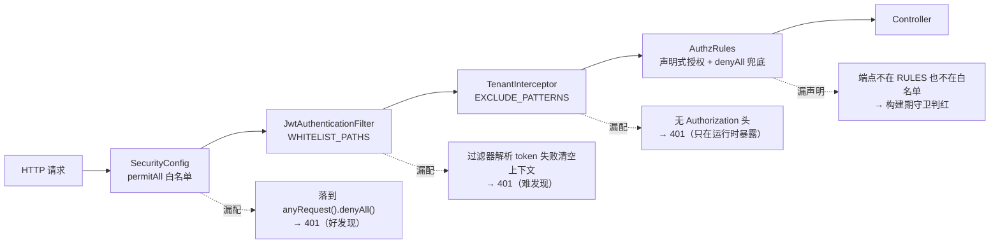

# N6 免登录白名单的「四处同心圆」：一个公开端点要过四道闸，漏一处就死

> 系列导航：第 1 篇《系统架构设计及原理》｜N1 多租户隔离｜N2 租户上下文｜N3 三层套餐模型｜N4 多语言词表｜N5 JWT 双令牌｜**N6（本篇）**｜N7 敏感字段服务级加解密
> 阅读准备：了解 Spring Security 过滤器链与 Spring MVC 拦截器的基本分工（不熟悉也没关系，§2 有一张全景图）。

---

## 1. 问题背景：加一个公开端点，为什么改了四处还没生效？

需求很常见：落地页要匿名访问一个接口。直觉动作是在 Spring Security 里加一行 `permitAll`。然后测试发现——**401**。

继续排查，再改一处；还是 401；再改一处；终于通了。回头看 diff：动了四个文件。

这不是懒或粗心，是架构决定的。本项目的请求生命周期里，**「要不要登录态」这件事被四个互相不知道对方存在的组件各自判定了一次**：



| # | 组件 | 判定问题 | 漏配症状 | 发现时机 |
| --- | --- | --- | --- | --- |
| ① | `SecurityConfig.securityFilterChain` | 这个路径要不要认证？ | 落到 `anyRequest().denyAll()` → 401 | 运行期，请求一次就炸 |
| ② | `JwtAuthenticationFilter.shouldNotFilter` | 这个路径要不要解析 token？ | 带过期/非法 token 调公开端点 → 过滤器解析失败**清空 SecurityContext** → 401 | 运行期，且只在「带脏 token」时炸 |
| ③ | `TenantInterceptor`（WebMvcConfig 排除表） | 这个路径要不要租户上下文？ | 穿过前两层后，拦截器以「无 Authorization 头」为由 401 | **运行期，且前两层越放心越晚发现** |
| ④ | `check-authz-declarative` 守卫的 `PERMIT_ALL` | 这个端点有没有「免登录」的书面记录？ | 端点既不在 RULES 也不在白名单 → 守卫判红 | **构建期**，唯一便宜的一道 |

四处同心圆，名字是白名单，实际是**同一决策的四个副本**。副本必然漂移——这是本项目的血泪定论：2026-10-13 一天之内，`wechat-register` 与推广四个公开端点**两次踩中第三处漏配**（`WebMvcConfig.java` 注释第 17-22 行在案）。

---

## 2. 原理：每道闸为什么不能合并

### 2.1 四道闸分属四个不同的框架层，谁也替不了谁

| 层 | 组件 | 技术定位 | 为什么必须有自己的名单 |
| --- | --- | --- | --- |
| Servlet Filter | `SecurityConfig` | Spring Security 授权链的入口 | 它回答「认证」，且兜底策略（denyAll）只有它知道 |
| Servlet Filter | `JwtAuthenticationFilter` | 自定义认证过滤器，插在 `UsernamePasswordAuthenticationFilter` 前 | 它回答「解析 token」。**它跳过与 Security 放行是两回事**：Security 放行了，过滤器照样会把脏 token 解析失败并清空上下文 |
| HandlerInterceptor | `TenantInterceptor` | Spring MVC 拦截器，全路径注册 | 它回答「租户上下文」。没有 token ≠ 认证失败——公开端点压根不该有租户上下文 |
| 构建期脚本 | `check-authz-declarative.mjs` | Node 静态扫描 Controller 端点 | 它回答「书面记录」。前三处是运行时行为，它把漂移挡在提交前 |

关键认知：**「Security 放行」≠「不过滤器」≠「不建租户上下文」**。Security 的 `permitAll` 只是授权决策，JwtFilter 的 `shouldNotFilter` 是过滤器自治，TenantInterceptor 的排除表是 MVC 层自治——三个框架层三套路径匹配机制，没有共享配置的官方通道。硬要合并（比如只配 Security 一处）的尝试在本项目早期就失败了：`wechat-register` 一期只加了 SecurityConfig 与守卫两处，漏了过滤器（`JwtAuthenticationFilter.java` 第 49-51 行注释在案）——**带过期 token 调用时过滤器解析失败清空 SecurityContext，公开端点照样 401**。

### 2.2 第三处是最阴的一处：越「前面没问题」越晚爆炸

对比三种漏配的死相：

- **漏 ①**：请求进不来，开发第一轮联调就撞上，5 分钟修完；
- **漏 ②**：要「带着过期 token 调公开端点」才复现——正常匿名调用不带 token，过滤器 `authHeader == null` 直接放行（`doFilterInternal` 第 147 行），**脏 token 场景才会炸**。微信场景天然带旧 token（用户登录过又点公开页），所以是微信系端点先踩中；
- **漏 ③**：前两层全放行，请求已经走到 MVC 层，被 `TenantInterceptor.preHandle` 一句 `StrUtil.isBlank(token)` 判 401：

```java
// TenantInterceptor.java:30-35
String token = request.getHeader("Authorization");
if (StrUtil.isBlank(token)) {
    response.setStatus(HttpServletResponse.SC_UNAUTHORIZED);
    response.getWriter().write("{\"code\":401,\"msg\":\"未登录，请先登录\"}");
    return false;
}
```

**它的设计前提就是「能走到这里的请求都带 token」**——公开端点恰恰没有 token。这类故障只在运行时暴露，且因为前两层「看起来都对了」，排查方向容易跑偏（去查 token 格式、查 CORS、查网关），实际只是排除表少一行。

### 2.3 第四处是唯一便宜的：把漂移挡在提交前

前三处都是「运行时用 401 交学费」。第四处（守卫的 `PERMIT_ALL` 清单）换了个思路：**把白名单写成书面记录，让机器核对前三处与它的偏差**。它做四件事（`check-authz-declarative.mjs` 文件头注释）：

1. **覆盖完整性**：扫所有 Controller 的 `@*Mapping`，与 `AuthzRules.RULES` + `PERMIT_ALL` 比对，两处都不在的端点判红——这就是把「漏声明 = 静默放行」变成「构建失败」的那条（N1 篇讲的 denyAll 两步切换的配套）；
2. **陈旧规则**：RULES 里有、Controller 已删除的端点判红——规则表不清就会越长越脏，最后没人信它；
3. **角色合法性**：只准 `student/teacher/admin/platform_admin` 四角色；
4. **第四同步点**（2026-10-13 新增，本片的核心）：`PERMIT_ALL` 里每个真实存在的端点，**两种路径形态**（`/api/v1` 前缀 + 裸路径）都必须出现在 `WebMvcConfig.EXCLUDE_PATTERNS`：

```js
// check-authz-declarative.mjs:264-275（有删节）
for (const p of PERMIT_ALL) {
  const real = ['GET','POST','PUT','DELETE','PATCH'].some((v) => epKeys.has(v + ' ' + p));
  if (!real) continue;              // 防御性冗余路径不强制要求
  checkedPublic++;
  const bare = p.replace(/^\/api\/v1/, '');
  for (const form of new Set([p, bare])) {
    if (!excluded.has(form)) {
      problems.push(`公开端点未排除租户拦截：${form} 不在 WebMvcConfig.EXCLUDE_PATTERNS —— TenantInterceptor 将以其无登录态为由 401（第四同步点漏配）`);
    }
  }
}
// 自检：一条都没核对到 → 解析逻辑失效 → 判红（防假绿）
if (checkedPublic === 0) {
  problems.push('第四同步点自检失败：PERMIT_ALL 中没有任何路径匹配到真实端点，解析逻辑可能已失效');
}
```

三个细节值得单独夸：

- **「双路径形态」是硬约束**：项目 L1 迁移后接口统一在 `/api/v1` 下，但历史裸路径（`/auth/login` 之类）仍在用，所以每处名单都是「前缀 + 裸」双写。守卫把这个惯例钉死：只写一种形态照样判红。
- **「真实存在」过滤**：PERMIT_ALL 里允许防御性冗余路径（没有 Controller 映射的历史残留），对它们不强制——否则误报会把守卫逼成「算了不看了」。
- **自检断言 `checkedPublic === 0`**：解析型守卫最致命的失效方式是「正则改坏 → 扫到 0 个 → 0 问题 → 退出码 0 → 假通过」。这条断言让「什么都没检查到」本身成为失败。

### 2.4 为什么 message-service 前缀被整体跳过

守卫开头有一行排除（`MSG_SERVICE_PREFIXES`）：

```js
const MSG_SERVICE_PREFIXES = ['/api/v1/message', '/api/v1/sensitive', '/api/v1/sse', '/api/v1/users/'];
```

这些前缀由 Nginx/dev-proxy 分流到 message-service:8090，**根本不到 booking-api**，在 AuthzRules 里声明了也永不生效。这是「授权清单的边界」问题：静态扫描的输入是 Controller 目录，而实际路由拓扑是「两个进程 + 一层代理」——守卫必须知道哪些端点不归它管，否则每次扫到 message 控制器都报「未声明授权」，狼来了三次就没人看守卫了。

同理还有 `PAGE_ROUTES`（`/`、`/booking`、`/favicon.ico`）：返回 HTML 的页面路由不是 API 端点，按角色区分没有意义，页面准入由前端 `guardEntryPage` + 后端接口授权共同承担。

---

## 3. 源码实现：四处名单长什么样

### 3.1 SecurityConfig：分组 + 注释的 permitAll

`SecurityConfig.java` 的 permitAll 不是一坨清单，而是按业务域分组（登录鉴权 / 微信系 / 推广 / 行业字典 / 注册 / 教师公开页 / 协议 / Actuator 探针 / 静态资源），每组带注释说明「为什么免登录」+「另需同步哪几处」。两个非平凡点：

- **Actuator 只放 health**：`/actuator/health` + `/actuator/health/**`，**不放 `/actuator/info`**（含构建时间与版本，对匿名无价值），**更不放 `/actuator/**`**（那等于把 env/beans/loggers 一并开放）。注释（187-199 行）还写明了漏配的两种死法：「这里放行但 JwtFilter 没跳 → 过滤器清空上下文 → 401」「这里没放行但过滤器跳了 → 落 denyAll → 401」；
- **裸路径与 `/api/v1` 双写**：L1 迁移的历史遗留，每一组都是成对出现。

### 3.2 JwtAuthenticationFilter：精确匹配 + 前缀匹配 + 分隔符校验

过滤器比 SecurityConfig 细一层，因为 `Set.contains` 精确匹配不够用：

```java
// JwtAuthenticationFilter.java:89-94
private static final java.util.List<String> WHITELIST_PREFIXES = java.util.List.of(
        "/actuator/health",
        "/api/v1/teacher/professional/file"
);
// shouldNotFilter 内：
for (String prefix : WHITELIST_PREFIXES) {
    if (uri.equals(prefix) || uri.startsWith(prefix + "/")) {   // 121-128 行
        return true;
    }
}
```

`prefix + "/"` 的分隔符校验是踩过的：裸 `startsWith` 会把 `/actuator/healthz`、`/actuator/health-foo` 这种**现在不存在但将来可能存在**的路径一并放行——注释原话「日后 Actuator 加自定义 health group 时会撞上这条」。前缀白名单必须配分隔符，这是通则。

另一个跳过维度是 `STATIC_PREFIXES`（`/js/`、`/css/`、`/images/`、`/favicon.ico`）与 `OPTIONS` 预检全跳过。

### 3.3 WebMvcConfig：排除表 + 一条「为什么会漏」的注释

```java
// WebMvcConfig.java:15-23
/**
 * 排除路径：免登录入口的**第四处同步点**（另三处：SecurityConfig 的 permitAll、
 * JwtAuthenticationFilter.WHITELIST_PATHS、check-authz-declarative 的 PERMIT_ALL）。
 * 页面、登录、注册、公开接口、静态资源没有登录态，不应走租户校验；
 * 漏配的症状是请求穿过 Security 与 JwtFilter 后，被 TenantInterceptor
 * 以「无 Authorization 头」为由 401 —— 公开端点整体失效，且只在运行时才暴露
 * （2026-10-13 实测：wechat-register 与 promo 四个公开端点两次踩中，
 *  已由 check-authz-declarative 守卫新增「第四同步点」校验兜底）。
 */
```

排除表比前三处多两项：`/error`（Spring MVC 错误转发，无登录态）与 `/api/v1/booking`（公开分享页的数据接口）。

### 3.4 守卫的第四同步点：静态核对 WebMvcConfig

见 §2.3。它的输入是三份东西：Controller 扫描结果（判定「真实存在」）、`PERMIT_ALL` 清单、`WebMvcConfig.EXCLUDE_PATTERNS` 的字符串字面量集合（`matchAll(/"([^"]+)"/g)` 一把抓）。输出是判红信息里直接带处方：`未排除租户拦截：/promo/register-tenant 不在 WebMvcConfig.EXCLUDE_PATTERNS`。

### 3.5 反向测试：证明守卫真的会红

守卫「全绿」不能证明它有效——`tests/check_authz_declarative_guard.js` 注入 8 类故障，每类都必须以非 0 退出码被拒：

| # | 注入的故障 | 期望退出码 | 期望输出 |
| --- | --- | --- | --- |
| 0 | 基线（不改任何东西） | 0 | —— |
| 1 | 删掉 `/user/updateStatus` 规则 | 1 | 未声明授权 |
| 2 | 注入非法角色 `superadmin` | 1 | 非法角色 |
| 3 | 造一条 Controller 里不存在的规则 | 1 | 陈旧规则 |
| 4 | 重复声明 `/monitor/trend` | 1 | 规则重复 |
| 5 | 清空 `PLATFORM_ONLY` 角色数组 | 1 | 未定义 |
| 6 | 删除全部规则 | 1 | 大量未声明 |
| 7 | **从 WebMvcConfig 删掉 promo/register-tenant 双形态** | 1 | 未排除租户拦截 |
| 8 | **从 WebMvcConfig 删掉 wechat-register 双形态** | 1 | 未排除租户拦截 |

第 7/8 条（2026-10-13 新增）就是第四同步点的反向测试——**变异目标从 AuthzRules 换成 WebMvcConfig**，证明的正是「漏第三处白名单」这件真实发生过两次的事故，以后每次提交都会被机器抓到。

### 3.6 反向测试自身的两个防假绿机关

这个测试文件本身是「如何写一个不会骗你的测试」的范本，两个机关值得所有项目抄：

**机关一：注入必须真的改动文件**：

```js
// check_authz_declarative_guard.js:89-96
const src = mutate(backup);
if (src === backup) {
  failures.push(`${name}: 用例注入无效（mutate 未改动规则表），不能据此判守卫通过`);
  return;
}
```

`replace` 正则写错时会静默返回原串 → 守卫在未改动的文件上跑 → 拿到「通过」→ **这个用例变成给自己盖章的空壳**。所以每个变异先断言「真的改了」，否则该用例判失败而不是跳过。

**机关二：结束必须逐字节还原**：

```js
// 234 行起
const rulesNow = fs.readFileSync(RULES_ABS, 'utf8');
const webmvcNow = fs.readFileSync(WEBMVC_ABS, 'utf8');
if (rulesNow !== orig) { failures.push('污染：AuthzRules.java 与测试前不一致'); ... }
```

测试跑完，被变异的两个源文件必须与测试前一字不差。反向测试天天在生产源码上动刀，没有这道还原校验，一次中途崩溃就把污染留在工作区——而且是最难发现的那种污染（功能照常，白名单少一行）。

配套的还有个执行细节：**不用 `spawnSync` 起子进程跑守卫，而是同进程 `import(url + '?t=rand')` + 临时接管 `process.exit`**（43-84 行）。原因是本机托管 node.exe 常被占用，`spawnSync` 恒返回 EBUSY → `status=null` → 7 项用例全部假失败（与小程序 itest 的 63 FAIL 同源）。反向测试跑不起来比没有测试更糟——它会训练团队忽略红色。

---

## 4. 踩坑实录

### 4.1 wechat-register：一期只加了两处，漏了过滤器

2026-09 微信直接注册（场景 C）上线时，白名单只加了 `SecurityConfig` 与守卫两处，漏了 `JwtAuthenticationFilter`。症状藏在调用方式里：**带过期 token 调用**时，过滤器解析失败 → `SecurityContextHolder.clearContext()` → 401；干净匿名调用反而正常。`JwtAuthenticationFilter.java:49-51` 的注释就是这次事故的尸检报告：

> 微信直接注册（场景 C）同样免认证：一期只加了 SecurityConfig 与守卫两处，漏了本过滤器 —— 带过期 token 调用时过滤器会解析失败并清空 SecurityContext，与白名单"三处同步"的约定不符。二期一并补齐（含推广公开端点）。

**通用教训：「免登录」是四个独立决策，验收标准是「四种调用姿势都能通」：干净匿名、带合法 token、带过期 token、带伪造 token。** 大多数团队只测第一种。

### 4.2 推广四端点：同一个坑，一天踩两次

2026-10-13 二期推广上线，四个公开端点（`referral/validate`、`register-tenant`、`register-user`、`tenant/validate-code`）先踩了漏 `JwtFilter`，补上后又漏了 `WebMvcConfig`——后者症状就是 §2.2 的「穿过前两层被 TenantInterceptor 401」。两次事故之后才诞生守卫的第四同步点检查与反向测试 7/8 用例。

**通用教训：靠「记得」同步多处必然漂移，同步点超过两处就必须有机器核对。** 人也别信自己——写这篇时核对当前代码，四处名单确实都在（守卫全绿即为证），但那是机器的功劳。

### 4.3 Actuator 探针：两处同步漏一处的两种死法

`/actuator/health` 接入时（2026-10-09），`SecurityConfig` 与 `JwtFilter` 必须同时改：只改 Security → 过滤器不跳过 → 探针 401；只改过滤器 → Security 落 denyAll → 探针 401。症状相同、根因相反，注释（187-191 行）把两种死法并排写在一起。后续又补了 `WebMvcConfig` 与守卫——**同一端点最终也凑齐了四处**，只是它是探针不是业务端点。

### 4.4 `/api/v1/message` 前缀：守卫的「管辖区」边界

守卫扫描 Controller 目录时会撞见 message 相关映射（共享密钥域下 api 侧有转发/台账代码），但这些前缀实际由 Nginx 分流到 8090。如果不设 `MSG_SERVICE_PREFIXES` 排除，每次 `npm run check:authz` 都报一批「未声明授权」——**误报是守卫的第一死因**，比漏报更致命：漏报炸一次就修，误报三次之后大家就开始 `--no-verify` 或者干脆不看 CI。

### 4.5 解析型守卫的自保：maskComments 与字符串字面量

守卫解析 Controller 源码时踩过一个隐蔽 bug：**路径里出现 `/*` 形式（斜杠+两个星号）会被误判为块注释起点**，导致该行及之后内容被吞、端点漏扫（`maskComments` 注释，106-110 行）。修复是给注释剥离器加字符串态跟踪：**扫任何源码前，先能把字符串字面量里的符号与真符号区分开**。同理还有「按行剔除注释」——`authController#password/forgot` 是注释掉的映射，正则会扫到，必须先 mask 再解析。

---

## 5. 落地 Checklist

新增一个免登录端点时，按顺序过一遍：

**改代码（四处，一处都不能少）**
- [ ] `SecurityConfig`：加 `permitAll`，**双路径形态**（`/api/v1/xxx` + `/xxx`），归到正确的业务分组并写注释
- [ ] `JwtAuthenticationFilter.WHITELIST_PATHS`：同步加双形态；若新端点是前缀型（`/**` 结尾），加进 `WHITELIST_PREFIXES` 并**用 `prefix + "/"` 分隔符校验**，别裸 startsWith
- [ ] `WebMvcConfig.EXCLUDE_PATTERNS`：同步加双形态（第四处，守卫会查）
- [ ] `check-authz-declarative.mjs` 的 `PERMIT_ALL`：登记（守卫自检的输入）

**验收（四种调用姿势）**
- [ ] 干净匿名调用 → 200
- [ ] 带合法 token 调用 → 200（过滤器不该被脏数据干扰）
- [ ] 带过期 token 调用 → 200（过滤器跳过 ≠ 清空上下文）
- [ ] 带伪造 token 调用 → 200 或按业务语义拒绝，**不能是 401 之外的静默故障**

**守卫与测试**
- [ ] `npm run check:authz` 全绿（端点 ≥100、规则 ≥50 的自检通过）
- [ ] `npm run test:authz-guard` 全绿（8 类注入全部判红 + 还原校验通过）
- [ ] 若新增端点属于「别的进程/代理管」的辖区（message 分流、页面路由），确认守卫的排除清单已覆盖，别让守卫误报

**架构层（一次性）**
- [ ] 团队公约：同步点 ≥2 就必须有机器核对；「我记得改了」不是同步
- [ ] 每个名单的注释里写清「另几处是谁」——漂移时第一个该看的就是注释里的同伴名单

---

## 下篇预告

**N7：敏感字段的服务级加解密**——`user.name` 入库加密、无 TypeHandler 的服务层解密约定、`IgnoreTenant` 裸查回显前必须 `cryptoUtil.decrypt` 的三种遗漏场景（统计接口回显 hex:base64 密文的事故），以及为什么「加密」不能只做在入库侧。
