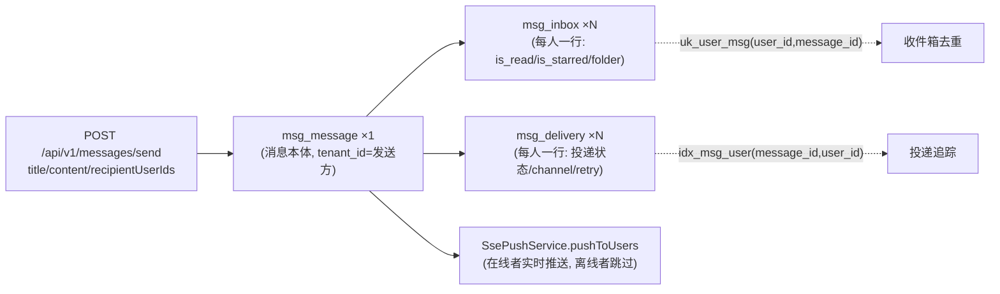

# N9：消息中心微服务拆分——独立库、REST 落库与 SSE 单向推送

> **系列导航**：本文是「SaaS 预约系统开发架构设计 1+N」系列第 N9 篇。
> 上一篇 [N8：声明式授权与 denyAll 兜底](#) 讲接口准入；本篇讲**进程级拆分**——
> 一个独立端口、独立数据库、复用同一套密钥域的消息中心，以及拆分过程中踩到的
> 四个「列名相同、语义不同」的坑。
>
> 文中所有代码片段、数据均来自本仓库真实源码，路径以 `api/` 为根。

---

## 一、问题背景：消息中心为什么要拆出去

### 1.1 拆分前的状态与目标

原消息中心能力内嵌于预约系统主应用（api 模块，8081）。多租户 SaaS 化推进后，
`api/message-service` 成为与 api 平级的独立应用模块。设计说明文档（`api/message-service/docs/设计说明.md`）
记录了四条目标：

- **独立服务**：独立 Spring Boot 应用、独立端口（8090）、独立库（`message_center`）；
- **能力闭环**：消息收发、收件箱状态、三级分类、模板、投递/批量任务追踪、管理员管理；
- **实时性**：REST 落库 + SSE 单向实时推送（无客户端轮询）；
- **安全**：复用主系统 JWT 密钥与 AES 密钥，token 直通校验，敏感字段落库加密。

### 1.2 选型决策：重，但不到 Spring Cloud 那么重

设计说明里的选型表值得完整过一遍，因为它体现了一种**克制的拆分哲学**：

| 维度 | 决策 | 说明 |
| --- | --- | --- |
| 形态 | api 下的独立应用模块 `message-service` | 自备 pom、启动类、端口、库，**不依赖 api 主服务类** |
| 端口 | 8090 | 独立于主服务 8081 |
| 数据库 | 独立库 `message_center` | 与主业务库（lesson_appointment）物理隔离 |
| 复用策略 | **复制轻量工具类 + 共享密钥** | 复制 `Result`/`JwtUtil`/`CryptoUtil`/`RoleConst` 等无业务依赖的工具；`jwt.secret` 与 `crypto.aes-key`/`crypto.hmac-key` 与主系统**完全一致** |
| token 互通 | 主系统登录签发的 JWT 可直接调用本服务 | 拦截器用同一 secret 验签，无需二次登录 |
| 推送选型 | REST 落库 + SSE 单向推送 | 服务端向在线客户端主动推送 |

两条**不选**同样重要：

- **不选 Feign/内部 RPC 框架**：业务系统通过普通 HTTP + 现签 JWT 调用，避免引入服务治理组件；
- **不选共享主库表**：消息表放独立库，避免跨服务事务耦合，保证消息服务可独立演进与故障隔离。

这就是本篇的工程立场：**拆进程、拆库、共享密钥域，但不上注册中心、配置中心、链路追踪**。
对一个双服务系统，Nginx 按前缀分流 + 共享密钥，已经解决了全部实际问题。

---

## 二、原理：四个关键设计

### 2.1 写扩散模型：一条消息，N 行收件箱

消息系统的数据模型只有两种：读扩散（拉模式）和写扩散（推模式）。本项目选写扩散——
发送时把消息**复制**到每个收件人的收件箱：



三张表各司其职（DDL 见 `api/sql/schema/20261008-1527-message_center-schema.sql`）：

- `msg_message`：消息本体（标题/正文/payload **AES-GCM 加密**落库，与 N7 同族）；
- `msg_inbox`：用户消息箱的**物理存储**，`uk_user_msg(user_id, message_id)` 唯一键保证同一消息
  同一用户只有一行（重复发送被 DB 挡住，不依赖应用层判重）；
- `msg_delivery`：投递状态追踪（`delivery_status` 0 未投/1 已投/2 已确认接收/3 拒绝失败，
  `channel` rest/sse，`retry_count`）。

**为什么必须先落库再推送**：消息是「当时发生了什么」的凭证，必须先有持久化事实，
推送只是尽力而为的加速器。SSE 推送失败（用户离线）不影响任何业务正确性——
这正是 `send()` 方法 catch 全异常只记 warn 的原因。

### 2.2 REST + SSE，而不是 WebSocket

设计说明把推送选型写成「REST 落库 + SSE 单向推送（已与用户确认）」。技术理由：

| 方案 | 判断 | 理由 |
| --- | --- | --- |
| 长轮询 | 否决 | 客户端仍需定时请求，实时性与服务器负担都不划算 |
| WebSocket | 暂不选 | 双向通道在本场景**没有需求**——消息中心是纯下行通知，客户端回传走普通 REST |
| SSE | **选中** | 单向足够；`EventSource` 浏览器原生、断线自动重连；走普通 HTTP，Nginx 按前缀分流即可，无 Upgrade 头协商 |

SSE 的工程代价有三个，源码里都处理了：**长连接管理**（注册表 + 三事件脱钩）、
**鉴权**（EventSource 不能自定义请求头 → token 走 query 参数）、
**单机内存注册表**（多实例需换 Redis 发布订阅，设计说明已列为演进项）。

### 2.3 跨服务信任：共享密钥域，而不是 Session 共享

两个进程之间没有共享内存，认证靠**共享密钥域**：

```java
// message-service/src/main/resources/application.properties
# 鉴权：与主系统共享同一 JWT 密钥，主系统登录签发的 Token 可直接在此校验
jwt.secret=${JWT_SECRET:cOzEE8g9...(与主系统逐字节相同)}
# 1小时（3600000ms）。2026-10-10 P2-2 修正：原 360000000 是 100 小时笔误；
# 须与主系统保持一致，勿单方面改回。
jwt.expiration=3600000
# AES-256-GCM 字段加密（与主系统相同密钥，可互通解密）
crypto.aes-key=${AES_KEY:...}
crypto.hmac-key=${HMAC_KEY:...}
```

于是「主系统登录 → 带着 token 直连 message-service」天然成立，
`MessageAuthInterceptor` 只做验签和上下文填充（与主系统 `JwtAuthenticationFilter` +
`TenantInterceptor` 的组合同构，但合并且更简单）：

```java
// api/message-service/.../security/MessageAuthInterceptor.java
String auth = request.getHeader("Authorization");
// SSE 场景允许 token 放 query 参数 ?access_token=xxx
if ((auth == null || !auth.startsWith("Bearer ")) && request.getParameter("access_token") != null) {
    auth = "Bearer " + request.getParameter("access_token");
}
// ... 验签通过后写入 MessageAuthContext，afterCompletion 清除
Long tenantId = jwtUtil.getTenantId(token);
a.setTenantId(tenantId == null ? -1L : tenantId);   // -1 = 未解析到租户（注意：不是 0）
```

注意最后一行与主系统的微妙差异：**主系统平台管理员 tenantId=0，而这里 tenantId<0 表示
「未解析到租户」**。`MessageAuthContext` 的注释写明了这个约定。0 和 -1 在两个服务里
各有语义，跨服务传租户概念时这是第一个容易错的地标（下一个在 2.4）。

反向链路（业务系统 → 消息服务）同样不需要真实用户会话：`MessageNotifyService`
用 `jwtUtil.generateToken(tenant, "system", "system")` **现签一个 system 身份令牌**，
让定时任务（上课提醒）也能发消息，且发件人稳定为 system 而不是「某个随机管理员」。

### 2.4 tenant_id = 发送方：本篇最大的语义坑

这是整篇文章最重要的一个约定，先把它钉死：

> **`msg_message.tenant_id` / `msg_delivery.tenant_id` / `msg_inbox.tenant_id`
> 记的都是发送方租户，不是接收方租户。**

`MessageLedgerService` 的类注释把这个坑的来龙去脉写得非常清楚：

> 消息库里三张表的 tenant_id 记的都是**发送方租户**（写扩散时原样带入），三张表里
> **没有任何一列是「接收方租户」**。所以"这条消息进了本租户哪些用户"这个判断，
> 消息库自己算不出来：
> - 按 `tenant_id` 过滤 = 按发送方过滤，语义完全错位；
> - 接收人归属租户只存在于主库 `lesson_appointment.user.tenant_id`。

为什么这样设计？因为消息的归属（分类、模板、统计、管理）天然按**发送方**组织——
「本租户发了哪些消息」是管理面的自然问题。而「我收到了哪些消息」必须按人组织
（`user_id`），跨租户接收恰恰是常态：平台方（tenant_id=0）发的公告，全体租户用户都收得到。

真库实证（`InboxService` 注释记录）：同一个 userId 的收件箱行**本来就跨多个 tenant_id 值**
——租户 2 的某个 admin 有 874 行，分布在 {0, 2} 两个 tenant_id 下（0 = 平台方发的，2 = 本租户发的）。
**如果按 tenant_id 过滤收件箱，这个人会看不到平台发给他的消息。**

---

## 三、源码实现

### 3.1 写扩散主链路：sendToUsers 的三步

`MessageService.sendToUsers`（`api/message-service/.../service/MessageService.java:71-96`）
是全部发送场景的核心，一个 `@Transactional` 里三步：

```java
@Transactional
public Map<String, Object> sendToUsers(SendMessageReq req, Long tenantId, String senderId, String senderRole) {
    validateCommon(req, tenantId, senderRole);          // ① 校验：分类存在性 + 敏感词过滤
    // 接收人去重去空白（null 过滤 + distinct）
    recipients = recipients.stream().filter(s -> s != null && !s.isBlank()).distinct().collect(...);

    Message msg = buildMessage(req, tenantId, senderId, senderRole);   // ② 加密构建
    msg.setStatus("sent");
    messageMapper.insert(msg);

    for (String uid : recipients) {                     // ③ 写扩散
        insertInbox(msg.getTenantId(), uid, msg.getMessageId());
        insertDelivery(msg.getTenantId(), msg.getMessageId(), uid, 1);
    }
    ssePushService.pushToUsers(recipients, msg);        // ④ 在线推送（事务外效果）
    return resultMap(...);
}
```

四个值得注意的点：

1. **敏感词过滤在加密之前**（`validateCommon` → `sensitiveWordService.validateAndFilter`）：
   REJECT 拒绝发送、MASK 就地掩码，都是对**明文**操作——加密后的密文没法做 DFA 匹配。
2. **`buildMessage` 全程加密**：`title`/`content`/`payload` 三列都走 `crypto.encryptWithIndex`
   （AES-GCM + HMAC 盲索引复合格式，N7 的原理在这里原样复用）。
3. **写扩散与推送在同一事务方法内**，但推送失败不回滚消息——`pushToUsers` 内部
   catch 全部 IO 异常只移除 emitter。落库是事实，推送是加速。
4. **`tenantId` 由 Controller 层裁定**（见 3.2），Service 不信任客户端的租户概念。

### 3.2 租户裁定：三种发送入口的三种口径

`MessageSendController` 的三个端点体现了「谁能以什么身份发到哪个租户」的完整矩阵：

```java
// /send：普通发送。租户 = 发送者令牌租户；平台管理员可显式指定 targetTenantId
Long tenant = req.getTargetTenantId() != null && MessageAuthContext.isPlatformAdmin()
        ? req.getTargetTenantId() : resolveCreateTenant();

// /broadcast：广播。canSendDownstream 才放行（学生无权广播——单独一道 403）
if (!RoleConst.canSendDownstream(MessageAuthContext.currentRole()))
    throw new MessageBizException(403, "无权广播消息");

// /system：系统通知。仅 system 角色或管理员
if (!RoleConst.SYSTEM.equals(role) && !RoleConst.isManager(role))
    throw new MessageBizException(403, "仅系统或管理员可发送系统通知");
```

共同点：**租户归属永远从令牌派生，客户端最多在「平台管理员」这个前提下提供
`targetTenantId` 覆盖**——与 N3/N5 里「target 服务端从令牌派生、DTO 不接受客户端值」
是同一套防篡改纪律。

### 3.3 SSE 注册表：ConcurrentHashMap + 三个生命周期钩子

`SsePushService` 全部家当是一张 `ConcurrentHashMap<String, SseEmitter>`，但每个细节都有注释：

```java
public SseEmitter connect(String userId) {
    String key = key(userId);
    SseEmitter em = new SseEmitter(0L);          // 0L = 永不自动超时
    SseEmitter old = emitters.put(key, em);
    if (old != null) {
        // 同一用户重复连接（前端 EventSource 自动重连、开多个标签页）时必须显式结束旧 emitter：
        // 它已不在 map 里（后续推送碰不到），又因 0L=永不超时而不会自己退出，
        // 会一直挂在容器的异步请求上，直到 TCP 层报错为止。
        try { old.complete(); } catch (Exception ignored) {}
    }
    em.onCompletion(() -> emitters.remove(key, em));
    em.onTimeout(() -> emitters.remove(key, em));
    em.onError(e -> emitters.remove(key, em));
    return em;
}
```

三个设计点：

- **`0L` 永不超时 + 重复连接显式 `complete()` 旧 emitter**：这是一对必须同时做的操作。
  只设超时不 complete，旧连接会悬挂到 TCP 报错；只 complete 不设超时，异常网络下
  连接永不回收（详见 4.4）。
- **三个生命周期钩子成对脱钩**：completion/timeout/error 三条路径都移除，
  且用 `remove(key, em)` 两参重载——只有 map 里存的还是**这个** emitter 才移除，
  防止把后到的同名连接误删。
- **推送失败即移除**：`catch (IOException | IllegalStateException)` → `emitters.remove(key)`。
  注释还交代了一个 Spring 陷阱：ResponseBodyEmitter 会把失败保存在 emitter 上并在异步
  收尾阶段**重放同一异常**，所以 GlobalExceptionHandler 仍会看到它（堆栈里带着
  `pushToUser` 帧，极易被误判「catch 没生效」）——不刷 ERROR 日志靠的是
  GlobalExceptionHandler 对「响应已提交」的静默分支。

前端侧（`frontend/js/messages-inbox.js:887`）是同构的：

```javascript
function connectSse() {
    const uid = state.userId; const token = localStorage.getItem('token');
    const url = MSG_BASE + EP.MSG_SSE_CONNECT(token);   // /api/v1/sse/connect?access_token=...
    es = new EventSource(url);
    es.addEventListener('ready', function () { flushOfflineQueue(); });  // 连接就绪即重发离线消息
    es.addEventListener('message', function (e) { /* new_message / message_recalled / message_deleted 三类 */ });
    es.onerror = function () { /* EventSource 会自动重连 */ };
}
```

- **token 走 query**：EventSource 无法自定义请求头（这是浏览器 API 的硬限制，
  也是拦截器里 `access_token` 参数分支存在的唯一原因）；
- **ready 事件即刷离线队列**：连接建立后服务端先发一条 `ready` 心跳（带在线人数），
  前端借此把断线期间暂存的消息补发（`queueOffline`/`flushOfflineQueue`，
  localStorage 最多 10 条 FIFO）——SSE 自动重连 + 应用层补发，两层兜底。

### 3.4 业务钩子：best-effort 的完整含义

`MessageNotifyService`（api 主服务侧）是业务系统接入消息中心的唯一通道，
类注释定义了纪律：

> 所有发送均为 best-effort：失败仅记录日志，不影响主业务流程。

「best-effort」在代码里是四层保障：

```java
@PostConstruct
private void init() {
    SimpleClientHttpRequestFactory factory = new SimpleClientHttpRequestFactory();
    factory.setConnectTimeout(2000);
    factory.setReadTimeout(3000);        // ① 2s/3s 超时：消息服务挂了不能拖死主业务流程
    this.restTemplate = new RestTemplate(factory);
}

// ② 调用处 catch 全异常，只记 warn
} catch (Exception e) {
    log.warn("消息自动发送失败(已忽略): {} | 接收人={}, 场景={}", e.getMessage(), recipientIds, categoryCode);
}
```

第三层是最容易被忽略的——**HTTP 200 骗局**：

```java
// message-service 业务失败时 HTTP 状态仍是 200，真实结果只在 body.code 里。
// 早期只看「HTTP 没抛异常」就记成功，导致 msg_category 缺编码时静默失败很久无人察觉。
Map<?, ?> rb = resp.getBody();
Object code = rb == null ? null : rb.get("code");
if (code != null && !"200".equals(String.valueOf(code))) {
    log.warn("消息自动发送被拒 -> code={}, message={} ...");
    return;
}
```

这又是 N1/N5 反复出现的契约问题的又一次复现：**HTTP 状态码与业务结果分离的系统里，
「没抛异常」≠「成功」**。本项目为此付出的学费跨了三个服务。

第四层是**返回值语义的演进**：`send()` 历来是 void（业务钩子失败不影响主流程），
但上课提醒的失败必须让调用方知道，好在流水表里把该行标成 FAILED——
否则「已发送」的记录会掩盖「其实没发出去」，事后无从追查。于是 `sendAsSystem`
返回 boolean，`notifyLessonReminder` 一路把结果传回 `NotifyTask`。

### 3.5 接收台账：跨 schema 只读聚合

「平台方发出的消息投递到了本租户哪些用户」——这个视图消息库自己算不出来（2.4），
必须由同时拥有两边的**主系统**提供。`MessageLedgerService` 的实现是一段教科书式的
跨 schema 聚合：

```java
/**
 * 为什么用 JdbcTemplate 而不是 Mapper + 租户插件
 * 本项目 MyBatis-Plus 的 TenantLineInnerInterceptor 会给 SQL 里每张未被忽略的表追加
 * tenant_id = 本租户。这些消息表**列名相同、语义不同**，被插件一追加就会：
 *   - msg_message.tenant_id = 2 → 平台方发出的消息（tenant_id=0）全部消失，查出 0 条；
 *   - msg_inbox.tenant_id = 2  → 同理（该列是发送方租户）。
 * 故这里走原生 SQL：既绕开语义错位的自动条件，又让「本租户」这个约束以**显式 SQL 条件**出现。
 */
private static final String USER_ID_COLLATE = " COLLATE utf8mb4_general_ci ";
private static final String PLATFORM_SENT_CONDITION = " m.tenant_id = 0 ";

private static final String INBOUND_FROM =
        " FROM message_center.msg_message m "
      + " JOIN message_center.msg_delivery d ON d.message_id = m.message_id "
      + " JOIN lesson_appointment.user u ON u.user_id = d.user_id" + USER_ID_COLLATE
      + " LEFT JOIN message_center.msg_inbox i ON i.message_id = m.message_id AND i.user_id = d.user_id ";
```

五个工程决策：

1. **绕开租户插件**：消息表加进 `IGNORE_TABLES` 或用 JdbcTemplate 原生 SQL——
   因为插件的自动条件在这里不是「多了一个过滤」，而是**把语义彻底改错**。
2. **显式 COLLATE**：`message_center` 是 `utf8mb4_0900_ai_ci`，`lesson_appointment` 是
   `utf8mb4_general_ci`，直接 `u.user_id = d.user_id` 报 `ERROR 1267 Illegal mix of collations`。
3. **INNER JOIN user 表排孤儿**：接收人必须能在主库定位到真实用户（真库有存量测试脏数据），
   列表的「接收人数」等于「能落到人的接收人数」——宁可少算，不要虚报。
4. **租户范围服务端派生**（`resolveScope`）：租户管理员传的 `tenantId` 一律忽略，
   强制本租户；平台管理员可指定或看全平台——**不接受前端传入的 userId 清单**，
   那等于把越权判断交给调用方。
5. **时间在 SQL 层出裸串**：`send_time` 是 `LocalDateTime.now()`（本地墙钟），
   而主系统 JacksonConfig 会给 LocalDateTime 补 Z（按其「值即 UTC」约定）。
   走 Jackson 序列化会让前端按 UTC 解读、**静默偏 8 小时**，故用 `DATE_FORMAT`
   在 SQL 层直接产 `yyyy-MM-ddTHH:mm:ss` 裸串，与 message-service 的出参形态保持一致。

---

## 四、踩坑实录

### 4.1 SSE 会话 key 拼了租户：平台方消息推送静默丢失（2026-10-12 修正）

这是本篇最隐蔽的故障，完整时间线如下：

1. **故障态**：`SsePushService` 的会话 key 是 `tenantId + ":" + userId`；
2. **订阅侧**（`SseController.connect`）取「当前令牌租户」——租户用户注册的 key 是 `2:uid`；
3. **推送侧**（`pushToUser`）取「消息的发送方租户」（`msg.getTenantId()`）——
   平台方发出的消息 key 是 `0:uid`；
4. **结果**：两侧算出的 key 不同 → `emitters.get("0:uid")` 返回 null → **直接 return，无日志**。
   平台公告类消息的实时推送**静默丢失**——用户只能靠手动刷新看到消息进来了。

修复只有一行思路，但注释把整个推理留在了代码里：

```java
/**
 * 2026-10-12 修正：会话 key 只按 userId，不再拼租户。
 * 原先 key = tenantId + ":" + userId，而订阅侧取「订阅者的令牌租户」、
 * 推送侧取「消息的发送方租户」，两侧算出的 key 不同：平台方（tenant_id = 0）
 * 发给租户用户时，推送去找 0:uid、而连接注册的是 2:uid → em == null 直接 return
 * （无日志），实时通知静默丢失。userId 是主键、全局唯一，足以定位一个会话，
 * 租户不应参与路由。
 */
```

**通用教训**：会话路由键必须选「两侧都自然持有且语义一致」的维度。
租户在消息系统里是**数据归属维度**（还是发送方的），不是**连接路由维度**——
把归属维度误用作路由维度，就会在「跨归属投递」这个最常见的场景下静默失效。
这与 2.4 的 tenant_id 语义是同一个坑的两个面。

### 4.2 收件箱按租户过滤：同源缺陷的另一面

与 4.1 同源：`InboxService` 最初也按 tenant_id 过滤收件箱，而该列是**发送方**租户。
真库实证：租户 2 的某个 admin 有 874 行收件箱记录，跨 {0, 2} 两个 tenant_id 值
（0=平台方发的公告，2=本租户发的通知）。按租户过滤 = 这个人看不到平台发给他的消息。

修复后的 `scopedWrapper` 把归属键收敛为 userId：

```java
/**
 * 收件箱的归属键就是 userId，不需要租户参与：
 * · 同一个 userId 的行**本来就跨多个 tenant_id 值**（真库某租户2 admin：874 行跨 {0,2}）；
 * ...
 */
private LambdaQueryWrapper<MessageInbox> scopedWrapper(String userId) {
    LambdaQueryWrapper<MessageInbox> w = new LambdaQueryWrapper<>();
    w.eq(MessageInbox::getUserId, userId);   // 只按人
    return w;
}
```

越权面交给 `assertUserScope`：**本人或平台管理员**。注释还交代了一个边界决策——
「同租户管理员代查」需要跨服务问主系统才能判定，两端 UI 经核查也没有代查入口，
故先收敛为平台管理员。这是「先收紧到能判定的范围，再按需求扩展」的典型操作。

### 4.3 HTTP 200 骗局：静默失败很久无人察觉

`msg_category` 缺编码期间，`MessageNotifyService` 的自动发送全部被 message-service
以 `code != 200` 拒绝，但 HTTP 状态始终是 200。早期实现只看「HTTP 没抛异常」就记成功，
导致**日志里一片「发送成功」，实际消息一条都没到**。

修复即 3.4 的 `body.code` 判定。这个坑的通用形态是：**RPC 边界上，传输层成功
（TCP 通了、HTTP 200 了）与应用层成功（业务接受了）是两件事**。凡是自建
Result 信封的服务间调用，都必须显式拆信封。

### 4.4 永不超时的连接不 complete：悬挂到 TCP 报错

`new SseEmitter(0L)`（永不超时）与「重复连接时显式 complete 旧 emitter」是绑定的。
漏了后者：旧 emitter 已被 `put` 挤出 map（后续推送碰不到），又因 0L 不会自己退出，
**一直挂在容器的异步请求上**，直到 TCP 层报错才回收——每个重复连接泄漏一条。

为什么选 0L 而不是一个大超时（如 30 分钟）？因为 SSE 的生命周期本就该由
客户端（关页面/断网）和服务端（踢人）显式结束，超时只是兜底；而兜底值取大会让
「异常悬挂」窗口变长。正确组合是：**0L + 三个生命周期钩子 + 重复连接显式 complete**。

### 4.5 跨 schema JOIN 的两颗地雷

`MessageLedgerService` 的 SQL 一次踩了两颗经典地雷，都写进了注释：

1. **COLLATE 冲突**（ERROR 1267）：两个库建库时 collation 不同（`utf8mb4_0900_ai_ci`
   vs `utf8mb4_general_ci`），字符串列 JOIN 前必须显式 `COLLATE utf8mb4_general_ci`。
2. **时间序列化补 Z**：跨服务读到的 `LocalDateTime` 如果走主系统的 Jackson 配置，
   会被按「值即 UTC」约定补 Z，前端静默偏 8 小时。解法是 SQL 层 `DATE_FORMAT` 出裸串。

还有第三颗隐藏的：**租户插件的自动条件**（3.5 决策 1）。列名相同、语义不同的表，
最危险的不是写错 SQL，而是框架「好心」帮你加了一个语义错的条件。

---

## 五、落地 Checklist

**拆分与部署**
- [ ] 新服务自备 pom/启动类/端口/库，不依赖主服务类（独立编译、独立启动）
- [ ] 密钥域与主系统逐字节一致（jwt.secret / aes-key / hmac-key），配置走环境变量覆盖
- [ ] Nginx/dev-proxy 按前缀分流（`/api/v1/message`、`/sse`、`/sensitive`、`/users/` → 8090），
      主服务的守卫把这些前缀列为不管辖区
- [ ] Actuator 最小暴露（health/info），liveness/readiness 分组（DB 挂了摘流量不重启）

**写扩散与推送**
- [ ] 消息先落库后推送，推送失败不回滚（`uk_user_msg` 保证重复发送被 DB 挡住）
- [ ] 敏感词过滤在加密前（明文态做 DFA）
- [ ] SSE 会话 key 只用全局唯一维度（userId），**不用数据归属维度**（租户）
- [ ] `0L` 永不超时 + 重复连接显式 complete 旧 emitter + onCompletion/onTimeout/onError 三脱钩
- [ ] 前端 token 走 query（EventSource 限制），ready 事件刷离线补发队列

**跨服务调用**
- [ ] 服务间调用判 **body.code**，不只看 HTTP 200（拆信封）
- [ ] 连接/读超时显式设置（2s/3s），best-effort 调用 catch 全异常只记 warn
- [ ] 需要结果回传的调用返回 boolean/结果对象，别让「已发送」记录掩盖「没发出去」
- [ ] 跨 schema SQL：显式 COLLATE、绕开租户插件、时间 DATE_FORMAT 裸串、INNER JOIN 排孤儿
- [ ] 租户/用户范围一律服务端从令牌派生，DTO 不接受客户端传的 userId 清单

**演进项（已记录未做）**
- [ ] 多实例部署时 SSE 注册表改 Redis 发布订阅（当前单机内存）
- [ ] WebSocket 双向（当前 SSE 单向够用，双向场景出现时再升级）

---

## 下一篇预告

**N10：消息隔离语义与三级分类体系**：`tenant_id=发送方`在收件箱、统计、撤回、全局删除
四条链路上的具体影响，分类的「角色维度 + 业务场景维度」两级设计，以及敏感词分组的
REJECT/MASK 双模式。

> 本文涉及的核心文件：
> - `api/message-service/`（独立模块：pom/启动类/application.properties/controllers/services）
> - `api/message-service/docs/设计说明.md`（选型决策原文）
> - `api/src/main/java/com/reservation/service/MessageNotifyService.java`（业务钩子，best-effort 四层保障）
> - `api/src/main/java/com/reservation/service/MessageLedgerService.java`（跨 schema 台账）
> - `api/sql/schema/20261008-1527-message_center-schema.sql`（四表 DDL）
