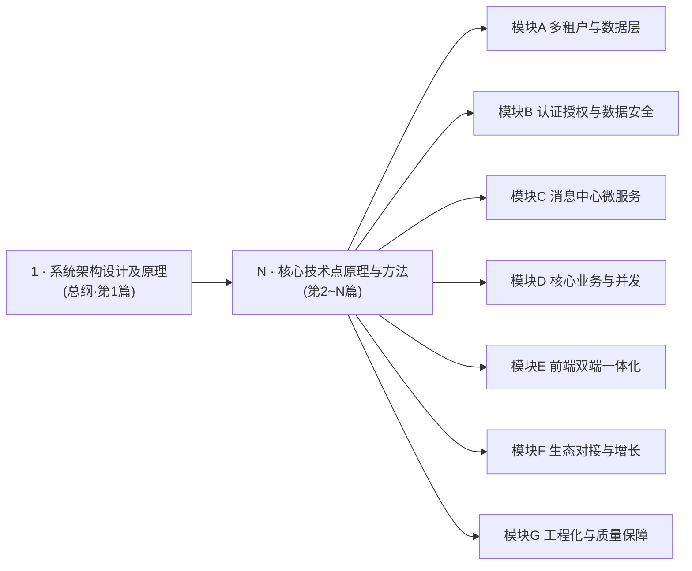
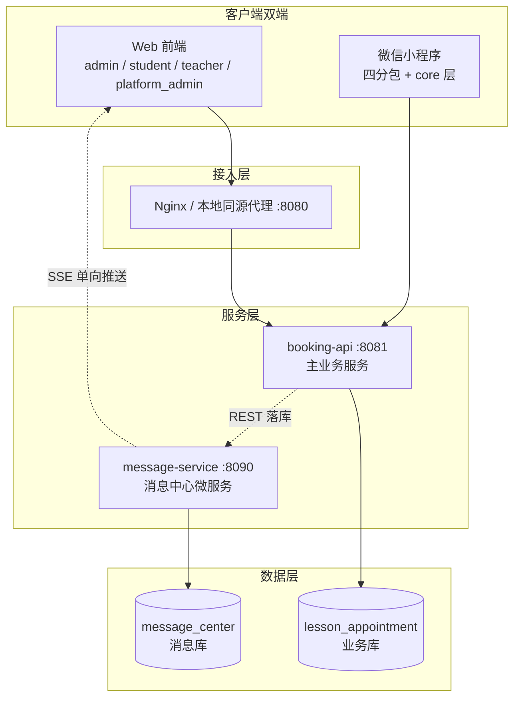

# 多租户 SaaS 在线预约系统 —— 开发架构设计文档（1+N）大纲

> 系列定位：用 **1 篇总纲**讲透「系统架构设计及原理」，再用 **N 篇分论**逐个拆解「各核心技术点的原理与方法」。
> 所有内容均来自一个真实落地项目：多租户 SaaS 预约系统（课程预约起步，向下兼容律师咨询等行业，术语动态切换），非Demo、可复现。
> 适合 CSDN 专栏连载：每篇独立成文，合起来是一条完整的「单体 → 多租户 SaaS」演进路线。

---

## 0. 系列总览

### 0.1 项目一句话

一套支持**多租户隔离、多行业术语切换、双端（Web + 微信小程序）一体**的在线预约系统：租户自助开通试用、平台/租户两级运营、消息中心实时推送、推广归因，全部跑在自研的契约治理与守卫体系之上。

### 0.2 目标读者与前置知识

| 项 | 说明 |
| --- | --- |
| 读者 | 有 Spring Boot 基础、想深入「多租户 SaaS 落地」的后端/全栈工程师 |
| 前置 | Java 17、Spring Boot 基础、MySQL 基础、了解 JWT 概念即可 |
| 不涉及 | 前端框架（本项目前端为原生 JS + IIFE，恰好适合讲「无框架工程化」） |

### 0.3 技术栈总览

| 层 | 选型 | 版本/说明 |
| --- | --- | --- |
| 后端框架 | Spring Boot | 3.3.5（JDK 17，Maven 构建） |
| ORM | MyBatis-Plus | 3.5.7（多租户拦截器核心载体） |
| 数据库 | MySQL | 8.4（业务库 lesson_appointment / 消息库 message_center 双库） |
| 安全 | Spring Security + jjwt | 0.11.5，双令牌（access + refresh） |
| 文档 | springdoc-openapi | 2.6.0 |
| 运维 | Actuator | 仅暴露 health/info 探针 |
| 消息中心 | 独立 Spring Boot 应用 | 端口 8090，REST 落库 + SSE 推送 |
| Web 前端 | 原生 HTML/JS + terser | 多页面（admin/student/teacher/platform_admin/login…），构建产物 dist |
| 小程序 | 微信原生小程序 | 四分包（student/teacher/admin/message）+ core 基础层 |
| 双端共享 | shared 域代码 | apiPaths / domain / adapters 三层 + 自动桥接生成 |
| 工程化 | Node 脚本 + Git hooks | 16 道守卫 + 反向测试 + pre-commit 红线 |
| 部署 | Docker + Nginx | deploy/ 脚本、本地同源代理 8080、冒烟 8083 |

### 0.4 1+N 结构总览

---

## 1. 【第 1 篇】系统架构设计及原理（总纲）

> 本篇是系列的「地图」：先建立全局视角，后续每篇分论都是对总纲中某一层的放大。

### 1.1 业务背景与架构目标

- 从单租户教学预约系统演进为多租户 SaaS 的动因与约束；
- 架构目标清单：租户数据零泄漏、多行业术语动态切换、双端体验一致、契约变更可防守、质量靠机制不靠人肉。

### 1.2 技术栈全景与选型理由

- 逐个技术点的「为什么是它」：如为什么用 MyBatis-Plus 拦截器做租户隔离而非视图/库表前缀；为什么消息中心独立应用独立库而非模块内嵌；为什么前端不上框架。

### 1.3 总体架构（建议配图：分层架构图）

- 要点：双端统一走 `/api/v1` 契约；同源代理解决开发期跨域；消息服务与主服务**库隔离、密钥域共享**。

### 1.4 多租户数据隔离架构

- `TenantLineInnerInterceptor` 动态 SQL 拼接原理、租户 ID 来源（ThreadLocal）、null 兜底为 -1 的防御设计；
- 白名单表机制（平台级表、推广表、微信用户表等 `ignoreTable`）；
- 插入侧自动填充（`TenantMetaObjectHandler`）与查询侧自动追加条件的「双向闭环」。

### 1.5 租户与套餐三层数据模型（建议配图：ER 图）

- `sys_package_template`（模板）→ `sys_tenant.package_id`（租户选型）→ `sys_tenant_package`（每租户实例）三层结构；
- 租户生命周期：开通 → 14 天试用 → 审批/付费 → 配额管控（`TenantQuotaService`）。

### 1.6 认证授权安全架构

- 过滤器链：JWT 解析 → SecurityContext → 授权注解 → denyAll 兜底；
- 「免登录白名单四处同心圆」设计（SecurityConfig / JwtFilter / check-authz / WebMvcConfig，缺一即静默失效）；
- 声明式授权登记制（`AuthzRules`）：接口能不能进与数据看不看得见分离。

### 1.7 消息中心子服务架构

- 独立应用 + 独立库 + 独立端口的设计动机（故障隔离、独立演进）；
- REST 落库 + SSE 单向推送的选型权衡（为什么不用 WebSocket/长轮询）；
- 消息隔离语义：发送方租户、收件箱按 userId、已读真相源。

### 1.8 前后端契约治理架构

- 统一响应体 `Result{code,message,data}` 与分页 `PageResult{rows,total}`（强调 **rows 不是 records** 的真实事故）；
- 错误码白名单与 HTTP 状态映射策略（401/403 保持 HTTP 200 走业务码的设计取舍）；
- 时间契约：`appointment` 以 UTC 为唯一真相源，序列化统一 `format(fmt)+"Z"`。

### 1.9 前端双端一体化架构

- shared 三层（apiPaths / domain / adapters）如何同时服务 Web 与小程序；
- 「四步同步链」：sync-miniprogram-shared → check:shared-sync → gen-shared-bridge → build.js；
- 桥接白名单机制（`window.*Domain` 手工登记，`check:bridge-exports` 钉住）。

### 1.10 工程化质量架构（建议配图：守卫链流程图）

- 16 道守卫按「契约/结构/流程」分类全景图；
- 反向测试方法论：守卫必须有「证真会红」的反向测试，否则 pre-commit 腐烂无人发现；
- 逃生门设计（`SKIP_<大写>`）与红线边界。

### 1.11 部署与运维架构

- Docker 化、Nginx、Actuator 探针（health/info 最小暴露面）；
- 冒烟编译（8083）→ 起服务 → 端到端验证的发布前检查链。

### 1.12 架构权衡与演进路线

- 已做出的关键取舍表（含代价）；
- 演进方向：消息服务拆分经验复用到更多子域、术语体系插件化等。

---

## 2. 【第 2~N 篇】核心技术点原理与方法

> 编排原则：每篇 = 一个核心技术点 = 「问题背景 → 原理 → 源码实现 → 踩坑实录 → 小结」五段式；全部标注真实源码位置，可对着仓库复现。

### 模块 A：多租户与数据层（4 篇）

| 编号 | 标题 | 核心问题 | 源码位置 |
| --- | --- | --- | --- |
| N1 | MyBatis-Plus 多租户隔离：拦截器动态 SQL 原理与实战 | 一行代码不改，如何让所有 SQL 自动带上租户条件？ | `api/.../config/MyBatisPlusConfig.java`、`TenantMetaObjectHandler.java` |
| N2 | 租户上下文与跨线程传递：ThreadLocal、异步池化与 tenant-xt 守卫 | 定时任务/线程池里租户 ID 丢失导致查错库的排查与防御 | `utils/TenantContext.java`、`interceptor/TenantInterceptor.java`、`task/TenantAwareExecutor.java` |
| N3 | 三层套餐模型与租户生命周期 | 模板→租户→实例如何建模？8 位租户码如何生成（去 0/O/1/I/l）？ | `entity/PackageTemplate.java`、`Tenant.java`、`TenantPackage.java`、`utils/TenantCodeGenerator.java` |
| N4 | sys_term 多语言三级作用域 | 平台词 > 行业词 > 租户词的优先级算法如何保证不串？ | `service/TermService.java`、`utils/TermMsg.java`、`shared/domain/term.js` |

### 模块 B：认证授权与数据安全（4 篇）

| 编号 | 标题 | 核心问题 | 源码位置 |
| --- | --- | --- | --- |
| N5 | JWT 双令牌鉴权：access/refresh、会话表与 Bearer 前缀强制 | 为什么「不带 Bearer 前缀」不是报错而是静默 401？ | `utils/JwtUtil.java`、`service/RefreshTokenService.java`、`service/UserSessionService.java` |
| N6 | 免登录白名单「四处同心圆」 | 四处配置缺一处，整体静默失效的真实故障复盘 | `SecurityConfig`、`JwtAuthenticationFilter`、`config/AuthzRules.java`、`config/WebConfig.java` |
| N7 | 声明式授权体系与 denyAll 兜底 | 「能不能进接口」与「看不看得见数据」为何要分离治理？ | `config/AuthzRules.java`、`common/RoleConst.java`、`tools/check-authz-declarative.mjs` |
| N8 | 敏感字段加密：user.name 入库加密、服务级解密 | 为什么不用 TypeHandler？裸查不解密为何前端会看到 hex:base64？ | `utils/CryptoUtil.java`、`service/UserService.java`、`service/PromoService.java` |

### 模块 C：消息中心微服务（3 篇）

| 编号 | 标题 | 核心问题 | 源码位置 |
| --- | --- | --- | --- |
| N9 | 独立消息服务拆分：端口、独立库与共享密钥域 | JWT/AES 工具类复制而非依赖，边界怎么划？ | `api/message-service/**`（`MessageCenterApplication`、`security/`、`utils/`） |
| N10 | REST 落库 + SSE 单向推送 | SseEmitter 生命周期、在线表、心跳重连、为何返回值不走 ResponseBodyAdvice | `controller/SseController.java`、`service/SsePushService.java` |
| N11 | 消息隔离语义与已读真相源 | 三张 msg_* 表的 tenant_id 为何是「发送方」？代查边界如何限定？ | `service/MessageLedgerService.java`、`shared/domain/message.js` |

### 模块 D：核心业务与并发（3 篇）

| 编号 | 标题 | 核心问题 | 源码位置 |
| --- | --- | --- | --- |
| N12 | 座位超卖防护：并发预约的锁、幂等与 SQL 加固 | 同一座位被两人同时约到的根因与多层防线 | `service/BookingSeatService.java`、`common/BookingIdGenerator.java`、`seat-oversell-hardening-20260918.sql` |
| N13 | 课程表生成器：重复规则、例外与 UTC 唯一真相源 | 课次时间为什么只能有一个权威来源？ | `common/ScheduleGenerator.java`、`service/CourseScheduleService.java` |
| N14 | 退款规则引擎：阶段退款与请假结算 | 规则如何配置化、结算如何可审计？ | `service/RefundRuleService.java`、`service/LeaveRefundSettleService.java` |

### 模块 E：前端与小程序一体化（4 篇）

| 编号 | 标题 | 核心问题 | 源码位置 |
| --- | --- | --- | --- |
| N15 | shared 域代码双端共享：apiPaths/domain/adapters 分层 | 一套代码如何同时喂给 Web 与小程序？ | `shared/**`（`domain/appointmentState.js`、`domain/message.js` 等） |
| N16 | 桥接生成与四步同步链 | 改了 shared 忘记同步，谁来拦住？白名单桥接如何生成？ | `tools/sync-miniprogram-shared.js`、`frontend/tools/gen-shared-bridge.js`、`frontend/build.js` |
| N17 | 小程序工程结构：四分包与 core 基础层 | 分包策略、登录态/术语/消息等横切关注点如何收敛 | `miniprogram/package-*`、`miniprogram/core/**` |
| N18 | 无框架前端工程规范：IIFE、内联事件与 dist 核验 | 同名函数静默覆盖、压缩产物如何正确验证 | `frontend/js/**`、`tools/check-global-collide.mjs` |

### 模块 F：生态对接与增长（2 篇）

| 编号 | 标题 | 核心问题 | 源码位置 |
| --- | --- | --- | --- |
| N19 | 微信登录体系：wx_userid 全局唯一与静默降级 | secret 占位时为何选择「降级」而非报错？ | `mapper/WxUseridMapper.java`、`dto/WeChatRegisterDTO.java` |
| N20 | 推广增长体系：双码路径、防刷三闸与两级统计 | 8 位推广码生成算法、点击只计数、转化归因、平台/租户两级报表 | `service/PromoService.java`、`controller/PromoController`、`entity/Promo*.java` |

### 模块 G：工程化与质量保障（3 篇）

| 编号 | 标题 | 核心问题 | 源码位置 |
| --- | --- | --- | --- |
| N21 | 契约守卫群：result/status/date/secret-env | 「PageResult 用 records 导致表格恒空」这类事故如何被机器拦住？ | `tools/check-result-contract-guard.mjs` 等 + `tests/check_*_guard.js` |
| N22 | 十六道守卫与反向测试方法论 | 守卫自身腐烂怎么办？变异测试如何「证真会红」？ | `tools/git-hooks/pre-commit`、`tests/**`、`package.json` scripts |
| N23 | 测试体系与排障实录 | 冒烟编译、itest-sut、e2e、CRLF 毒害测试等真实踩坑 | `tests/**`、`build_smoke.sh`、`tools/check-tz-guard.mjs` |

> 合计：**1 篇总纲 + 23 篇分论（7 个模块）**。模块可按专栏分册发布，也可拆成「多租户」「安全」「消息」「工程化」四条独立故事线。

---

## 3. 发布执行建议（CSDN）

### 3.1 专栏结构

- 主专栏：《多租户 SaaS 预约系统：架构设计与核心技术点详解》
- 子专栏建议：① 架构总纲；② 多租户落地；③ 安全与契约；④ 消息中心；⑤ 前端一体化；⑥ 工程化质量体系。
- 每篇文首放「系列导航 + 本篇源码分支/commit 提示」，文末放「下篇预告」，提升追更率。

### 3.2 单篇写作模板（五段式）

1. **问题背景**：没有这个机制会出什么事故（优先用真实故障，如白名单缺一处静默 401、records/rows 表格恒空）；
2. **原理**：框架/机制内部在做什么（配 mermaid 时序图或流程图）；
3. **源码实现**：贴关键代码 20~60 行 + 逐段注释，标注文件路径；
4. **踩坑实录**：本项目中真实翻车现场与修复（差异化内容，最涨粉）；
5. **小结**：一页 checklist，方便读者搬进自己项目。

### 3.3 配图清单（全部用 mermaid，CSDN 直接渲染）

| 图 | 用于篇章 |
| --- | --- |
| 分层架构图 | 总纲 1.3 |
| 租户三层模型 ER 图 | 总纲 1.5 / N3 |
| 请求过滤时序图（JWT→授权→denyAll） | 总纲 1.6 / N5~N7 |
| SSE 连接与推送时序图 | 总纲 1.7 / N10 |
| 四步同步链流程图 | 总纲 1.9 / N16 |
| 守卫链执行流程图 | 总纲 1.10 / N22 |
| 座位超卖并发时序图 | N12 |
| 术语三级作用域优先级判定图 | N4 |

### 3.4 篇幅与难度分级

| 分级 | 篇章 | 建议篇幅 |
| --- | --- | --- |
| ★ 入门 | 总纲、N15、N18、N19 | 3000~5000 字 |
| ★★ 进阶 | N1、N3、N5、N9、N10、N20、N21 | 5000~8000 字 |
| ★★★ 硬核 | N2、N6、N7、N8、N11、N12、N13、N14、N16、N22、N23 | 6000~10000 字 |

### 3.5 连载节奏建议

- 先发总纲（第 1 篇）建立全集框架，再按「多租户 → 安全 → 消息 → 业务 → 前端 → 工程化」顺序周更 2~3 篇；
- 每模块完结后发一篇「模块复盘合订」，把散点踩坑串成体系，适合做合集引流。

---

## 附：大纲使用说明

- 本文档仅为**系列大纲**，用于确定章节边界与发布顺序；每篇正文按 3.2 模板展开。
- 所有「源码位置」均相对仓库根目录，写作时以实际代码为准（代码会演进，路径如失效以仓库结构图为准）。
- 下一步：确认大纲后，按第 1 篇（系统架构设计及原理）开始正文写作。
