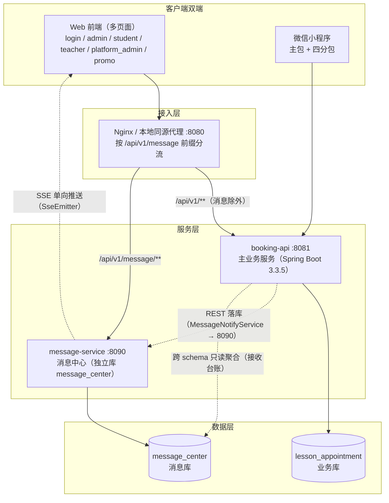
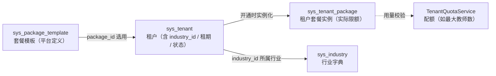
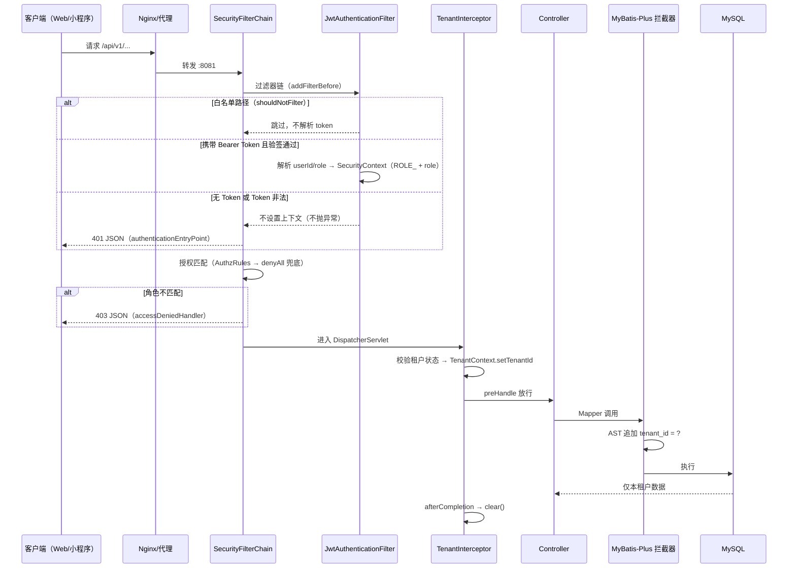
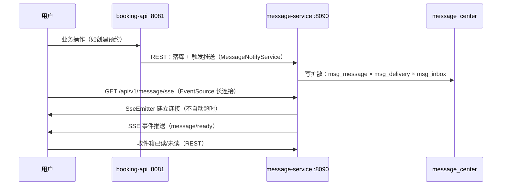
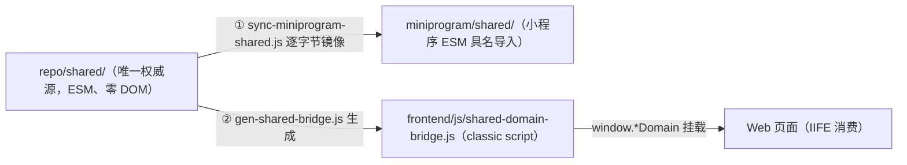
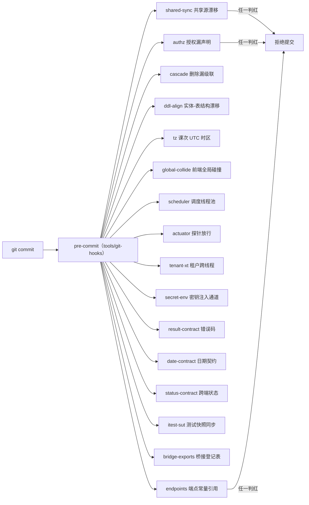

# 多租户 SaaS 预约系统架构设计（一）：总体架构与核心设计原理

> **系列导航**：本文是《多租户 SaaS 预约系统：架构设计与核心技术点详解》的第 1 篇（总纲）。
> 后续 N 篇会逐个放大本文提到的每一层：多租户隔离、认证授权、消息中心、契约治理、前端双端一体化、工程化质量体系……
>
> **一句话摘要**：本文给出一个真实落地的多租户 SaaS 预约系统的全景架构——Spring Boot 3.3.5 主服务（8081）+ 独立消息中心（8090）+ Web/小程序双端共享域代码 + 16 道 Git 守卫，并讲清每一个架构决策背后的原理与代价。

---

## 一、业务背景与架构目标

### 1.1 业务背景

系统最初是一个**单租户的教学预约系统**：学生预约老师的课次，老师管理课程表，管理员审核预约。随着要服务不同行业的客户（培训机构、律所咨询、健身房……），单租户架构暴露出三个硬伤：

1. **每个客户一套部署**：数据库、应用、域名全部独立，升级一次要改 N 遍；
2. **术语写死**：代码里满是小明们看不懂的行业黑话，换个行业就要全局替换字符串；
3. **数据无法汇聚**：平台方想看运营总览（租户数、活跃度、续费预警），只能挨个客户数据库导表。

于是有了这次迁移：**一套代码、一个集群，服务 N 个租户**，租户自助开通试用，平台/租户两级运营。

### 1.2 架构目标（五条铁律）

| # | 目标 | 落地手段 |
| --- | --- | --- |
| 1 | 租户数据零泄漏 | MyBatis-Plus 租户拦截器 + ThreadLocal 上下文 + 异步线程传递 + 跨线程守卫 |
| 2 | 多行业术语动态切换 | sys_term 三级作用域词表（平台词 > 行业词 > 租户词）+ 服务端模板渲染 |
| 3 | 双端体验一致 | shared 域代码单一权威源 + 自动同步 + 桥接生成 |
| 4 | 前后端契约可防守 | Result/PageResult/UTC 时间三类契约 + 构建期守卫拦截 |
| 5 | 质量靠机制不靠人肉 | 16 道 Git 守卫 + 反向测试（证真会红）+ pre-commit 门禁 |

后文的每一节，都是对这五条目标的一次架构展开。

---

## 二、技术栈全景与选型理由

| 层 | 选型 | 版本 | 选型理由（一句话） |
| --- | --- | --- | --- |
| 后端框架 | Spring Boot | 3.3.5（JDK 17） | 生态成熟，Validation/AOP/Actuator 开箱即用；注意 jakarta 命名空间 |
| ORM | MyBatis-Plus | 3.5.7 | `TenantLineInnerInterceptor` 是多租户隔离的核心载体，业务代码零侵入 |
| 数据库 | MySQL | 8.4（驱动 8.0.33） | 选**单库多租户**（共享表 + tenant_id 列），不要分库——理由见 2.2 |
| 安全 | Spring Security + jjwt | jjwt 0.11.5 | 无状态双令牌（access + refresh），配合会话表实现在线统计 |
| 接口文档 | springdoc-openapi | 2.6.0 | 注解即文档，契约守卫的比对基准 |
| 运维探针 | Actuator | 随 Boot | 只暴露 health/info，最小暴露面 |
| 消息中心 | 独立 Spring Boot 应用 | 同技术栈 | 独立端口 8090、独立库 message_center，故障隔离 |
| Web 前端 | 原生 HTML/JS + terser | 无框架 | 多页面但交互不重，避免框架升级成本；压缩只碰局部变量 |
| 小程序 | 微信原生小程序 | 四分包 | student/teacher/admin/message 分包按需加载 |
| 双端共享 | shared 域代码（ESM、零 DOM） | 自研 | 一套领域逻辑同时喂 Web 与小程序 |
| 工程化 | Node 脚本 + Git hooks | 自研 16 道 | 跨平台、可直接静态分析源码，pre-commit 即门禁 |

### 2.1 为什么数据库选「单库多租户」而不是分库分表

- 平台运营报表（租户趋势、在线统计、续费预警）需要**跨租户聚合**，分库后这些查询全部要跨库 JOIN，成本陡增；
- 当前租户量级（百级）远未到单库容量瓶颈；
- **代价**：隔离级别完全由应用层保证——一旦拦截器漏配某张表，就是跨租户数据事故。所以架构上必须配「守卫」兜底（第十节），用机器检查代替人肉 review。

### 2.2 为什么消息中心是独立进程而不是主应用里的一个模块

- **故障隔离**：SSE 是长连接，高峰期成千上万条连接如果跑在主服务里，会把 Tomcat 线程池占满，拖垮正常业务请求；
- **独立演进**：消息的发送策略、模板、敏感词、回收站可以单独发版；
- **独立库**：`message_center` 与业务库 `lesson_appointment` 同实例但分 schema，消息表的写入模式（写扩散：一条消息 × N 个接收人）与业务表完全不同。
- 两个服务**共享同一密钥域**：消息服务直接校验主服务签发的 JWT，不做二次登录（复制工具类、共享密钥配置）。

---

## 三、总体架构



架构上四个值得注意的点：

1. **一个前缀两条路由**：`/api/v1/message/**` 走消息服务，其余走主服务。分流点在 Nginx / 开发代理，前端只感知一个源，没有跨域问题；
2. **主服务与消息服务有两种协作方式**：业务事件（预约成功、候补申请）由主服务 REST 调用消息服务落库；而「平台消息发给了本租户哪些人」这种需要跨两个库才能算出的视图，由主服务直连消息库做跨 schema 只读聚合（跨库 JOIN 必须显式统一 collation，这是个真实的坑，第 N11 篇细讲）；
3. **双端共享同一份域代码**：shared/ 是唯一权威源，小程序侧镜像同步，Web 侧构建时生成桥接文件；
4. **没有服务注册中心、没有网关框架**：两个服务、固定端口，Nginx 足够。不过度设计，是这套架构的另一半原则。

---

## 四、多租户数据隔离架构（核心中的核心）

多租户有四种主流方案：独立数据库、共享数据库独立 Schema、共享表（tenant_id 列）、以及混合。本项目选**共享表**，隔离由 MyBatis-Plus 的 `TenantLineInnerInterceptor` 在 SQL 层自动完成。

### 4.1 拦截器：给每条 SQL 自动戴上租户「镣铐」

```java
// api/src/main/java/com/reservation/config/MyBatisPlusConfig.java（节选）
TenantLineInnerInterceptor tenantInterceptor = new TenantLineInnerInterceptor();
tenantInterceptor.setTenantLineHandler(new TenantLineHandler() {
    @Override
    public Expression getTenantId() {
        Long tenantId = TenantContext.getTenantId();
        // 无租户上下文（未登录/异步线程/定时任务）用 -1 兜底：
        // 既不拼出 tenant_id = NULL，也不会退化成查全量，避免越权
        return new LongValue(tenantId == null ? -1L : tenantId);
    }

    @Override
    public boolean ignoreTable(String tableName) {
        Long tenantId = TenantContext.getTenantId();
        // 平台管理员（tenantId=0）：不拼接租户条件，可查看全部租户数据
        if (tenantId != null && tenantId == 0) {
            return true;
        }
        // 其余身份：平台表不参与隔离
        return IGNORE_TABLES.contains(tableName);
    }
});
```

原理：MyBatis-Plus 在 SQL 执行前用 JSqlParser 解析 AST，对每个未被忽略的表在 WHERE 末尾追加 `tenant_id = <当前租户>`。**业务 Mapper 一行代码都不用改**，这是选它而不是手写 AOP 拼 SQL 的根本原因。

三个关键设计，全部来自真实翻车现场：

**（1）兜底值必须是 -1，不能是 null。** 反编译 mybatis-plus-extension 3.5.7 确认：`getTenantId()` 返回非 null 时插件**无条件**拼 `tenant_id = <值>`，没有 NullValue 判断。若返回 null 兜底，SQL 变成 `tenant_id = NULL`，恒不成立，查出 0 条——表现为「功能没报错，就是没数据」。而 -1 是不存在的租户 id，语义是「查不到任何数据」，与「无上下文时不该看到任何租户数据」的安全预期一致。

**（2）平台管理员的「查全量」靠 `ignoreTable` 短路，不能靠 tenant_id = 0。** 插件对 `tenantId=0` 的处理是拼接 `tenant_id = 0`，只会匹配平台自身数据；而平台管理员要的是**全部租户**。所以 `ignoreTable` 在 `tenantId == 0` 时直接返回 true，整条 SQL 不拼任何租户条件。

**（3）IGNORE_TABLES 白名单必须显式维护。** 平台级表（sys_tenant、sys_package_template、sys_industry……）、语义特殊表（sys_term 词表、wx_userid 微信绑定、promo 推广三表、sys_legal_doc 协议）都在名单里，且每一条都在代码注释里写明了**不排除会出什么事**（通常是 `Unknown column 'tenant_id'` 或语义错位）。这张表是多租户架构里最脆弱的清单，新增表时必须回答一个问题：它有没有 tenant_id 列？有，语义是不是「归属租户」？

### 4.2 写入侧：MetaObjectHandler 自动填充

拦截器只管 SELECT/UPDATE/DELETE，**不管 INSERT**。实体 tenantId 为 null 时 MyBatis-Plus 会显式插入 NULL，触发 `Column 'tenant_id' cannot be null`。所以配了 `TenantMetaObjectHandler`：insert 时该字段为空则自动填当前租户；**业务已显式赋值的不覆盖**（审计日志在切面主线程解析场景依赖此特性）；无上下文时填 0（平台/历史数据约定）。

### 4.3 上下文传递：从请求线程到线程池

租户 id 存在 `TenantContext`（ThreadLocal）里，由 MVC 拦截器 `TenantInterceptor` 在 `preHandle` 里从 JWT 解析并写入，同时做三件事：

1. **租户状态校验**：租户不存在 / 已删除 / 已停用 → 直接 403「租户已停用或不存在」（token 有效但租户被平台封了，必须拦住）；
2. **日志埋点**：MDC 写入 tenantId，出问题能按租户维度检索日志；
3. **会话续期**：`userSessionService.touch(token)`，内部节流，不是每请求都写库。

`afterCompletion` 里 `TenantContext.clear()` + `MDC.remove`——**ThreadLocal 必须成对清理**，否则线程池复用会把上一个租户的上下文带给下一个请求，这是跨租户泄露的经典路径。

真正的难点在**异步**：定时任务要把「逐租户的慢操作」（如上课提醒）移出调度线程，ThreadLocal 不跨线程。项目为此自建了 `TenantAwareExecutor`，契约只有一条：**提交的任务必须自带租户 id，由执行器在工作线程里 set → 执行 → finally clear**。配套的设计（都写在类注释里，是很好的架构文档）：

- 不用 `@Async`：TaskDecorator 只能「拷贝上下文」，表达不了「每个租户一个独立任务各自设 id」；
- 有界队列（64）+ CallerRunsPolicy：队列满时由提交线程自己跑，施加背压，**绝不丢通知**；刻意不用 DiscardPolicy（静默丢）/ AbortPolicy（一个异常拖垮全轮）；
- 刻意不做「同一租户去重」：幂等由数据库唯一键 `uk_dispatch_once` 保证，两个去重真相源比没有更危险。

---

## 五、租户与套餐三层数据模型

SaaS 的商业结构是「套餐」：平台定义几档套餐模板（基础版/专业版/旗舰版，各含资源限额），租户开通时选一档，之后按实例使用。



- **模板层**：平台管理员维护，改模板不影响已开通租户；
- **选用层**：`sys_tenant.package_id` 记录租户选的是哪档；
- **实例层**：`sys_tenant_package` 是租户实际持有的套餐（限额快照 + 当前用量），支持运营侧单独调整某个租户的限额而不动模板。

配套的租户生命周期：自助注册（推广码 / 直接注册）→ 14 天试用 → 审批 / 付费 → 续费 / 停用 / 删除，全链路在 `TenantService` + `TenantQuotaService`。租户码是 **8 位 base32 风格编码，生成时剔除 0/O/1/I/l 四个易混淆字符**（`TenantCodeGenerator`），保留字 platform/default 禁用——这是要给用户在电话里念的编码，可读性就是正确性的一部分。

---

## 六、认证授权安全架构

### 6.1 请求生命周期全景



### 6.2 JWT 过滤器：不抛异常的「静默」设计

`JwtAuthenticationFilter` 有三个反直觉的设计，理解它们是理解整套安全架构的钥匙：

1. **强制 `Authorization: Bearer ` 前缀**。不带前缀时不报错、只是不设置 SecurityContext，请求继续走——然后被 `denyAll` 兜底挡成 401。为什么不在过滤器里直接 401？因为过滤器分不清「这是免登录端点忘了带 token」还是「该带没带」，**放行让授权层裁决**，职责更单一；
2. **免登录白名单有三层形态**：精确路径（WHITELIST_PATHS）、前缀路径（/actuator/health、/api/v1/teacher/professional/file，且**必须校验分隔符**——裸 `startsWith` 会把将来可能出现的 `/actuator/healthz` 一并放行）、静态资源前缀；
3. **验签失败也走 `filterChain.doFilter` 继续放行**，由后续授权层统一拒绝。过滤器只负责「识别身份」，不负责「执行门禁」。

认证对象是 `UsernamePasswordAuthenticationToken(userId, token, [ROLE_ + role])`——主体是 userId，权限是**单个**角色。角色从哪来？token 里带，签发时写入。这里埋了一个伏笔：一个用户只有一个角色，那「教师兼租户管理员」怎么办？本项目用多账号 + 切换解决，是权衡后的选择（详见 N5 篇）。

### 6.3 「免登录白名单四处同心圆」——本架构最著名的坑

一个端点要真正做到免登录，需要在**四个地方**同时登记，缺一处不会报错，只会静默失效：

| # | 位置 | 漏配症状 |
| --- | --- | --- |
| 1 | `SecurityConfig` 的 permitAll | 请求被 `anyRequest().denyAll()` 拦成 401 |
| 2 | `JwtAuthenticationFilter.WHITELIST_PATHS` | 过滤器解析 token 失败 → 清空 SecurityContext → 401 |
| 3 | `WebMvcConfig.EXCLUDE_PATTERNS`（TenantInterceptor 排除） | 穿过 Security 后被 TenantInterceptor 以「无 Authorization 头」拦成 401 |
| 4 | `check-authz-declarative` 守卫的 PERMIT_ALL | 构建期不红，但端点未登记授权，运行期炸 |

这个坑在项目里真实踩中过两次（wechat-register、promo 四个公开端点）：**每一处单看都「像配了」，四处凑齐才生效**。最终的解法不是「文档写清楚」，而是把第四处校验做进守卫——机器来核对四处是否一致，人只负责写代码。

### 6.4 声明式授权：AuthzRules + denyAll 兜底

修复前，授权策略是 `.anyRequest().authenticated()`——只回答「登录了吗」，不回答「你能干这件事吗」；具体权限靠 120 处散落在 Controller 方法体里的 `permissionCheck.checkXxx(token)`，实测 7 个 Controller、40+ 端点零检查（含改用户状态、数据清理等敏感操作）。

解法是把授权**上移为集中声明**：`AuthzRules.RULES` 是一张 `(HTTP方法, 路径模式, 角色[])` 规则表，`SecurityConfig` 启动时逐条展开为 `hasRole/hasAnyRole`；新增端点忘了声明，`check:authz` 守卫在构建期判红，运行期被 `denyAll` 兜底炸成 403——**「漏声明 = 拒绝」取代「漏声明 = 放行」**。

切换 denyAll 时特意走了两步：先把 182 个端点全部显式声明（兜底仍是 authenticated），守卫实测无陈旧规则后，才切 denyAll。一步到位会把「角色归属只能从前端调用链反推」的共享端点直接变成线上 403 故障。

注意边界：AuthzRules 只管「能不能进接口」；**数据级授权**（只能改自己的课次）查库比对归属，SpEL 表达不了，仍由 `PermissionCheck` 承担。两层并存，不是替换关系。

---

## 七、消息中心子服务架构

消息中心的定位：站内信 + 业务通知（预约提醒、候补结果、审批结果）+ 管理员群发，覆盖三端（Web、小程序、管理后台）。



设计要点：

1. **REST 落库 + SSE 单向推送**，不选 WebSocket。站内信的本质是「服务端 → 客户端」的单向广播，SSE 基于 HTTP、自动重连、穿透代理友好；WebSocket 的双工能力在这里是浪费，还要额外处理心跳和代理兼容；
2. **写扩散模型**：一条群发消息 = 1 行 msg_message + N 行 msg_delivery + N 行 msg_inbox（收件箱隔离按 userId，已读真相源是 msg_inbox.is_read）；
3. **三张表的 tenant_id 记的都是「发送方租户」**——这是最容易踩的语义坑：按 tenant_id 过滤收件箱 = 按发送方过滤，平台方发出的消息会全部消失。所以「本租户用户收到了哪些平台消息」必须由主服务跨库 JOIN 才能算出（第三节提到的 MessageLedgerService）；
4. **SSE 连接管理**：`ConcurrentHashMap<userId, SseEmitter>` 在线表，同用户二次连接时顶掉旧连接；`SseEmitter(0L)` 不自动超时，靠心跳 + 断线重连保活；
5. **密钥域共享**：消息服务复制 JWT/AES 工具类、共用同一密钥配置，对主服务签发的 token 直接校验——用户无感知，但这也意味着两个服务的密钥配置必须同进同退，所以有 `secret-env` 守卫盯着密钥注入通道（N23 篇细讲）。

---

## 八、前后端契约治理架构

前后端分离项目里，最持久的成本不是写接口，是**接口悄悄变了而没人知道**。这套架构把契约做成了三类「机器可检」的约定。

### 8.1 统一响应体：Result 与 PageResult

```java
// common/Result.java（节选）—— 契约铁律：code 必须是 primitive int
private int code;      // 历史用 Integer 时，fail(null) 叠加 jackson non_null 配置
private String message; // 会让整个 code 字段从 JSON 里消失，客户端 unwrapResult 判
private T data;        // res.code === 200 取不到值，按 code 聚合的监控全部失效

private static final Set<Integer> ALLOWED_CODES = Set.of(200, 400, 401, 403, 404, 405, 409, 500, 1001);

public static <T> Result<T> fail(Integer code, String message) {
    if (code == null) throw new IllegalStateException("Result.fail 的 code 不能为 null...");
    if (!ALLOWED_CODES.contains(code)) throw new IllegalStateException("Result.fail 的 code 非法：" + code + "...");
    ...
}
```

一个字段类型的选择（Integer → int）消灭了一整类静默故障：`fail(null)` 在编译期就不可能通过。错误码白名单 + 运行期断言 + `check-result-contract` 守卫，三道防线。

分页契约同样有故事：`PageResult` 的字段叫 **`rows`**，不是 MyBatis-Plus 内部的 `records`。曾经前端按 `records` 读，表格恒空、接口 200、日志全绿——**契约不一致但没有任何一「层」报错**。现在字段名由守卫钉住，新增分页接口用错字段名构建期即红。

### 8.2 时间契约：UTC 是唯一真相源

```java
// common/../config/JacksonConfig.java（节选）
module.addSerializer(LocalDateTime.class, new UtcLocalDateTimeSerializer());
// 出参一律输出 2026-10-09T21:31:22Z（显式补 Z）
// 入参接受 ISO-8601 带 T，不带时区标识
```

两个刻进骨头里的教训：

1. **`LocalDateTimeSerializer.withZone(UTC)` 对 LocalDateTime 不生效**——无时区类型，实测产出仍是裸串。要补 Z，只能自己拼；
2. **绝不「顺手改成带转换」**：课次等关键时间在入库前已转 UTC（ScheduleGenerator），序列化层再转一次就是转换两次，比不转换更糟。

前后端因此有了一个简单契约：**后端出 UTC 带 Z，前端按用户时区渲染**（shared/domain/datetime.js 的 utcToZoned）。`check-date-contract` 守卫盯着源码里必须存在显式 `+ "Z"`。

---

## 九、前端双端一体化架构

Web 端和小程序端共用同一批领域逻辑（术语映射、状态机、错误码文案、URL 解包），复制两份必然漂移。解法是 **shared 单一权威源 + 两种消费方式**：



shared 分三层：

| 层 | 内容 | 例子 |
| --- | --- | --- |
| apiPaths | 端点常量 + URL 归一化 + 响应解包 | `ENDPOINTS.AUTH_LOGIN`、`unwrapResult` |
| domain | 零 DOM 纯逻辑领域模块 | appointmentState / bookingState / datetime / errorCode / message / term / mask / refundRule |
| adapters | 双端差异的适配薄层 | net / router / storage / ui |

**改 shared 的四步链**（写进 README，也写进守卫）：

```bash
node tools/sync-miniprogram-shared.js   # ① 镜像到小程序
npm run check:shared-sync               # ② md5 校验镜像未漂移
node frontend/tools/gen-shared-bridge.js # ③ 生成 Web 桥接产物
node frontend/build.js                  # ④ 构建（内部再跑 shared-sync + origin lint）
```

两个「静默失效」陷阱值得单独说：

- **桥接白名单不会自动跟随导出**。`window.*Domain = {...}` 是手工登记表（bridge-exports.json），给 shared/domain 加了导出忘了补白名单，Web 端读到 undefined、落进回退分支（界面漏出裸英文/编码），编译构建全绿。解法：`check:bridge-exports` 守卫逐项核对「源导出集合」与「实际挂 window 的键集合」，**未登记的遗漏 = 漂移 = 拦截**；
- **小程序不能 import 仓库根的文件**，所以镜像必须逐字节一致。改了 mp 副本忘了改根 shared？md5 守卫拦下。

Web 前端本身是**无框架多页面**：每个页面一个 HTML + 若干 JS，JS 全部包 IIFE、内联事件挂 window、**同文件禁止同名函数**（JS 静默覆盖，编译器和 lint 都不报）。构建用 terser 但**刻意不开 `mangle.toplevel`**——顶层全局函数是跨文件引用的契约，混淆了整站断裂。dist 是压缩产物，验证手段是 grep 字符串字面量和 DOM id，不是 grep 函数名。

---

## 十、工程化质量架构：16 道守卫

前面每一节都有「不报错、不告警、只在运行时炸」的陷阱：漏白名单、records/rows、withZone 失效、桥接漏登记、硬编码 URL……这些缺陷的共同点是**没有一层会自然拒绝它们**。架构上的总解法是：**把「已知会静默失效的教训」固化成机器检查，挂进 pre-commit**。



三条治理原则：

1. **每道守卫都有「逃生门」**：`SKIP_AUTHZ=1 git commit ...`。紧急情况可跳过，但必须显式声明——「不要习惯性跳过」写在 hook 注释第一行；
2. **守卫自己也会腐烂**：pre-commit 只跑守卫、不跑反向测试，守卫失效无人发现。所以每道守卫配一个 `tests/check_*_guard.js` 反向测试：先变异源码（如删掉一处白名单登记）**断言守卫真的会红**，再还原逐字节校验。变异前必须断言「源码真的被改掉了」——否则测的是一个没改动的文件，绿得毫无意义；
3. **守卫注释即文档**：每个 hook 段都写着「必要性：这个缺陷不报错、不告警，实测形态是 XXX」。后来人看 hook 就知道祖上踩过什么坑。

---

## 十一、部署与运维架构

- **Docker**：`docker/mysql8` 提供本地 MySQL 8.4；应用本身打 Spring Boot fat jar；
- **Nginx**：前端 dist 静态伺服 + `/api/v1/message/**` 分流到 8090 + 反向代理到 8081；本地开发用同源代理（`dev-frontend-local.js`，8080），**开发与生产同源**，从根上消灭 CORS 与「注册后跳错端口」类问题；
- **健康检查**：Actuator 只放行 `/actuator/health`（liveness/readiness），`deploy/healthcheck.sh` 探活；`/actuator/info` 刻意不放行——对匿名无价值，多暴露一个端点多一份风险；
- **发布前冒烟**：`build_smoke.sh compile`（8083 起服务）→ 接口自检 → 端到端验证，四级检查链；
- **日志**：logback 版本钉死（防止传递依赖搞出 core/classic 错配，运行时 NoClassDefFoundError 炸日志线程）；MDC 带 tenantId，按租户检索；
- **备份**：`deploy/backup.sh` + mysqldump 必须 `--result-file=`（防 GBK 环境输出乱码）。

---

## 十二、架构权衡与演进路线

### 12.1 关键取舍一览

| 决策 | 得到 | 失去 |
| --- | --- | --- |
| 单库多租户 | 跨租户统计简单、运维成本低 | 隔离靠应用层，必须配守卫兜底 |
| 拦截器自动拼租户条件 | 业务代码零侵入 | IGNORE_TABLES 清单是单点，新增表必须过审 |
| 消息中心独立进程 | SSE 长连接不拖垮主服务 | 多一套部署、密钥配置需同步 |
| 无框架原生前端 | 无升级成本、构建极简 | 大页面全靠约定（IIFE/禁同名函数）+ 守卫兜底 |
| 声明式授权 + denyAll | 漏声明即拒绝 | 切换需两步走，前期维护规则表成本 |
| 守卫替代人工 review | 已知陷阱机器拦截 | 守卫自身需反向测试防腐烂 |

### 12.2 演进方向

1. 消息服务的拆分经验复制到下一个该拆的子域（通知调度已具备独立条件）；
2. 术语体系从「词表」演进到「模板包」，让新行业接入从「配词」变成「装包」；
3. 守卫从 pre-commit 延伸到 CI，覆盖连库比对（当前 ddl-align 是静态方案，连库版留作 CI 补充）。

---

## 小结

本文给出了这套多租户 SaaS 预约系统的全景：**一套共享表 + 拦截器实现租户隔离，双服务（8081/8090）双库分工，shared 域代码打通 Web 与小程序，三类契约 + 16 道守卫把「会静默失效的教训」固化成机器检查**。架构的主旋律只有一句：**凡是不报错的缺陷，都必须有机器来拦**。

**下篇预告（N1）**：《MyBatis-Plus 多租户隔离原理与实战》——从 JSqlParser 的 AST 改写讲起，拆解 `TenantLineInnerInterceptor` 为什么必须放在分页拦截器之前、`-1` 兜底值的推演过程、以及 IGNORE_TABLES 每一条背后的血泪故事。

> 本文涉及的全部源码路径均相对仓库根目录（api/src/main/java/com/reservation/...），代码会持续演进，阅读时以仓库实际结构为准。
